# Day 28｜组成原理＋计算机网络

[← Day 27](day27.md) · [总入口](README.md) · [Day 29 →](day29.md)

**选择题：12道，来自两份完整src题单；大题：2道。** 先做选择题，再展开题下解析。组内题目沿用src顺序；标为复做的组，已会的快速通过，重点处理上次错题。

**预计用时：75—115分钟。** 选择题及核对约30—50分钟，大题约40—55分钟，最后用5—10分钟重做今天最值得记住的一道错题。约两小时是配题目标，不是必须耗满或到点强停；计算卡住时先保留题号，先完成其余选择题。

## 选择题组1｜0813 · 组成原理

[有限位运算：溢出、标志与乘除](../src/0813.md) · 5道 · 复做第1次。

### 选择题1｜2021-13

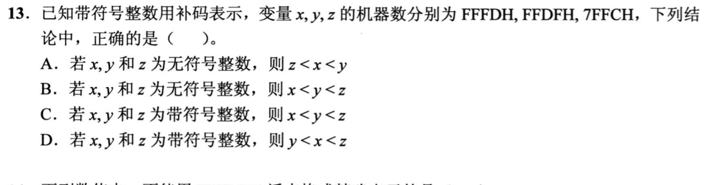

<details>
<summary>答案与解析</summary>

**答案：D。**

**直接法：** 16位有符号：x=FFFDH=−3，y=FFDFH=−33，z=7FFCH=32764，所以y<x<z。若按无符号解释则z<y<x。

</details>

### 选择题2｜2023-16

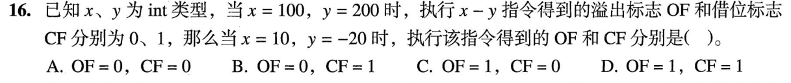

<details>
<summary>答案与解析</summary>

**参考答案：B（待逐题复核）。** 解析待补。

</details>

### 选择题3｜2024-15

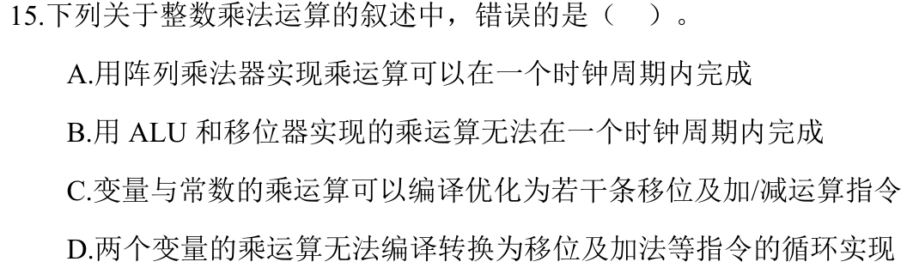

<details>
<summary>答案与解析</summary>

**答案：D。**

**直接法：** 两个变量相乘也能用循环移位加法实现，D说无法转换是错的。阵列乘法器可在一个足够长的时钟周期完成；串行移位加法通常需多个周期。

</details>

### 选择题4｜2025-14

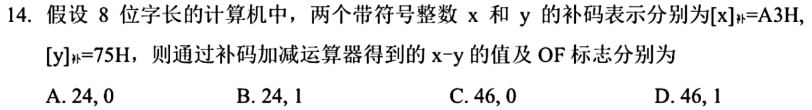

<details>
<summary>答案与解析</summary>

**参考答案：D（待逐题复核）。** 解析待补。

</details>

### 选择题5｜2026-13

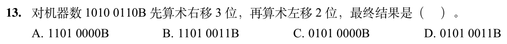

<details>
<summary>答案与解析</summary>

**答案与解析待补。**

</details>

## 选择题组2｜0902 · 计算机网络

[信号与速率：带宽怎样限制可传数据](../src/0902.md) · 7道 · 复做第1次。

### 选择题6｜2020-34

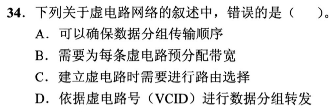

<details>
<summary>答案与解析</summary>

**参考答案：B（待逐题复核）。** 解析待补。

</details>

### 选择题7｜2021-34

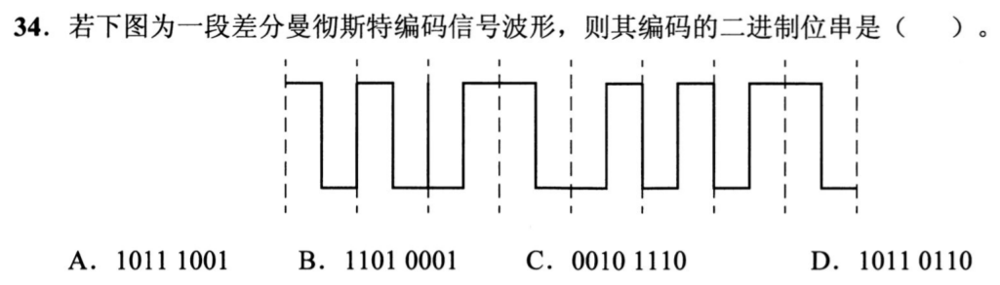

<details>
<summary>答案与解析</summary>

**答案：A。**

**直接法：** 差分曼彻斯特看每个位起点是否跳变，而非中点方向。由图逐位判得10111001；每位中点的必有跳变只用于时钟同步。

</details>

### 选择题8｜2022-34

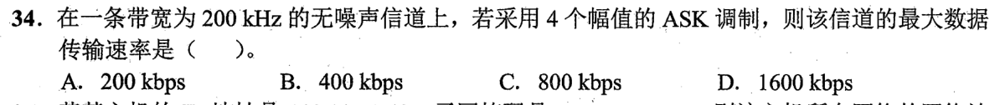

<details>
<summary>答案与解析</summary>

**参考答案：C（待逐题复核）。** 解析待补。

</details>

### 选择题9｜2023-34

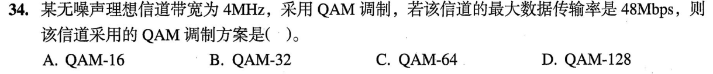

<details>
<summary>答案与解析</summary>

**参考答案：C（待逐题复核）。** 解析待补。

</details>

### 选择题10｜2024-34


<details>
<summary>答案与解析</summary>

**答案：C。**

**直接法：** FSK用不同频率表示0和1；ASK改变幅度，PSK改变相位，DPSK用相邻码元相位差。

</details>

### 选择题11｜2025-34

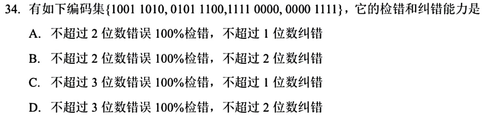

<details>
<summary>答案与解析</summary>

**答案：C。**

**直接法：** 逐对异或：最小汉明距离为4。因此最多保证检出3位错，最多纠正1位错；两位错的纠错球会重叠，不能保证纠2位。

</details>

### 选择题12｜2026-34

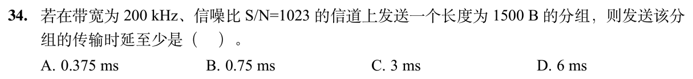

<details>
<summary>答案与解析</summary>

**答案：D。**

**直接法：** 香农容量=200kHz×log₂(1+1023)=2Mb/s。1500B=12000bit，传输时延至少为12000÷2000000=0.006s=6ms。

**排除法／易混点：** 先把字节乘8变成bit；再用分组比特数除以信道容量。这里求传输时延，不另外加传播时延。

</details>

## 解答题

### 大题1｜2024-45

[原题单 0924｜地址翻译链：TLB、页表与 Cache 的先后关系](../src/0924.md)

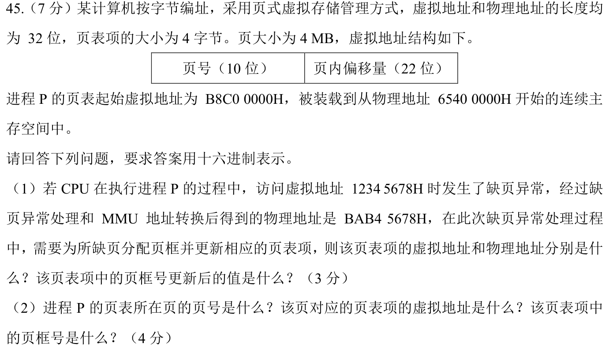

<details>
<summary>答案与解析</summary>

（1）1234 5678H 的页号为048H，表项偏移120H。分别加页表虚、实基址，得 B8C0 0120H、6540 0120H。BAB4 5678H右移22位，得到新页框号2EAH。

（2）B8C0 0000H右移22位得2E3H。页表共2¹⁰×4B=4KiB，且起址按4MiB对齐，整表在一页内。描述这一页的表项虚址为 B8C0 0000H+2E3H×4=B8C0 0B8CH。实际装入地址6540 0000H右移22位，得到页框号195H。

</details>

### 大题2｜2020-45

[原题单 0925｜并发同步：PV 操作大题](../src/0925.md)

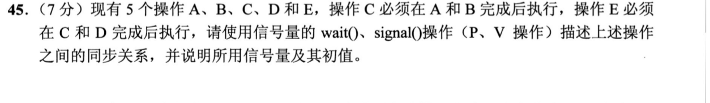

<details>
<summary>答案与解析</summary>

定义sAC、sBC、sCE、sDE，初值均为0：

```text
A: 执行A; V(sAC);
B: 执行B; V(sBC);
C: P(sAC); P(sBC); 执行C; V(sCE);
D: 执行D; V(sDE);
E: P(sCE); P(sDE); 执行E;
```

A和B可并行，D也不必等待A、B、C；C必须等A和B，E必须等C和D。这里是先后同步，不是把全部操作塞进同一互斥区。P在前置操作尚未完成时阻塞，V记录其完成事件；初值1会允许后继抢跑。

</details>

## 一行记录

```text
实际用时__；未完成或未核对的题号__；今天最容易混淆的是__
```
