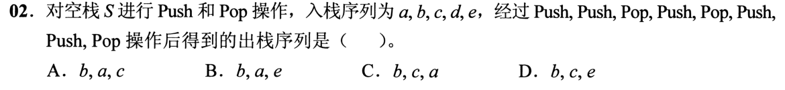
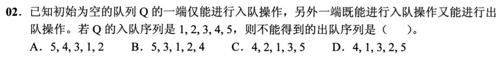
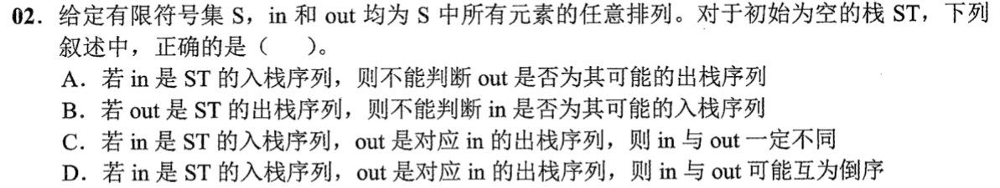
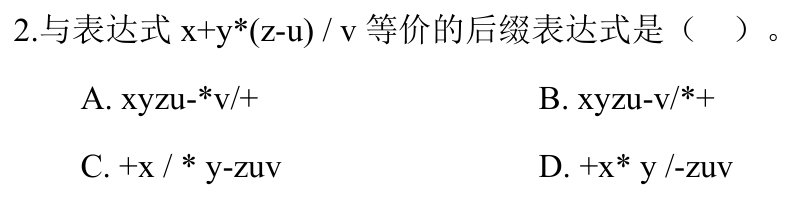
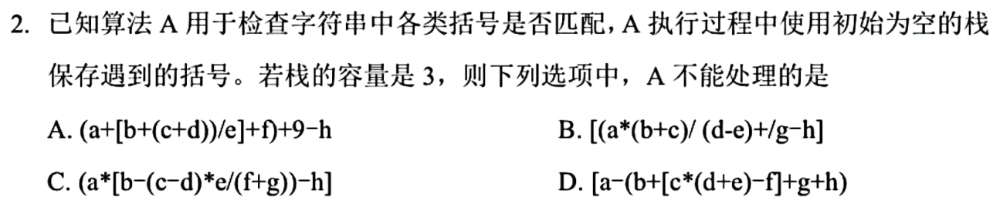
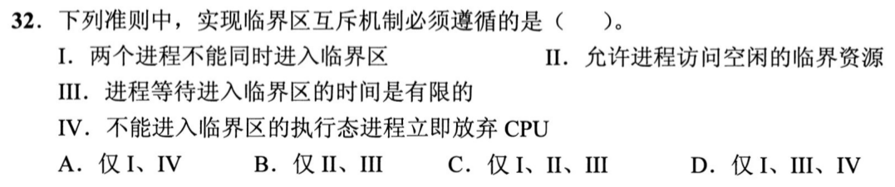
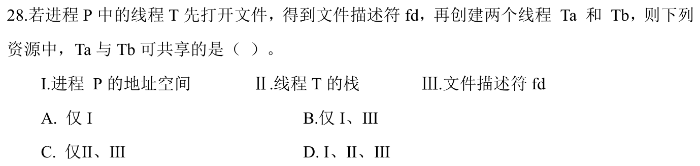
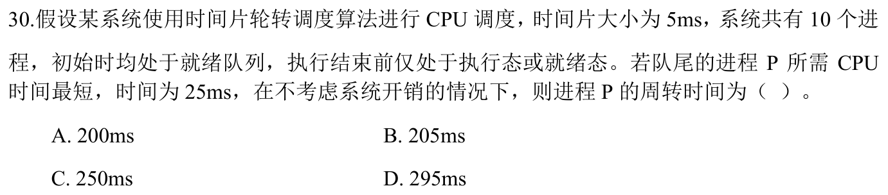
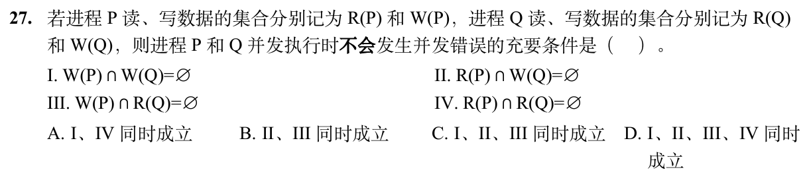
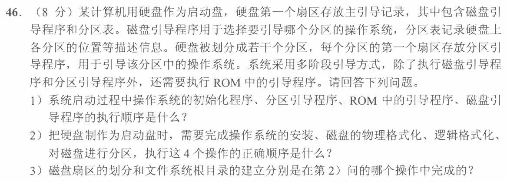

# Day 29｜数据结构＋操作系统

[← Day 28](day28.md) · [总入口](README.md) · [Day 30 →](day30.md)

**选择题：11道，来自两份完整src题单；大题：1道。** 先做选择题，再展开题下解析。组内题目沿用src顺序；标为复做的组，已会的快速通过，重点处理上次错题。

**预计用时：45—75分钟。** 选择题及核对约15—30分钟，大题约25—35分钟，最后用5—10分钟重做今天最值得记住的一道错题。约两小时是配题目标，不是必须耗满或到点强停；计算卡住时先保留题号，先完成其余选择题。

## 选择题组1｜0802 · 数据结构

[受限容器：栈与队列的状态推进](../src/0802.md) · 5道 · 复做第1次。

该src另收录的大题 2026-42 单独安排在解答题部分，不混入本组选择题。

### 选择题1｜2020-02



<details>
<summary>答案与解析</summary>


**答案：D。**

* **核心判据**：严格遵循栈的后进先出（LIFO）状态机推导。**审题重点：操作步骤已由题干严格固定给出，且操作结束后并未要求将栈内剩余元素全部弹出**。
* **正选推导**：
  * 初始栈状态：`[]`；输出：`空`；
  * 操作 1：`Push(a)` $\to$ 栈内: `[a]`
  * 操作 2：`Push(b)` $\to$ 栈内: `[a, b]`
  * 操作 3：`Pop()` $\to$ 弹出 **`b`**，栈内: `[a]`
  * 操作 4：`Push(c)` $\to$ 栈内: `[a, c]`
  * 操作 5：`Pop()` $\to$ 弹出 **`c`**，栈内: `[a]`
  * 操作 6：`Push(d)` $\to$ 栈内: `[a, d]`
  * 操作 7：`Push(e)` $\to$ 栈内: `[a, d, e]`
  * 操作 8：`Pop()` $\to$ 弹出 **`e`**，栈内: `[a, d]`
  * 操作序列到此终止。实际输出序列严格为 **`b, c, e`**，选 D。
* **干扰项击穿**：
  * 切勿脑补把最后栈中残留的 `d` 和 `a` 自动弹出（错选成 `b, c, e, d, a`）。题目给出的操作步数已执行完毕。


</details>

### 选择题2｜2021-02



<details>
<summary>答案与解析</summary>


**答案：D。**

* **核心判据**：输出受限双端队列（两端可入，仅一端可出）的物理拓扑约束：
  * 假定只能从**右端出队**（左端仅支持入队，右端兼顾入队与出队）；
  * **出队顺序单调性**：右端任何出队操作，弹出的必然是当前队列最右侧的元素。一旦某个元素从左端压入，它就位于已入队所有元素的左侧，在它右边的所有元素全部出队前，该元素绝对无法越级提前出队！
* **正选推导**：
  * 检验 **D 选项（4, 1, 3, 2）**：
    1. 要使 4 最先出队、紧接着 1 出队：4 出队后，**元素 1 必须位于队列最右端**；
    2. 当 1、2、3 入队时，1 必须在最右侧，2 和 3 只能从左端依次压入，此时队列内从左到右严格排布为 `[3, 2, 1]`；
    3. 随后元素 4 从右端入队并立即从右端弹出（输出 4）；
    4. 紧接着右端弹出 1（输出 1）；
    5. **致命冲突产生**：此时队列最右端露出的元素严格是 **2**，下一个出队的必须是 2，物理上绝对不可能跨过 2 先输出 3！
    6. 故序列 `4, 1, 3, 2` 绝对无法生成，选 D。
* **干扰项击穿**：
  * A (1, 2, 3, 4)：所有元素均从右端入、右端出（模拟普通 FIFO 队列）；
  * B (4, 1, 2, 3)：1,2,3 全从左端入（队内从左至右为 3,2,1），4从右端入，出队顺序为 4, 1, 2, 3，完全可行；
  * C (3, 1, 4, 2)：同样可通过两端交替入队合法生成。


</details>

### 选择题3｜2022-02



<details>
<summary>答案与解析</summary>


**答案：D。**

* **核心判据**：栈对输入流重排的极限边界：
  * **完全逆序输出**：若将 `in` 序列中的所有元素连续全部压入栈中，随后再执行连续全部弹出操作，`out` 序列必然是 `in` 的**绝对逆序**。
  * **完全顺序输出**：若对 `in` 中的每个元素执行“即进即出”（Push 紧跟 Pop），`out` 序列与 `in` 序列**完全一致**。
* **正选推导**：
  * D 选项指出“`out` 序列可能是 `in` 的逆序”，直接对应全部进栈后全部出栈的标准操作，必然成立，选 D。
* **干扰项击穿**：
  * **A / B**：声称“无法根据 in 和 out 确定是否为合法出栈序列”，错误。通过使用一个辅助栈模拟推导，可在 $O(n)$ 时间内确定任意给定的两个序列是否合法；
  * **C**：声称“in 与 out 绝不可能相同”，错误，每进一个立即弹出一个时两者完全相同。


</details>

### 选择题4｜2024-02



<details>
<summary>答案与解析</summary>


**答案：A。**

* **核心判据**：中缀表达式转后缀表达式（逆波兰式）法则：
  1. 操作数的物理相对顺序在转换后绝对保持不变；
  2. 运算符严格依据数学结合优先级依次后置：**最高优先级括号 $\to$ 同级乘除从左至右 $\to$ 最后处理最低级加减**。
* **正选推导**：
  原中缀表达式为：$x + y \times (z - u) / v$
  1. 处理最内层括号 $(z - u)$：运算符后置为 **`zu-`**；
  2. 处理乘法 $y \times (z - u)$：运算符后置为 **`yzu-*`**；
  3. 处理同级的除法 $/ v$：按从左到右结合顺序后置为 **`yzu-*v/`**；
  4. 处理最外层加法 $x + \dots$：最后将加号置于末尾，得到 **`xyzu-*v/+`**；
  * 严格匹配 A 选项。
* **干扰项击穿**：
  * 乘除同优先级时必须按从左到右结合，不能跳过乘法先做除法；
  * 运算操作数 $x$ 位于加法左侧，在后缀表达式中必然排在首位。


</details>

### 选择题5｜2025-02



<details>
<summary>答案与解析</summary>


**答案：D。**

* **核心判据**：利用栈检测括号匹配时，栈所消耗的辅助空间大小，**严格取决于表达式中未闭合左括号的“最大瞬时嵌套深度”**，与表达式的字符总长度或括号总数毫无关系。当且仅当最大嵌套深度 $> 3$ 时，容量为 3 的工作栈会发生上溢（Stack Overflow）而无法匹配。
* **正选推导**：
  * 追踪 **D 选项**：`a * [b + (c * [x + (d + e)])]`
    1. 读到第 1 个左括号 `[` $\to$ 栈内: `[`（深度 1）；
    2. 读到第 2 个左括号 `(` $\to$ 栈内: `[`, `(`（深度 2）；
    3. 读到第 3 个左括号 `[` $\to$ 栈内: `[`, `(`, `[`（深度 3，容量 3 已满！）；
    4. 紧接着读到 `(d + e)` 前面的第 4 个左括号 `(`：此时栈已满，再压栈必然发生**栈上溢（Stack Overflow）**报错！
    * 故 D 选项无法在容量为 3 的栈中成功完成匹配，选 D。
* **干扰项击穿**：
  * A、B、C 选项中虽然括号很多，但内部的括号均及时闭合弹栈释放了空间，其最大嵌套深度均严格 $\le 3$，容量 3 的栈完全够用。


</details>

## 选择题组2｜0826 · 操作系统

[并发约束：把交错执行压成可证明的顺序](../src/0826.md) · 6道 · 复做第1次。

### 选择题6｜2020-32



<details>
<summary>答案与解析</summary>


**答案：C。**

* **核心判据**：临界区互斥四大基本准则的物理强弱区分：
  * **必须满足的核心硬准则**：
    1. **空闲让进（Progress）**：临界区空闲时，请求进入的进程必须能够获准进入；
    2. **忙则等待（Mutual Exclusion）**：临界区已有进程时，其他试图进入的进程必须被挡在门外；
    3. **有限等待（Bounded Waiting）**：等待进入的进程必须在有限时间内进入，防止饥饿；
  * **非必要可选准则**：
    * **让权等待（Yield/Block）**：指进程不能进入临界区时立即放弃 CPU 转入阻塞。**自旋锁（Spinlock，如 Peterson 算法或硬件 Test-and-Set 指令）就是典型的忙等机制**，它们虽然持续消耗 CPU 轮询标志而未“让权”，但依然是合法且广泛应用的互斥实现方案。故让权等待不是所有互斥机制所必需的。
* **正选推导**：Ⅳ（等待时立即让出 CPU）并非所有互斥机制所必须满足，选 C。


</details>

### 选择题7｜2024-28



<details>
<summary>答案与解析</summary>


**答案：B。**

* **核心判据**：多线程并发模型的共享与独占资源边界：
  * **进程级共享资源（同进程内全线程共享）**：整个进程的**虚拟地址空间（代码段、数据段、堆）**、**打开的文件描述符表**、信号处理程序；
  * **线程级独占私有资源（线程彼此独立隔离）**：每个线程必须拥有自己**独立的运行栈（用户栈/内核栈）**、**独立的通用寄存器上下文（PC、SP、PSW）**，以维持独立的函数调用和指令执行流。
* **正选推导**：
  * Ⅰ 进程的地址空间：共享；
  * Ⅲ 进程打开的文件：共享；
  * Ⅱ 线程 $T$ 的运行栈：每个线程独立分配栈空间，$T_a$ 和 $T_b$ 各有专属栈，绝不能共享主线程 $T$ 的栈作为自身的运行栈；
  * 故选 B（仅 Ⅰ、Ⅲ）。


</details>

### 选择题8｜2024-30



<details>
<summary>答案与解析</summary>


**答案：C。**

* **核心判据**：时间片轮转（RR）调度周转时间模型：
  * 进程 $P$ 需要的 CPU 执行时间为 $25\text{ms}$，时间片大小为 $5\text{ms}$，因此 $P$ 总共必须获得 **$\frac{25}{5} = 5$ 个时间片**；
  * 题设初始时 $P$ 位于 10 个进程的就绪队列末尾；
  * 题设其余 9 个进程运行时间均不短于 25ms，说明在 $P$ 完成之前的 5 轮调度中，没有其他进程中途退出，每一轮轮转都固定有 10 个进程瓜分时间片（每轮耗时 $10 \times 5\text{ms} = 50\text{ms}$）。
* **正选推导**：
  * 进程 $P$ 排在第 10 位，因此它将在第 5 轮的最后 5ms 内正式执行完毕；
  * 经历的完整轮转时间 $= 5 \times 50\text{ms} = \mathbf{250\text{ms}}$，选 C。
* **干扰项击穿**：
  * 切勿只算 $P$ 自己的运行时间 25ms，周转时间从提交算起到运行结束，中间排队和他人运行的时间全部属于周转时间。


</details>

### 选择题9｜2025-27


<details>
<summary>答案与解析</summary>


**答案：D。**

* **核心判据**：单条机器指令执行的原子性驻留要求：
  * 操作系统为进程分配的最小物理页框数，**底线是必须能够满足“单条指令在最坏寻址情况下完整执行所需同时跨越驻留的页面数量”**；
  * 若分配页框数小于该指令所需页面数，指令在取指、间接寻址或多操作数访存时，载入新页会淘汰本指令刚载入的旧页，引发单条指令内部的死循环缺页颠簸（Thrashing），指令永远无法执行完毕；
  * 这一极限取决于**指令系统的寻址方式与指令格式**（例如：指令跨页边界占 2 页 + 间接寻址地址指针占 1 页 + 源操作数占 1 页 + 目的操作数跨页占 2 页）。
* **正选推导**：最少物理页框数下限直接由**指令的寻址方式**决定，选 D。
* **干扰项击穿**：
  * 虚拟空间或物理空间总大小决定系统整体配置，代码段总长度决定整个程序的页面总数，它们都不直接限制单条指令执行所需的最小原子页框数。


</details>

### 选择题10｜2026-26


<details>
<summary>答案与解析</summary>


**答案：A。**

* **核心判据**：计数型信号量（Counting Semaphore）物理状态映射原理：
  * 信号量初始值 $S_0 = 5$（代表临界区 $Q$ 最大允许的并发许可证总数为 5）；
  * 当 $S \ge 0$ 时，$S$ 表示当前剩余可用的许可证数量；
  * **当 $S < 0$ 时，$|S|$ 严格代表当前因申请许可证失败而被挂起在等待队列中的阻塞进程数量**！
* **正选推导**：
  1. 当前 $S = -2 < 0$，因此阻塞队列中的进程数 $n = |-2| = \mathbf{2}$；
  2. 初始的 5 个许可证已被全部领走，且后续又透支排队了 2 个进程，说明当前已经进入临界代码段 $Q$ 并在其中并发执行的进程数已达到满额上限：$m = \mathbf{5}$；
  3. 故 $m = 5, n = 2$，选 A。


</details>

### 选择题11｜2026-27



<details>
<summary>答案与解析</summary>


**答案：C。**

* **核心判据**：并发程序无冲突可再现执行的经典 **Bernstein 准则（伯恩斯坦条件）**：
  两个并发进程 $P_1$ 和 $P_2$ 能无冲突并行且结果具有确定性的充要条件是它们必须同时满足三个独立性条件：
  1. $R_1 \cap W_2 = \emptyset$（$P_1$ 读的变量不能被 $P_2$ 并发修改，防止读脏数据）；
  2. $W_1 \cap R_2 = \emptyset$（$P_1$ 修改的变量不能被 $P_2$ 并发读取）；
  3. $W_1 \cap W_2 = \emptyset$（两进程不能并发写入同一变量，防止写覆盖冲突）。
* **正选推导**：
  * 必须满足 Ⅰ、Ⅱ、Ⅲ；
  * **Ⅳ $R_1 \cap R_2 = \emptyset$（读读互斥）无须满足**！两进程同时读取相同的共享数据变量是完全安全无害的，绝不破坏结果的一致性。
  * 故选 C（仅 Ⅰ、Ⅱ、Ⅲ）。


</details>

## 解答题

### 大题1｜2021-46

[原题单 0927｜文件与磁盘：名字、索引和物理块怎样连接](../src/0927.md)



<details>
<summary>答案与解析</summary>

（1）ROM引导程序 → 磁盘主引导记录中的磁盘引导程序 → 所选分区首扇区的分区引导程序 → 操作系统初始化程序。磁盘引导程序读取分区表定位要启动的分区。

（2）物理格式化 → 磁盘分区 → 逻辑格式化 → 安装操作系统。先建立可读写的扇区，再决定哪些扇区组成分区，最后在目标分区建立文件系统并安装系统。

（3）划分扇区属于物理格式化。建立文件系统根目录属于逻辑格式化。分区表描述分区范围，根目录是分区中文件系统的一部分。

</details>

## 一行记录

```text
实际用时__；未完成或未核对的题号__；今天最容易混淆的是__
```
