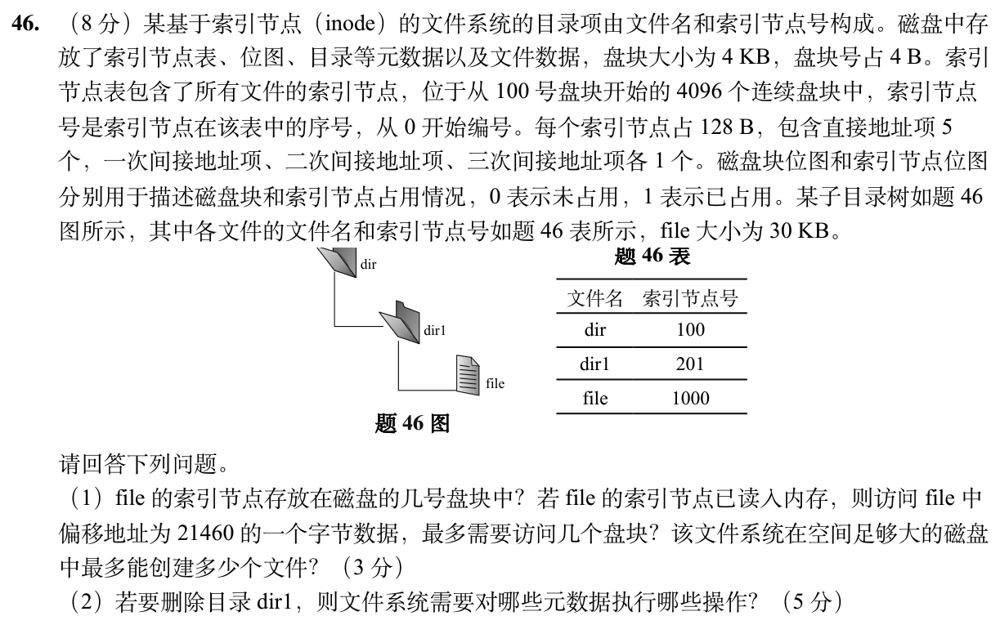

# Day 29｜文件与磁盘攻坚｜索引、目录与删除

[← Day 28](day28.md) · [总入口](README.md) · [Day 30 →](day30.md)

**今日判断。** 先把 inode 表所在的磁盘块、文件逻辑块、间接索引块分开数。删除要顺着目录关系和引用数回收。

## 今天按这个顺序做

1. **0–10分钟｜回收。** 闭卷重写昨天的一处断点，写不出就标U。
2. **10–35分钟｜前置题。** 重做 [0830](modules/0830.md) 的文件名查找题，再闭卷写出目录项的两个字段。用 [Day 09 大题2](day09.md) 两个文件名同指一个inode的例子核对。
3. **35–100分钟｜整题。** 两道题各给约30分钟，先完整写出步骤，剩余时间修正关键一步。先尝试5分钟，再开提示。
4. **100–120分钟｜验收。** 回答下方条件变化，订正后闭卷再写一次。到120分钟停止。

## 大题1｜2026-46 · inode 位置、间接访问与递归删除

[原题单 0927](../src/0927.md)

没有入口时的第一步

每个盘块可装32个inode。文件内偏移先除4096得到从0编号的逻辑块，再与5个直接项比较。

完整解法与必要补学

（1）每块4096/128=32个 inode。编号1000的 inode 在表中第⌊1000/32⌋=31个块，盘块号100+31=131。21460÷4096的商为5，已跨过直接项0～4。inode在内存时，最坏读取一级间接索引块和目标数据块各一次，共2块。inode表共4096×32=131072个槽，这是可创建文件对象总数的上限，目录也使用inode。

（2）dir1 非空。若按递归删除，先去除 dir1 中 file 的目录项，更新 file 的inode链接计数。若链接数减至0且没有打开引用，回收其数据块与一级间接索引块（30KiB要8个数据块，其中3个经一级间接），清这些块在磁盘块位图中的占用位，并释放 inode 1000，清其inode位图位。再在父目录 dir 中删除 dir1 的目录项，更新父目录inode的大小、时间等相应元数据；若实现记录目录链接数，移除子目录还要更新父目录链接数。释放 dir1 的目录数据及可能的索引块，清相应盘块位图；释放 inode 201，清对应inode位图位。普通非递归空目录删除接口应先判非空，不能直接删。

重做后检查

若偏移改成20479，块号4，用直接项；偏移20480刚进入块号5，才需要一级间接。

## 大题2｜2022-45 · 硬链接与多级索引（闭卷重做）

[Day 09 原图与折叠讲解](day09.md)。只做原页大题2。圈出两个名字共用的inode，再对照新题解释为何删除一个名字未必立即释放数据。

## 闭卷变式

把第（1）问的文件偏移改为20480B，且一级间接块已缓存，最坏还要读几块？

检查答案

逻辑块号仍为5，但inode和一级索引块都在内存，只须读数据块一块。

记录：实际用时__；两次作答状态 I／H／U__；卡住的题号与第一处断点__。
