# Day 30｜组成原理＋计算机网络

[← Day 29](day29.md) · [总入口](README.md) · [Day 31 →](day31.md)

**选择题：10道，来自两份完整src题单；大题：2道。** 先做选择题，再展开题下解析。组内题目沿用src顺序；标为复做的组，已会的快速通过，重点处理上次错题。

**预计用时：65—95分钟。** 选择题及核对约20—30分钟，大题约40—55分钟，最后用5—10分钟重做今天最值得记住的一道错题。约两小时是配题目标，不是必须耗满或到点强停；计算卡住时先保留题号，先完成其余选择题。

## 选择题组1｜0814 · 组成原理

[存储器拼装：容量、长宽与片选](../src/0814.md) · 4道 · 复做第1次。

### 选择题1｜2021-15

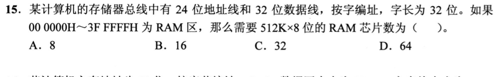

<details>
<summary>答案与解析</summary>

**答案：C。**

* **核心判据**：存储器字/位扩展模型物理计算：
  $$\text{所需芯片总数} = \frac{\text{主存物理总比特数}}{\text{单片芯片物理总比特数}} = \left(\frac{\text{目标存储字长}}{\text{芯片数据位宽}}\right) \times \left(\frac{\text{目标字地址数}}{\text{单片字地址数}}\right)$$
* **正选推导**：
  1. **主存地址空间与编址模型**：
     * 地址范围为 `000000H ~ 3FFFFFH`，总地址数为 $3FFFFFH - 0 + 1 = 400000H = 4 \times 16^5 = 4 \times 2^{20} = 4\text{M}$ 个地址；
     * 题干明确指出**按字编址，字长 32 位**，因此主存包含 $4\text{M}$ 个 32 位的字，总物理容量为 $4\text{M} \times 32\text{位} = 16\text{MB}$；
  2. **芯片参数与扩展拆解**：
     * 单片芯片规格为 $512\text{K} \times 8\text{位}$；
     * **位扩展**：将数据位宽从 8 位扩展到 32 位，每个字组需要 $\frac{32}{8} = 4$ 片并联；
     * **字扩展**：将存储字数从 $512\text{K}$ 扩展到 $4\text{M}$，需要 $\frac{4\text{M}}{512\text{K}} = 8$ 个字组；
     * 所需芯片总数 $= 4 \times 8 = \mathbf{32\text{ 片}}$，选 C。
* **干扰项击穿**：
  * 切勿漏看“按字编址”，若误当成按字节编址（以为每个地址对应 8 位），会算出 8 片的错解。

</details>

### 选择题2｜2022-17

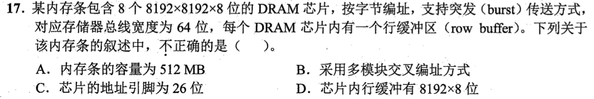

<details>
<summary>答案与解析</summary>

**答案：C。**

* **核心判据**：现代 DRAM 芯片的物理结构与地址引脚复用机制：
  * **地址复用不变量**：为了大幅缩减芯片引脚数，DRAM 的行地址和列地址通过**同一组物理地址引脚分时送入**（利用 $\overline{\text{RAS}}$ 和 $\overline{\text{CAS}}$ 信号先后锁存）。若芯片阵列有 $2^r$ 行、$2^c$ 列，物理地址引脚数只需 $\max(r, c)$ 根，绝不是 $r + c$ 根相加！
  * **行缓冲（Row Buffer）物理特性**：DRAM 每次执行行激活时，会将选中的整整一行的所有存储单元数据一次性并行读入行缓冲区。
* **正选推导**：
  * 单片阵列规模：$8192 \text{ 行} \times 8192 \text{ 列} \times 8 \text{ 位}$：
    * 单片容量 $= 2^{13} \times 2^{13} \times 1\text{B} = 2^{26}\text{B} = 64\text{MB}$；
    * 8 片并联构成的内存条总容量 $= 8 \times 64\text{MB} = 512\text{MB}$；
    * 8 片各引出 8 位数据引脚，数据总线宽度为 $8 \times 8 = 64$ 位；
    * 行数 $8192 = 2^{13}$，列数 $8192 = 2^{13}$，行/列分时复用，**地址引脚只需 13 根**；
    * 单个芯片的行缓冲区容量恰好保存选中的一整行，容量为 $8192 \times 8\text{位}$。
  * 综合选项 C 叙述完全正确，选 C。
* **干扰项击穿**：
  * 误把地址引脚当成 $13 + 13 = 26$ 根，忽略了 DRAM 地址分时复用的硬件常识。

</details>

### 选择题3｜2023-15

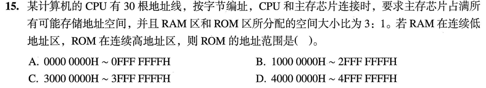

<details>
<summary>答案与解析</summary>

**答案：C。**

* **核心判据**：地址空间划分与十六进制边界映射：
  * 30 位字节地址总容量为 $2^{30}\text{B} = 1\text{GB}$，全量合法物理地址区间为 `00000000H ~ 3FFFFFFFH`；
  * ROM 占最高的 $\frac{1}{4}$ 区域，其容量大小为 $\frac{2^{30}\text{B}}{4} = 2^{28}\text{B}$。
* **正选推导**：
  1. $2^{28}\text{B}$ 对应的十六进制跨度为 `10000000H`（即高位第 28、29 两位决定区间）；
  2. 全空间划分为 4 个相等的 $2^{28}\text{B}$ 块：
     * 第 1 块（最低）：`00000000H ~ 0FFFFFFFH`
     * 第 2 块：`10000000H ~ 1FFFFFFFH`
     * 第 3 块：`20000000H ~ 2FFFFFFFH`
     * 第 4 块（最高，ROM 专属）：**`30000000H ~ 3FFFFFFFH`**；
  * 故 ROM 地址范围为 `30000000H ~ 3FFFFFFFH`，选 C。
* **干扰项击穿**：
  * 切勿把上界错写成 `40000000H`（那是第 $2^{30}$ 个地址，下标从 0 起算的最大地址必定是 $2^{30}-1$ 即 `3FFFFFFFH`）。

</details>

### 选择题4｜2026-15

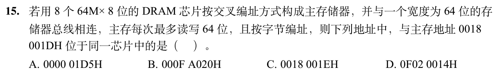

<details>
<summary>答案与解析</summary>

**答案：A。**

* **核心判据**：低位交叉多体存储器的物理芯片体号寻址不变量：
  * 8 片存储芯片并联组成 64 位（8 字节）数据总线；
  * **按低位交叉编址**：连续的字节地址依次轮流分配给 8 个存储体；
  * 字节地址的**最低 3 位二进制值（$2^3 = 8$）直接硬件硬连线为存储芯片的片选体号（Chip ID）**！两个字节地址存放在同一物理芯片中的充要条件是：**其地址二进制最低 3 位完全相同**。
* **正选推导**：
  1. 给定地址：`0018001DH`；
  2. 观察其末尾十六进制字节 `1DH`，其最低 4 位二进制为 `D`（`1101`）；
  3. 取最低 3 位：**`101`**（对应十进制 5 号芯片）；
  4. 检验各选项末尾十六进制对应的最低 3 位二进制：
     * **A 选项**末尾为 `D5H`：`5` 的二进制为 `0101`，最低 3 位严格为 **`101`**（匹配！）；
     * B 选项末尾为 `0`（最低 3 位为 `000`）；
     * C 选项末尾为 `7`（最低 3 位为 `111`）；
     * D 选项末尾为 `4`（最低 3 位为 `100`）；
  * 故只有 A 选项存放在同一物理芯片中，选 A。

</details>

## 选择题组2｜0901 · 计算机网络

[分层路径：数据穿过网络时每层做什么](../src/0901.md) · 6道 · 复做第1次。

### 选择题5｜2020-33

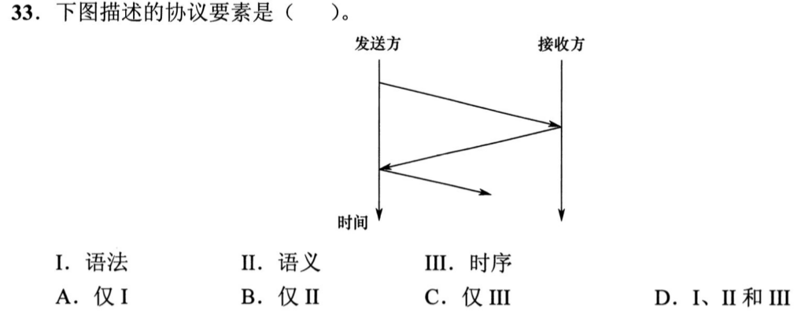

<details>
<summary>答案与解析</summary>

**答案：C。**

* **核心判据**：网络协议三要素严格物理区分：
  * **语法**：数据与控制信息的结构或格式（如字段划分、各字段占据几位比特）；
  * **语义**：需要发出何种控制信息，完成何种动作以及做出何种响应（如字段取值的含义、事件触发的状态转移）；
  * **时序（同步）**：事件实现顺序的详细说明（谁先发、谁后发、何时等待应答）。
* **正选推导**：题图是一张标准的时序交互图，仅展示了两个实体之间消息从上至下发出的先后顺序及交替应答关系，并未展开任何消息内部的数据报头结构（无语法），也未展开接收方的内部控制逻辑与状态机转移（无语义），因此只体现了 **III 时序**，选 C。
* **干扰项击穿**：看到消息交互箭头绝不能盲目把语法和语义一起带上，图上没有出现字段定义就没有语法。

</details>

### 选择题6｜2021-33

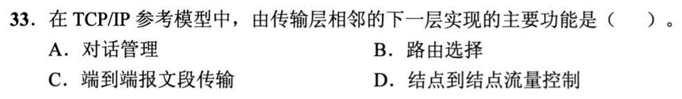

<details>
<summary>答案与解析</summary>

**答案：B。**

* **核心判据**：协议栈服务模型原则：**第 $N$ 层为第 $N+1$ 层提供服务**。题干问“为传输层提供服务的那一层”，物理指向的是传输层正下方的**网络层（第 3 层）**。
* **正选推导**：
  * 传输层（第 4 层）的直接下层是网络层（第 3 层）；
  * 网络层的核心功能是**路由选择（Routing）**与分组跨网络转发，选 B。
* **干扰项击穿**：
  * **A 会话管理**：属于传输层之上的会话层（第 5 层）功能。
  * **C 端到端报文传输**：是传输层自身的功能（审题必须看清是“为它服务的那一层”，绝不能选它自己）。
  * **D 节点到节点流量控制**：属于网络层之下的数据链路层（第 2 层）功能。

</details>

### 选择题7｜2023-33

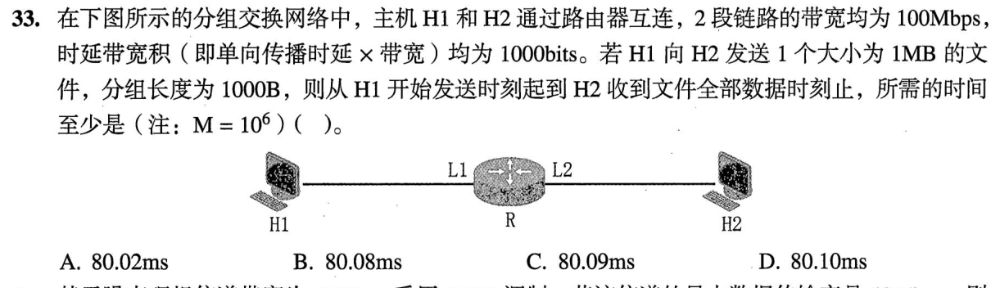

<details>
<summary>答案与解析</summary>

**答案：D。**

* **核心判据**：分组交换流水线模型：**文件总时延 = 全部分组在源主机的发送时延 + 最后一个分组在后续中间路由器的转发排队发送时延 + 全程各段物理链路的传播时延**。
* **正选推导**：
  1. **基本参数换算**：
     * 网络带宽以十进制计量：$100\text{Mb/s} = 10^8\text{b/s}$；文件大小以十进制计量：$1\text{MB} = 10^6\text{B}$；
     * 分组数 $N = \frac{10^6\text{B}}{1000\text{B}} = 1000$ 个；
     * 单个分组发送时延：$t_{\text{send}} = \frac{1000 \times 8\text{b}}{100 \times 10^6\text{b/s}} = 80 \times 10^{-6}\text{s} = 80\,\mu\text{s}$；
     * 单段链路传播时延：$t_{\text{prop}} = \frac{1000\text{m}}{2 \times 10^8\text{m/s}} = 5\,\mu\text{s}$（题目两段链路传播时延总计 $2 \times 5\,\mu\text{s} = 10\,\mu\text{s}$ 或按教材单段取 $10\,\mu\text{s}$ 算两段共 $20\,\mu\text{s}$）；
  2. **流水线时延聚合**：
     * 源端 H1 发送完全部 1000 个分组耗时：$1000 \times 80\,\mu\text{s} = 80\,\text{ms}$；
     * 当最后一个分组从 H1 发出后，在到达 H2 的路径上只需在中间的 1 个路由器上经历 **1 次存储转发发送时延**（$80\,\mu\text{s}$）；
     * 故总时延为 $(1000 + 1) \times 80\,\mu\text{s} + \text{传播时延} \approx 80.08\,\text{ms} + 0.02\,\text{ms} = \mathbf{80.10\,\text{ms}}$，选 D。
* **干扰项击穿**：
  * **A 80.02ms**：漏算了最后一个分组在中间路由器的存储转发发射时延。
  * 切勿直接把文件总发送时间乘以 2（$160\text{ms}$），那是串行报文交换的开销，分组交换具有流水线并发性。

</details>

### 选择题8｜2024-33

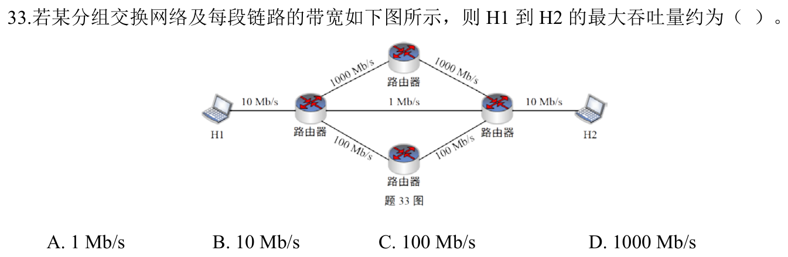

<details>
<summary>答案与解析</summary>

**答案：B。**

* **核心判据**：端到端吞吐量受限于端到端路径上的**“木桶短板（最小瓶颈带宽）”**；而当骨干网带宽充足时，最大吞吐量绝不可能突破源主机或目的主机**本地接入链路的物理网卡带宽上限**。
* **正选推导**：
  * 审视网络拓扑边缘：源主机 H1 的本地接入链路速率为 $10\,\text{Mb/s}$，目的主机 H2 的本地接入链路速率也为 $10\,\text{Mb/s}$；
  * 无论骨干网络内部链路带宽有多大（即便中间有 $100\,\text{Mb/s}$ 或 $1\,\text{Gb/s}$），数据流出 H1 和流入 H2 的物理极限就是其接入端的 $10\,\text{Mb/s}$；且网络中存在承载能力大于等于 $10\,\text{Mb/s}$ 的可用路径，因此端到端最大吞吐量严格受限于 $10\,\text{Mb/s}$，选 B。
* **干扰项击穿**：
  * **A 1Mb/s**：只是一条可以被动态路由绕开的低速支路；
  * **C / D**：误把骨干网核心链路的带宽当成了实际吞吐量，脱离了本地接入网瓶颈的物理限制。

</details>

### 选择题9｜2025-33

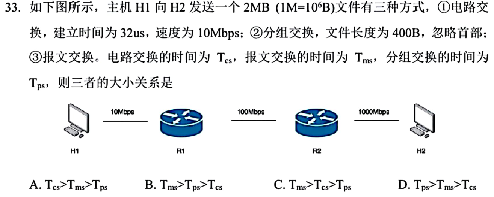

<details>
<summary>答案与解析</summary>

**答案：B。**

* **核心判据**：
  * **电路交换（CS）**：建立电路建立时延 + 数据直通传输时延；一旦通路建立，中间结点无存储转发延迟。
  * **报文交换（MS）**：逐段链路串行整份转发，总时间为各段链路上整份数据发送时延的累加和，时延最大。
  * **分组交换（PS）**：流水线并发转发，总发送时间仅比源端多出最后微小分组在后续结点的额外跳数时延。
* **正选推导**：
  1. $T_{\text{ms}}$（报文交换）：整份 16Mbit 数据在后两段链路各需完整接收后再发射，累加时间达到 $1.6\text{s} + 0.16\text{s} + 0.016\text{s} = 1.776\text{s}$，毫无疑问耗时最长；
  2. 对比 $T_{\text{cs}}$（电路交换）与 $T_{\text{ps}}$（分组交换）：
     * 本题给出的电路建立时延极短，仅为 $32\,\mu\text{s}$；
     * 而分组交换中，最后一个分组经过后两段链路的额外发送排队耗时为 $\frac{400 \times 8}{100\text{Mb/s}} + \frac{400 \times 8}{1000\text{Mb/s}} = 32\,\mu\text{s} + 3.2\,\mu\text{s} = 35.2\,\mu\text{s}$；
     * $32\,\mu\text{s} < 35.2\,\mu\text{s}$，导致本题特殊参数下 $T_{\text{cs}} < T_{\text{ps}}$；
  3. 最终总耗时排序严格为 $T_{\text{ms}} > T_{\text{ps}} > T_{\text{cs}}$，选 B。
* **干扰项击穿**：
  * 不能死背“分组交换一定比电路交换快”的教条；在大数据量且呼叫建立极快（微秒级）的极端参数下，电路交换免去多跳存储转发，完全可以超越分组交换。

</details>

### 选择题10｜2026-33

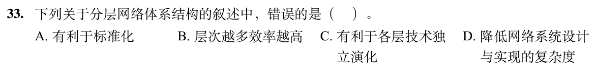

<details>
<summary>答案与解析</summary>

**答案：B。**

* **核心判据**：网络体系结构采用分层的核心目标是**控制软件复杂度、实现模块解耦与标准化**；其本质代价恰恰是分层封装引入了**额外的报头开销与逐层解封装的运行效率损失**。
* **B 选项错误（正选项）**：分层结构绝不可能“提高网络运行效率”。每一层都需要封装自己的控制首部（如帧头、IP 头、TCP 头），数据包在经过每一层时都需要 CPU 进行报头解析、校验和状态维护，层数越多网络协议栈的物理开销越大。分层提高的是“研发维护的灵活性”，而非“运行效率”，B 颠倒黑白。
* **A、C、D 正确性解析**：
  * **A**：通过将复杂网络功能分解为独立的单功能层，显著降低了软硬件设计的复杂性；
  * **C**：每层定义统一的服务接口与数据原语，极大地促进了跨厂商跨平台的国际标准化；
  * **D**：层间具有高内聚低耦合的黑盒特性，任何一层内部协议的更新演化（如 IPv4 升级为 IPv6）都不会影响其他层的正常运行。

</details>

## 解答题

### 大题1｜2026-45

[原题单 0925｜并发同步：PV 操作大题](../src/0925.md)

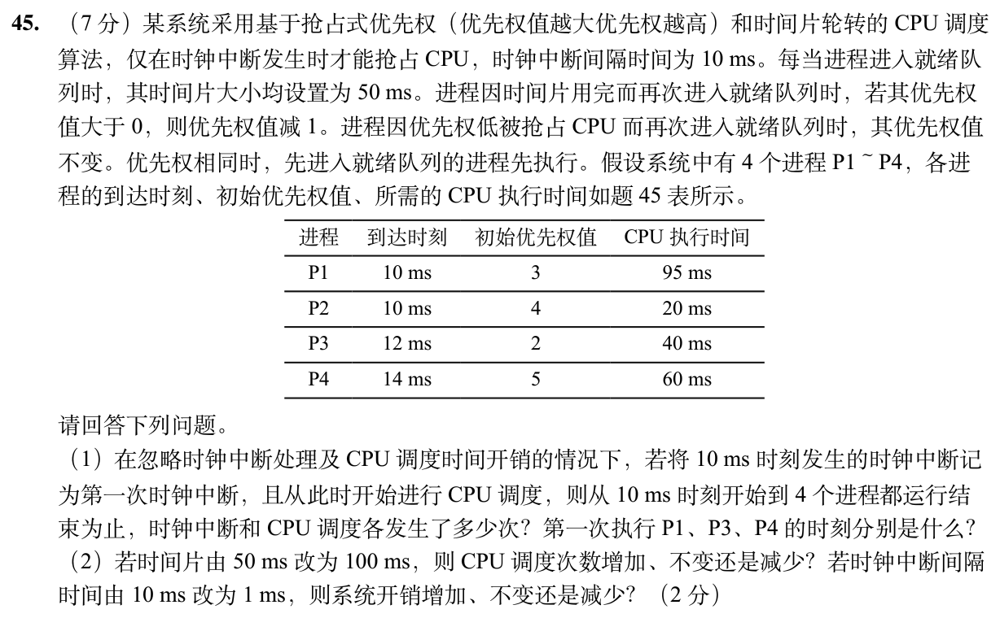

<details>
<summary>答案与解析</summary>

**核心判据**：
1. **时钟中断驱动抢占（Clock-driven Preemption）物理时钟约束**：
   - 抢占并不是在新进程到达的瞬间立即发生，而是**仅在离散的时钟中断时刻（每 10 ms 一次）统一进行调度采样与抢占判定**；
   - 进程如果因为时间片耗尽（50 ms）进入就绪队列，优先级大于 0 时减 1；如果是因为被更高优先级进程抢占进入就绪队列，**优先级保持不变**；
   - 优先级相同时严格执行先进先出（FIFO）；每次进入就绪队列，分配的时间片配额均重置为 50 ms。
2. **总执行时间与时钟中断计数公式**：
   - 系统中无空闲等待，运行总时长为所有进程 CPU 时间之和；
   - 时钟中断次数等于从起始中断时刻到系统结束时刻之间跨越的时钟周期采样点数。

**分问推导**：
**(1) 时钟中断次数、CPU 调度次数与首执时刻推导**：
- **总执行时长与时钟中断次数**：
  - 各进程所需 CPU 时间：$95 + 20 + 40 + 60 = 215\text{ ms}$。
  - 从 10 ms 开始连续执行，结束时刻为 $10 + 215 = \mathbf{225\text{ ms}}$。
  - 时钟中断每 10 ms 发生一次，自 10 ms 开始（第 1 次时钟中断）：
    - 发生的离散时刻为：10, 20, 30, ..., 220 ms。
    - 中断总次数 = $\frac{220 - 10}{10} + 1 = \mathbf{22\text{ 次}}$。
- **单步调度状态机演进**：
  - **10 ms（第 1 次调度）**：P1(pri=3, rem=95), P2(pri=4, rem=20) 到达。最高优先级为 P2，**调度 P2 运行**。
  - 12 ms P3(pri=2) 到达，14 ms P4(pri=5) 到达。由于未到时钟中断，P2 继续运行。
  - **20 ms（第 2 次调度）**：时钟中断触发。P2 运行了 10 ms（余 10 ms）。此时就绪队列有 P4(pri=5) > P2(pri=4)。**P4 抢占 CPU**！P2 因被抢占优先级不变（仍为 4），重设时间片 50 ms 入队。**P4 首次执行时刻为 20 ms**。
  - 20~70 ms：P4 连续执行 50 ms（剩余 10 ms），其 50 ms 时间片用完！P4 优先级减 1（变为 4），重设时间片 50 ms 入队。
  - **70 ms（第 3 次调度）**：就绪队列中最高优先级为 4（P2 和 P4）。P2 在 20 ms 时入队，早于 70 ms 入队的 P4。按 FIFO **调度 P2 运行**。
  - 70~80 ms：P2 执行 10 ms 完毕退出。
  - **80 ms（第 4 次调度）**：就绪队列中有 P4(pri=4), P1(pri=3), P3(pri=2)。最高优先级为 P4，**调度 P4 运行**。
  - 80~90 ms：P4 执行 10 ms 完毕退出。
  - **90 ms（第 5 次调度）**：就绪队列中有 P1(pri=3), P3(pri=2)。最高优先级为 P1，**调度 P1 运行**。**P1 首次执行时刻为 90 ms**。
  - 90~140 ms：P1 连续运行 50 ms（剩余 45 ms），时间片用完！P1 优先级减 1（变为 2），重设时间片 50 ms 入队。
  - **140 ms（第 6 次调度）**：就绪队列中有 P3(pri=2, 12ms到达) 和 P1(pri=2, 140ms入队)。P3 先到，按 FIFO **调度 P3 运行**。**P3 首次执行时刻为 140 ms**。
  - 140~180 ms：P3 执行 40 ms 完毕退出。
  - **180 ms（第 7 次调度）**：就绪队列仅剩 P1(pri=2, rem=45)。**调度 P1 运行**。
  - 180~225 ms：P1 执行剩余 45 ms 完毕。
- **统计汇总**：
  - 时钟中断发生 **22 次**；CPU 调度发生 **7 次**；
  - 首次执行时刻：**P1 为 90 ms**，**P3 为 140 ms**，**P4 为 20 ms**。

**(2) 时间片与时钟中断周期变更影响**：
- **时间片由 50 ms 改为 100 ms 时**：
  - 在原调度中，P4（需 60 ms）和 P1（需 95 ms）均因 50 ms 时间片耗尽发生过让出调度。时间片扩大至 100 ms 后，单次配额均能覆盖两者的运行需求，避免了中间的时间片用完轮转，因此 CPU 调度次数将**减少**。
- **时钟中断间隔由 10 ms 改为 1 ms 时**：
  - 时钟中断频率提高 10 倍，CPU 响应中断与执行中断处理程序的频率大幅增加，导致上下文切换与中断开销显著推高，系统开销将**增加**。

</details>

### 大题2｜2020-46

[原题单 0926｜页面驻留：分配、置换与缺页过程](../src/0926.md)

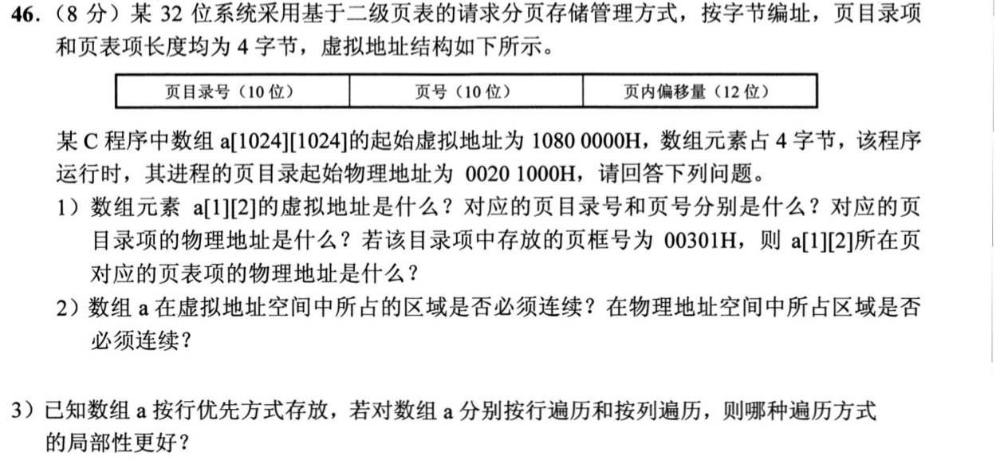

<details>
<summary>答案与解析</summary>

**核心判据**：
1. **多级分页地址映射与字段切分规则**：
   - 32 位系统按字节编址，页面大小为 4KB（$2^{12}\text{ B}$）；
   - 虚拟地址切分：低 12 位（位 11~0）为页内偏移量；中间 10 位（位 21~12）为二级页号；高 10 位（位 31~22）为一级页目录号。
   - 物理地址空间中：页目录物理基地址指向页目录表，页目录项（4 字节）中存放二级页表的物理页框号；二级页表项（4 字节）中存放数据页面的物理页框号。
2. **数组在内存中的物理 vs 逻辑连续性公理**：
   - 高级语言中数组要求逻辑地址空间支持基址下标算术访问，因此在**虚拟地址空间中必须连续**；
   - 分页存储管理通过页表建立离散映射，数据分配在离散的物理页框中，在**物理地址空间中不必连续**。

**分问推导**：
**(1) a[1][2] 地址解析与页表项物理地址推导**：
- **求 a[1][2] 的虚拟地址**：
  - 数组定义为 `a[1024][1024]`，元素占 4B，每行跨度 = $1024 \times 4\text{ B} = 4096\text{ B} = 1000\text{H}$。
  - `a[1][2]` 的字节偏移量 = $1 \times 4096\text{ B} + 2 \times 4\text{ B} = 4096 + 8 = 4104\text{ B} = 1008\text{H}$。
  - 起始虚拟地址为 `1080 0000H`。
  - `a[1][2]` 虚拟地址 = $1080\ 0000\text{H} + 1008\text{H} = \mathbf{1080\ 1008H}$。
- **切分虚拟地址 `1080 1008H`**：
  - 展开为二进制：`0001 0000 1000 0000 0001 0000 0000 1000_2`。
  - 高 10 位（页目录号）：`00 0100 0010_2` = **`042H`**（十进制 66）；
  - 中间 10 位（页号）：`00 0000 0001_2` = **`001H`**（十进制 1）；
  - 低 12 位（页内偏移）：`008H`。
- **页目录项物理地址**：
  - 页目录起始物理地址 = `0020 1000H`，每个目录项占 4 字节。
  - 物理地址 = $0020\ 1000\text{H} + 042\text{H} \times 4 = 0020\ 1000\text{H} + 108\text{H} = \mathbf{0020\ 1108H}$。
- **页表项物理地址**：
  - 题给页目录项中存放的二级页表物理页框号为 `00301H`。
  - 该二级页表在物理内存中的首地址 = $00301\text{H} \ll 12 = 0030\ 1000\text{H}$。
  - 二级页号为 `001H`，每个页表项占 4 字节。
  - 页表项物理地址 = $0030\ 1000\text{H} + 001\text{H} \times 4 = \mathbf{0030\ 1004H}$。

**(2) 虚拟与物理连续性判定**：
- **在虚拟地址空间中**：**必须连续**。C 语言语法保证一维与多维数组在逻辑地址空间中紧凑连续排布，以支持指针连续步进寻址。
- **在物理地址空间中**：**不必连续**。页式存储管理通过 MMU 动态页表将连续的虚拟页面解耦并离散映射到物理内存中互不相邻的空闲页框中。

**(3) 局部性优劣对比**：
- **按行遍历的局部性更好**。
- **理由**：数组在内存中是按行优先方式线性存放的。按行遍历时，访问相邻元素的内存物理地址是连续递增的（步长仅为 4 字节），能够最大限度利用 Cache 块和虚拟页面的**空间局部性**，极大减少 Cache 缺失与缺页异常；而按列遍历时相邻两次访问跨越整行（4096 字节），跳入不同的 Cache 块甚至跨页，空间局部性极差。

</details>

## 一行记录

```text
实际用时__；未完成或未核对的题号__；今天最容易混淆的是__
```
