# Day 31｜数据结构＋操作系统

[← Day 30](day30.md) · [总入口](README.md) · [Day 32 →](day32.md)

**选择题：15道，来自两份完整src题单；大题：1道。** 先做选择题，再展开题下解析。组内题目沿用src顺序；标为复做的组，已会的快速通过，重点处理上次错题。

**预计用时：55—85分钟。** 选择题及核对约25—40分钟，大题约25—35分钟，最后用5—10分钟重做今天最值得记住的一道错题。约两小时是配题目标，不是必须耗满或到点强停；计算卡住时先保留题号，先完成其余选择题。

## 选择题组1｜0803 · 数据结构

[树的形状：遍历序列如何约束结构](../src/0803.md) · 11道 · 复做第1次。

### 选择题1｜2020-03

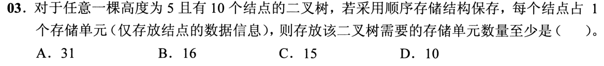

<details>
<summary>答案与解析</summary>

**参考答案：A（待逐题复核）。** 解析待补。

</details>

### 选择题2｜2020-04

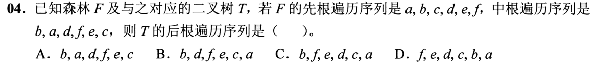

<details>
<summary>答案与解析</summary>

**参考答案：C（待逐题复核）。** 解析待补。

</details>

### 选择题3｜2021-04

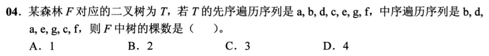

<details>
<summary>答案与解析</summary>

**参考答案：C（待逐题复核）。** 解析待补。

</details>

### 选择题4｜2022-03

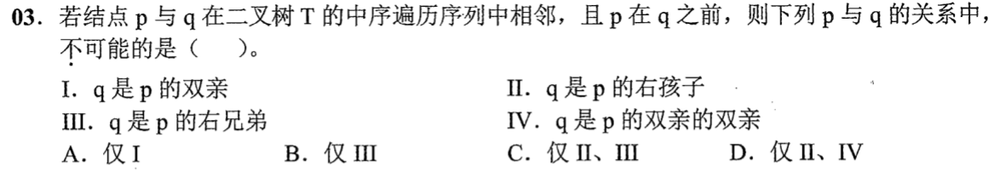

<details>
<summary>答案与解析</summary>

**参考答案：B（待逐题复核）。** 解析待补。

</details>

### 选择题5｜2022-04

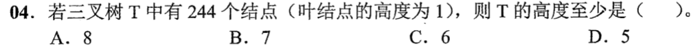

<details>
<summary>答案与解析</summary>

**答案：C。**

三叉树h=5最多(3⁵−1)/2=121个，不够244；h=6最多364个，故最小高度6。

</details>

### 选择题6｜2023-05

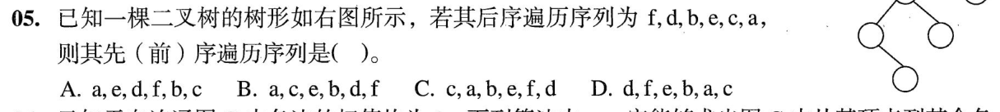

<details>
<summary>答案与解析</summary>

**答案：A。**

后序末项a是根；右子树仅一个结点c，左子树后序f,d,b,e，其根e、右孩子b、左孩子d（d右孩子f）。先序根左右得a,e,d,f,b,c，选A。按树形分配后序片段，不能仅靠末两项猜结构。

</details>

### 选择题7｜2024-03

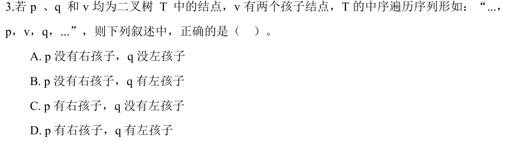

<details>
<summary>答案与解析</summary>

**答案：A。**

p是v的中序前驱，v有左子树时p为左子树最右结点，因此p无右孩子；q为右子树最左结点，因此q无左孩子。

</details>

### 选择题8｜2025-03

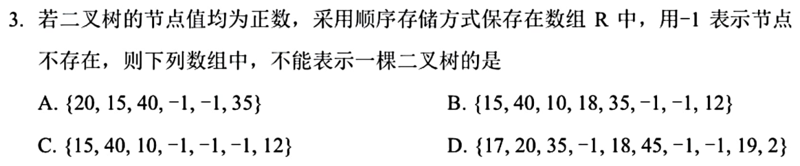

<details>
<summary>答案与解析</summary>

**参考答案：D（待逐题复核）。** 解析待补。

</details>

### 选择题9｜2025-04

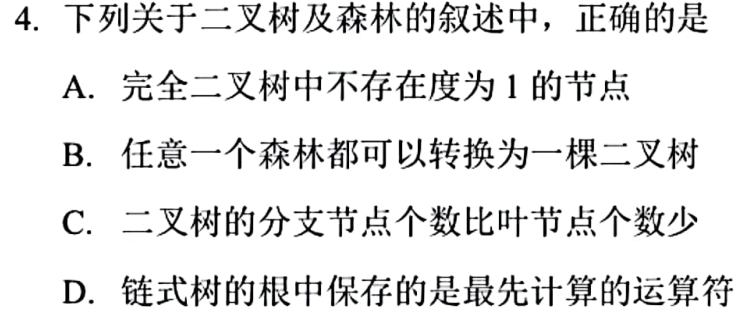

<details>
<summary>答案与解析</summary>

**答案：B。**

任意森林可用左孩子右兄弟转换成二叉树。完全二叉树可有一个度1结点；一般二叉树分支数未必少于叶子；表达式树根通常是最后执行的运算。

</details>

### 选择题10｜2026-03

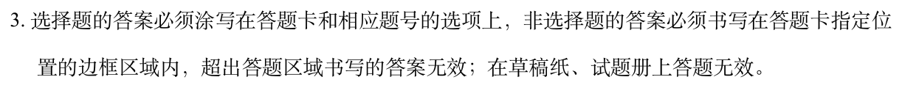

<details>
<summary>答案与解析</summary>

**答案与解析待补。**

</details>

### 选择题11｜2026-04

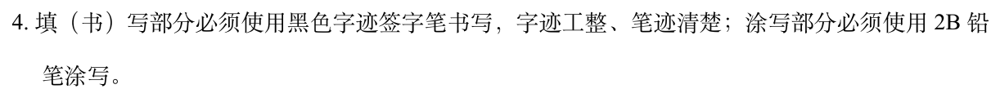

<details>
<summary>答案与解析</summary>

**答案与解析待补。**

</details>

## 选择题组2｜0828 · 操作系统

[内存边界：分配、回收与保护](../src/0828.md) · 4道 · 复做第1次。

### 选择题12｜2020-24

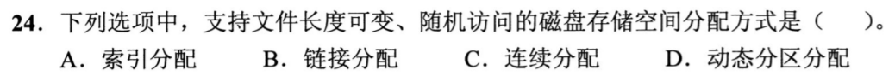

<details>
<summary>答案与解析</summary>

**参考答案：A（待逐题复核）。** 解析待补。

</details>

### 选择题13｜2023-30

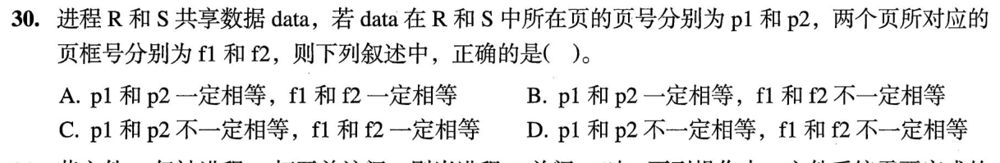

<details>
<summary>答案与解析</summary>

**答案：C。**

R与S可用不同虚拟页号p1、p2映射共享数据，但共享同一物理页框，f1=f2。别把各自地址空间的编号当成全局编号。

</details>

### 选择题14｜2024-27

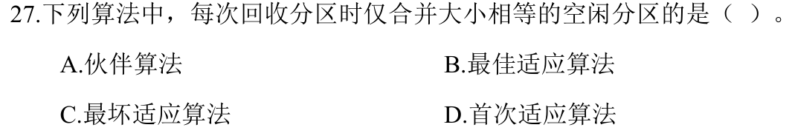

<details>
<summary>答案与解析</summary>

**参考答案：A（待逐题复核）。** 解析待补。

</details>

### 选择题15｜2026-28

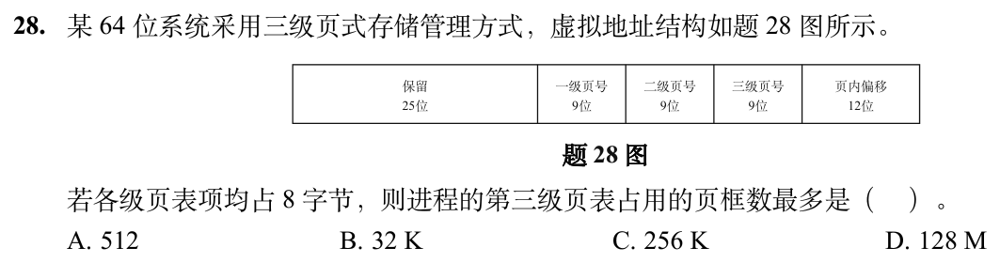

<details>
<summary>答案与解析</summary>

**答案与解析待补。**

</details>

## 解答题

### 大题1｜2022-45

[原题单 0927｜文件与磁盘：名字、索引和物理块怎样连接](../src/0927.md)

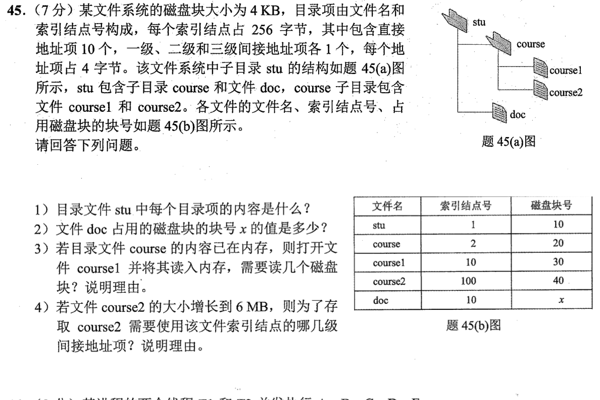

<details>
<summary>答案与解析</summary>

（1）题设目录项由名字与索引结点号组成。图中 stu 的两个目录项是 (course, 2) 和 (doc, 10)。

（2）doc 与 course1 的 inode 号都是10，指向同一文件数据，故 x=30。

（3）读2块。course 的目录内容已在内存，可直接获得 inode 10；读含 inode 10 的磁盘块，再读数据块30。题目只声明目录内容已缓存，因此按 inode 与数据块尚未缓存计算。

（4）6MiB 需要 6×1024/4=1536 个数据块。一块索引块可放 4096/4=1024 个地址。10个直接项加一级间接项只能覆盖1034块，余502块用二级间接，因此一级、二级都用到，三级无需使用。

</details>

## 一行记录

```text
实际用时__；未完成或未核对的题号__；今天最容易混淆的是__
```
