# Day 32｜组成原理＋计算机网络

[← Day 31](day31.md) · [总入口](README.md) · [Day 33 →](day33.md)

**选择题：11道，来自两份完整src题单；大题：1道。** 先做选择题，再展开题下解析。组内题目沿用src顺序；标为复做的组，已会的快速通过，重点处理上次错题。

**预计用时：55—90分钟。** 选择题及核对约25—45分钟，大题约25—35分钟，最后用5—10分钟重做今天最值得记住的一道错题。约两小时是配题目标，不是必须耗满或到点强停；计算卡住时先保留题号，先完成其余选择题。

## 选择题组1｜0815 · 组成原理

[Cache访问：地址切分、局部性与替换](../src/0815.md) · 5道 · 复做第1次。

### 选择题1｜2020-15


<details>
<summary>答案与解析</summary>

**答案：D。**

Cache一般用SRAM，TLB通常是相联查找结构，不能说两者都由DRAM组成。按本题模型，缺失后的下级信息位于主存，硬件可以处理查询。

</details>

### 选择题2｜2021-16

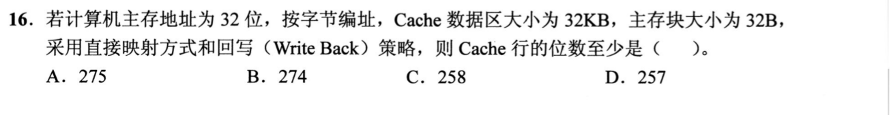

<details>
<summary>答案与解析</summary>

**答案：A。**

Cache共32KiB/32B=1024行，行号10位；块内偏移5位，标记32−10−5=17位。每行还要256位数据、1位有效位、1位回写所需脏位，总计256+17+1+1=275位。直接映射没有组内替换选择，不额外增加LRU位。

</details>

### 选择题3｜2022-16

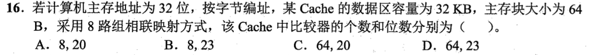

<details>
<summary>答案与解析</summary>

**答案：A。**

32KiB/64B=512行，8路得64组，组号6位，偏移6位，tag=32−6−6=20位；8路需要8个20位比较器。

</details>

### 选择题4｜2024-16

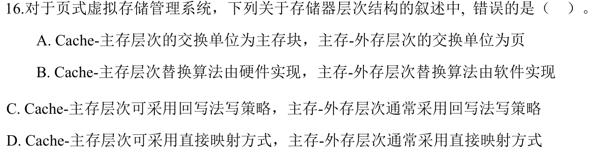

<details>
<summary>答案与解析</summary>

**答案：D。**

主存页框不是虚拟页的固定直接映射槽位，虚拟页可装入可用页框。Cache可直接映射；主存—外存页面映射通常是全相联的灵活装入。

</details>

### 选择题5｜2026-18

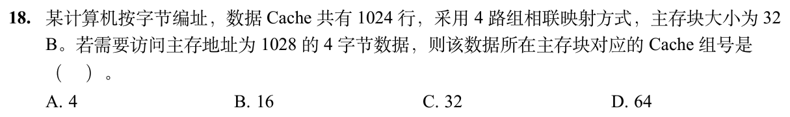

<details>
<summary>答案与解析</summary>

**答案：C。**

1024行、4路得到256组。地址1028所属主存块号为⌊1028/32⌋=32，组号32 mod 256=32。4字节数据只影响访问长度，不能把1028除以4后当块号；4路表示每组4行，也不是把主存块号再除以4。

</details>

## 选择题组2｜0903 · 计算机网络

[链路可靠性：帧、窗口与重传状态](../src/0903.md) · 6道 · 复做第1次。

### 选择题6｜2020-36

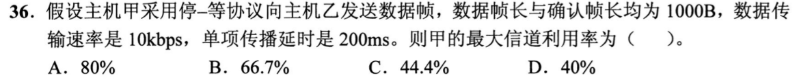

<details>
<summary>答案与解析</summary>

**答案：D。**

数据帧与ACK都为1000B，各需1000×8/10000=0.8s；往返传播0.4s。一轮停等周期0.8+0.4+0.8=2s，只有0.8s用于发送数据，利用率0.8/2=40%。本题ACK并不短，不能忽略其发送时延。

</details>

### 选择题7｜2022-33

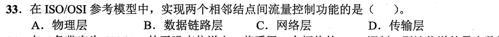

<details>
<summary>答案与解析</summary>

**答案：B。**

相邻结点之间流量控制属数据链路层；传输层处理端到端流量控制。看清题目限定的通信对象。

</details>

### 选择题8｜2023-35

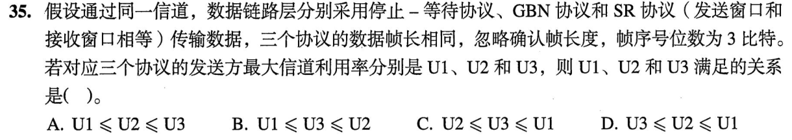

<details>
<summary>答案与解析</summary>

**答案：B。**

3位序号共8个，停等窗口1，SR等大发收窗口最大4，GBN发送窗口最大7。帧长与信道相同，无差错时最大利用率随可连续发送帧数增加，所以U1≤U3≤U2。等号可能出现，例如窗口较小的协议已足够填满信道；SR的重传效率优势不等于它在相同序号位数下窗口更大。

</details>

### 选择题9｜2023-37

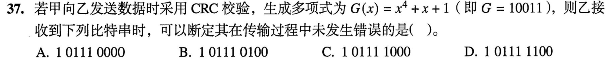

<details>
<summary>答案与解析</summary>

**答案：D。**

101111100对10011做模2除法余数为0000，其他候选余数非零，故按题意选D。严格说CRC通过只能说明未检出差错，不能逻辑保证传输绝无错误；可检出范围取决于生成多项式。

</details>

### 选择题10｜2024-37

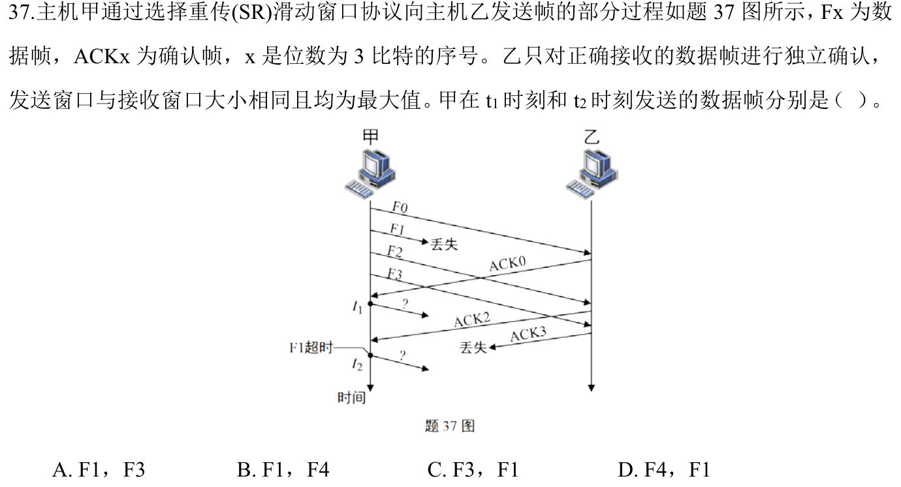

<details>
<summary>答案与解析</summary>

**答案：D。**

3位序号的SR窗口最大4。收到ACK0后，窗口从[0,1,2,3]滑到[1,2,3,4]，t1可发新帧F4。ACK2是独立确认，不能代替丢失F1的确认；F1超时后t2只重传F1，不连带重传已确认帧。故为F4、F1。

</details>

### 选择题11｜2026-35

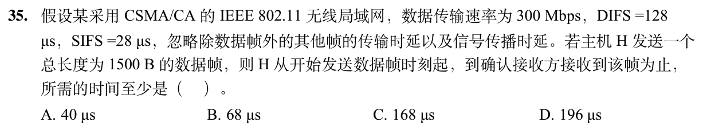

<details>
<summary>答案与解析</summary>

**答案：B。**

数据帧发送需1500×8/300=40μs。发送结束后还要等待SIFS=28μs才能收到ACK，忽略ACK发送和传播时间，合计68μs。题目从开始发DATA计时，之前争用信道的DIFS不再加入；只算40μs还不能确认对端已收到。

</details>

## 解答题

### 大题1｜2026-46

[原题单 0927｜文件与磁盘：名字、索引和物理块怎样连接](../src/0927.md)

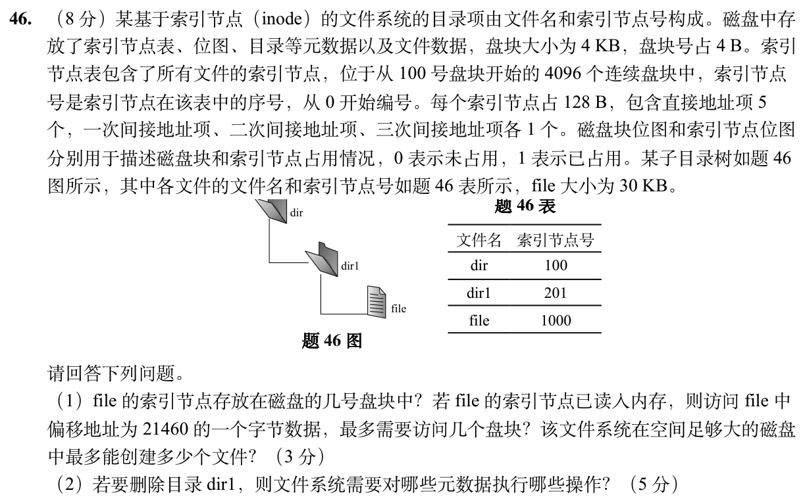

<details>
<summary>答案与解析</summary>

（1）每块4096/128=32个 inode。编号1000的 inode 在表中第⌊1000/32⌋=31个块，盘块号100+31=131。21460÷4096的商为5，已跨过直接项0～4。inode在内存时，最坏读取一级间接索引块和目标数据块各一次，共2块。inode表共4096×32=131072个槽，这是可创建文件对象总数的上限，目录也使用inode。

（2）dir1 非空。若按递归删除，先去除 dir1 中 file 的目录项，更新 file 的inode链接计数。若链接数减至0且没有打开引用，回收其数据块与一级间接索引块（30KiB要8个数据块，其中3个经一级间接），清这些块在磁盘块位图中的占用位，并释放 inode 1000，清其inode位图位。再在父目录 dir 中删除 dir1 的目录项，更新父目录inode的大小、时间等相应元数据；若实现记录目录链接数，移除子目录还要更新父目录链接数。释放 dir1 的目录数据及可能的索引块，清相应盘块位图；释放 inode 201，清对应inode位图位。普通非递归空目录删除接口应先判非空，不能直接删。

</details>

## 一行记录

```text
实际用时__；未完成或未核对的题号__；今天最容易混淆的是__
```
