# Day 33｜数据结构＋操作系统

[← Day 32](day32.md) · [总入口](README.md) · [Day 34 →](day34.md)

**选择题：16道，来自两份完整src题单；大题：1道。** 先做选择题，再展开题下解析。组内题目沿用src顺序；标为复做的组，已会的快速通过，重点处理上次错题。

**预计用时：60—95分钟。** 选择题及核对约30—50分钟，大题约25—35分钟，最后用5—10分钟重做今天最值得记住的一道错题。约两小时是配题目标，不是必须耗满或到点强停；计算卡住时先保留题号，先完成其余选择题。

## 选择题组1｜0804 · 数据结构

[编码代价：哈夫曼树与前缀码](../src/0804.md) · 5道 · 复做第1次。

### 选择题1｜2021-05

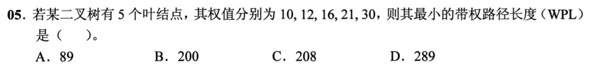

<details>
<summary>答案与解析</summary>

**答案：B。**

每次合并最小两权：10+12=22，16+21=37，22+30=52，37+52=89。哈夫曼树WPL等于各次合并值之和，22+37+52+89=200。89只是根权值，即所有叶权之和，不是带权路径长度。

</details>

### 选择题2｜2022-05

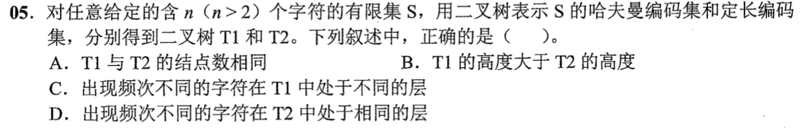

<details>
<summary>答案与解析</summary>

**答案：D。**

定长编码的所有字符都是同一深度，频次不同也不改变码长。哈夫曼树中频次不同的字符也可同层。两种树的高度可以相同；例如4个等频字符都用2位。结点数也未必相同，例如3个字符的定长码取00、01、10，按这三条路径建树有6个结点，而二叉哈夫曼树有5个。

</details>

### 选择题3｜2023-04

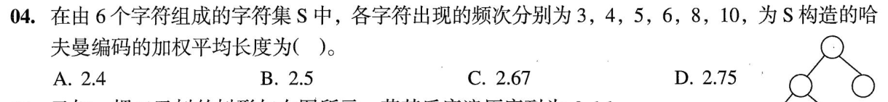

<details>
<summary>答案与解析</summary>

**答案：B。**

依次合并3+4=7、5+6=11、7+8=15、10+11=21、15+21=36，WPL=7+11+15+21+36=90。频次总和36，所以加权平均码长90/36=2.5。不能用WPL除以字符种类数6。

</details>

### 选择题4｜2025-05

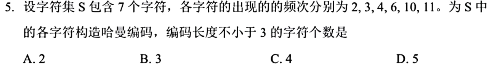

**题面缺项：** 图中称7个字符却只列6个频次。本页给出按现有数据的结果，不擅自补数；详见折叠解析。

<details>
<summary>答案与解析</summary>

**答案：按图列出的6个频次选B；题面的“7个字符”与数据不符。**

题图及仓内PDF均只列2、3、4、6、10、11，共6个频次，不能擅自补出第7个。先按这6个数计算：2+3=5，4+5=9，6+9=15，10+11=21，15+21=36。权10、11、6的码长为2，权4为3，权2、3为4，故码长不少于3的有3个，对应B。若原题确为7个字符，必须先补回缺失频次，才能判定该版本；原有参考字母D不能替代缺失题设，也不能反推并编造第7个频次。

</details>

### 选择题5｜2026-05

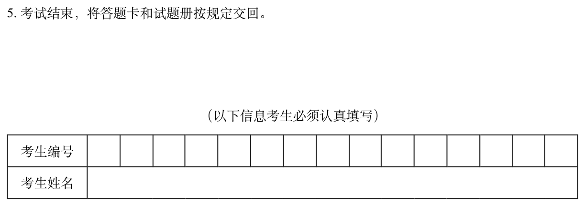

<details>
<summary>答案与解析</summary>

**答案：D。**

原图七个权值依次为1、2、4、5、8、10、12。按最小两权合并：1+2=3，3+4=7，5+7=12，8+10=18，12+12=24，18+24=42。e的权8与f的权10在子树18中，深度均为2；g的权12在子树24中，深度也为2。因此与e同深度的叶子恰为f、g。合并生成的权3不是原字符c的权值，不能把它混进原始七个叶权。

</details>

## 选择题组2｜0830 · 操作系统

[文件路径：名字、索引、数据块与共享](../src/0830.md) · 11道 · 复做第2次。

### 选择题6｜2020-23

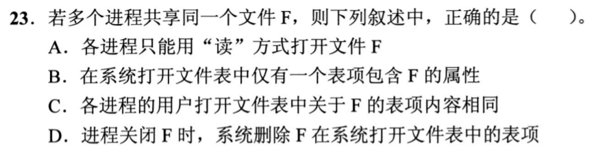

<details>
<summary>答案与解析</summary>


**答案：B。**

* **核心判据**：双层打开文件表物理隔离体系：
  * **系统打开文件表（System-wide，全系统唯一）**：集中管理该物理文件共享的全局属性（文件物理大小、磁盘块号/内存 inode 指针、**打开该文件的进程引用计数 `count`**）；
  * **进程打开文件表（Per-process，各进程私有）**：管理进程独立的运行时状态（**各自独立的读写偏移指针 `offset`**、访问权限模式 `flags`、指向系统打开文件表的指针）。
* **正选推导**：
  * B 选项正确：文件 $F$ 的属性信息集中保存在系统打开文件表的共享表项中，各进程的私有表项通过指针指向它以避免内存冗余。
* **干扰项击穿**：
  * **A 错误**：并发共享打开不要求全为只读，多个进程可以分别以读、写模式并发打开（通过文件锁保证同步）；
  * **C 错误**：各进程拥有自己独立的读写位置指针（如分别进行 `lseek`），绝非强制相同；
  * **D 错误**：某进程执行 `close` 仅将系统表项中的引用计数减 1（`count--`），只要还有其他进程在打开使用（`count > 0`），系统打开文件表的表项绝不能被删除！


</details>

### 选择题7｜2020-30

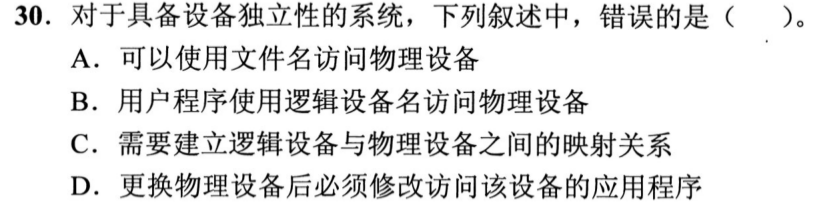

<details>
<summary>答案与解析</summary>


**答案：D。**

* **核心判据**：设备独立性（Device Independence，设备无关性）的根本物理目标：**应用程序只使用统一的逻辑设备名（如 `stdout`、`/dev/tty`）或通用文件 I/O 接口编写代码，底层由操作系统的逻辑设备表（LUT）映射到具体的物理设备端口与驱动**。
* **D 选项错误（正选项）**：声称“更换物理设备时必须修改应用程序的代码”，彻底颠倒了设备独立性的存在意义！设备独立性的核心价值正在于：更换打印机或硬盘物理型号时，应用程序完全无需修改，仅需系统更换对应驱动并在 LUT 表中重新绑定映射即可。D 违背基本原理，选 D。
* **A、B、C 正确性解析**：
  * **A**：通过虚拟文件系统屏蔽底层差异，应用可用统一接口（`read/write`）读写外设；
  * **B**：应用程序使用逻辑设备名与具体物理接口解耦；
  * **C**：系统必须负责维护逻辑设备到实际物理设备的动态映射表（LUT）。


</details>

### 选择题8｜2020-31

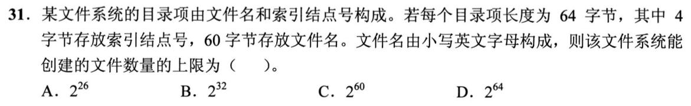

<details>
<summary>答案与解析</summary>


**答案：B。**

* **核心判据**：文件系统的唯一性标识物理不变量：**整个文件系统中的每一个文件，必须且只能分配一个全局唯一的索引节点号（inode number）**。
* **正选推导**：
  * 题设每个目录项中用于指示文件的索引节点号长度固定为 **4 字节（32 位二进制）**；
  * 32 位二进制整数最多能够提供 $2^{32}$ 个互不重叠的唯一编号；
  * 无论磁盘物理空间有多大、目录层级有多深，全系统能创建的文件总数上限绝对不可能突破编号空间的极限，严格受限于 **$2^{32}$**，选 B。
* **干扰项击穿**：
  * 60 字节的文件名可以排列组合出极大的命名空间，且不同子目录下完全允许同名文件，文件名长度绝不是限制系统文件总数的瓶颈；
  * 目录项大小 64 字节仅是存储单体开销，不能当作文件总数的计算指数。


</details>

### 选择题9｜2021-30

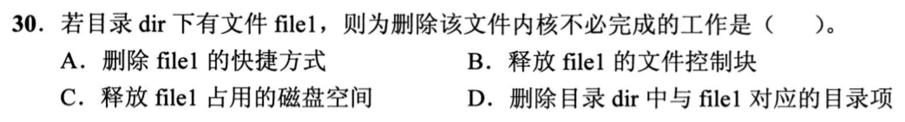

<details>
<summary>答案与解析</summary>


**答案：A。**

* **核心判据**：软链接（快捷方式）与硬链接的底层物理差异：
  * **快捷方式（符号链接/软链接）**：是一个完全独立的实体小文件，内部仅仅记录了目标文件的**路径字符串**，与目标文件拥有不同的 inode；
  * **删除动作的单向性**：彻底删除目标文件时，操作系统只会释放目标文件自身的 inode 和盘块，**绝不会全盘遍历去清理指向它的快捷方式**；因此快捷方式文件依然保留在桌面上，但其路径已变成无效悬空的“断链”。
* **正选推导**：删除目标应用程序后，快捷方式仍然存在，但双击它无法再启动应用程序，A 选项叙述完全正确，选 A。
* **干扰项击穿**：
  * 切勿把快捷方式与硬链接混淆：硬链接是多个目录项共享同一个 inode，删除其中一个名字只是将硬链接计数减 1。


</details>

### 选择题10｜2023-31

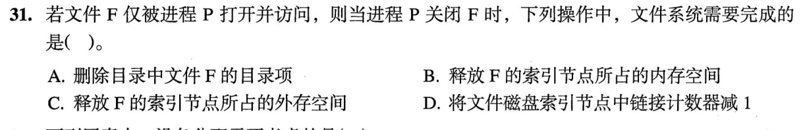

<details>
<summary>答案与解析</summary>


**答案：B。**

* **核心判据**：严格区分 `close()` 系统调用与 `delete()` / `unlink()` 的物理操作边界：
  * **`close()`**：属于**内存运行时会话的清理**。将系统打开文件表的引用计数减 1；当引用计数减至 0 时，释放保存在**内存中的活动索引节点（inode）缓存**；
  * **磁盘上的持久数据绝对不受 `close()` 的触动**！磁盘上的目录项、磁盘中的 inode 以及数据块完好无损地保留在外存中。
* **正选推导**：关闭最后一个打开该文件的进程时，操作系统只负责**释放该文件在内存中的活动索引节点**，选 B。
* **干扰项击穿**：
  * **A 删除目录项**、**C 释放磁盘数据块**、**D 减少硬链接数**：全都是执行 `rm` 或 `unlink` 删除文件时的写盘动作；若执行 `close` 就去删目录项或磁盘块，下次开机文件全部丢失。


</details>

### 选择题11｜2024-26


<details>
<summary>答案与解析</summary>


**答案：A。**

* **核心判据**：空闲空间管理结构的存储容量稳定性：
  * **位图法（Bitmap / 位示图）**：全盘的每一个物理盘块严格对应位图中的 1 个二进制位（bit）。设磁盘总块数为 $N$，位图大小固定为 $\frac{N}{8}$ 字节。**其占用空间大小完全由磁盘物理总容量决定，无论全盘是完全空闲、极度碎片化还是全盘存满，位图所占的物理空间绝对恒定不变**。
  * **空闲表 / 空闲链表 / 成组链接法**：所维护的表项、链表结点或成组链块数量，直接受当前空闲盘块的离散碎片化程度与空闲数量影响，动态剧烈伸缩。
* **正选推导**：只有位图法占用空间大小固定，选 A。


</details>

### 选择题12｜2024-29

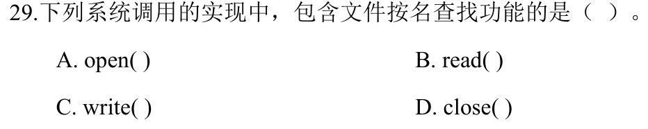

<details>
<summary>答案与解析</summary>


**答案：A。**

* **核心判据**：文件访问两阶段设计（路径解析 vs 文件描述符直接寻址）：
  * **`open(pathname, flags)`**：入参是**文本路径字符串**。操作系统必须从根目录或当前工作目录开始，逐级读取目录盘块、匹配目录项、取出 inode 号，执行开销巨大的**目录树查找**，建立打开文件表项并返回整型文件描述符 `fd`；
  * **`read(fd)` / `write(fd)` / `close(fd)`**：入参直接是**整数 `fd`**。进程直接使用 `fd` 作为数组下标索引私有打开文件表，顺藤摸瓜定位到已在内存中的 inode，**完全不需要再次遍历目录树**！
* **正选推导**：必须在目录中查找文件的只有 `open`，选 A。


</details>

### 选择题13｜2025-28

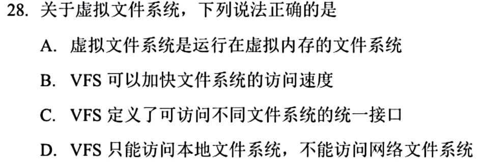

<details>
<summary>答案与解析</summary>


**答案：C。**

* **核心判据**：虚拟文件系统（VFS）的本质是**软件工程的多态抽象接口层**：
  * VFS 通过定义统一的对象操作原语（`vnode/inode`、`file`、`dentry`）向上层屏蔽 ext4、FAT32、NTFS 以及 NFS 网络文件系统的底层实现异构性；
  * **性能客观不变量**：文件读写的物理速度取决于底层硬件设备（SSD/HDD）以及具体文件系统算法；VFS 作为一层软件胶水层，甚至带来了微小的函数指针间接调用开销，**绝不可能带来“显著高于普通文件系统的访问速度”**。
* **C 选项错误（正选项）**：把 VFS 的“接口抽象”误吹成“提升访问速度”，彻底违背客观机理，选 C。
* **A、B、D 正确性解析**：
  * **A**：通过挂载机制将各异构文件系统整合为一个统一的逻辑命名空间；
  * **B**：向上层应用提供统一标准的 POSIX 系统调用；
  * **D**：不仅支持本地文件系统，还能无缝支持基于网络的分布式文件系统（如 NFS）。


</details>

### 选择题14｜2025-29

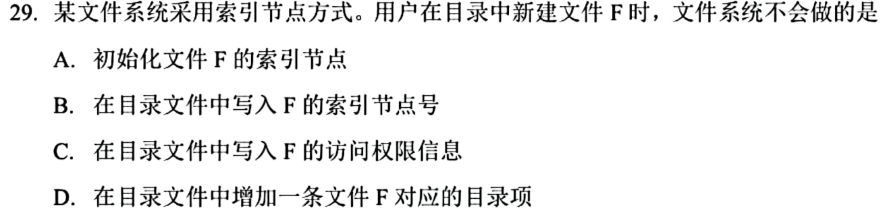

<details>
<summary>答案与解析</summary>


**答案：C。**

* **核心判据**：UNIX/Linux 目录项与索引节点（inode）的严格功能解耦：
  * **目录项（Directory Entry）**：极简化设计，内部**仅保存两个字段：`文件名` 与 `对应的 inode 编号`**；
  * **索引节点（inode）**：统一集中存储文件的**访问控制权限（rwx）、所有者 UID、文件大小、时间戳、物理盘块指针**等所有元数据。
* **正选推导**：
  * 创建新文件时，内核会分配新的 inode（A）、将访问权限写入该新分配的 inode 中（B）、将包含文件名和 inode 编号的目录项写入其父目录中（D）；
  * **绝对不会把访问权限写入目录项中**！故 C 是操作系统不会执行的操作，选 C。


</details>

### 选择题15｜2025-31

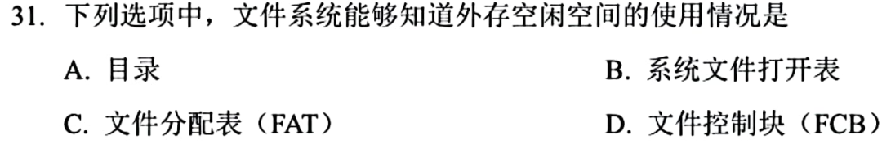

<details>
<summary>答案与解析</summary>


**答案：C。**

* **核心判据**：文件分配表（FAT，File Allocation Table）的双重物理使命：
  1. **文件链式存储映射**：每个非空表项记录当前簇的下一个后继簇号；
  2. **全盘空闲空间管理**：FAT 的表项与卷内的所有物理簇一一对应。若某个表项取值为 **0**，直接表明该物理簇是**空闲簇**！
* **正选推导**：FAT 表本身直接覆盖了全卷每一个簇的使用状态，能够直接反映外存空间的空闲与占用分布，选 C。
* **干扰项击穿**：
  * **A 目录表**：只记录已存在文件的名字和入口；
  * **B 文件控制块（FCB）**：只描述特定单个文件的属性；
  * **D 系统打开文件表**：只记录当前内存中已打开的文件，均无法获知全盘未用空间的宏观分布。


</details>

### 选择题16｜2025-32

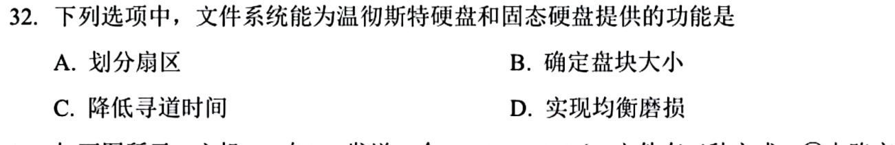

<details>
<summary>答案与解析</summary>


**答案：B。**

* **核心判据**：格式化层次划分：
  * **低级格式化（物理格式化）**：在出厂时对盘面划分物理磁道与扇区；
  * **逻辑格式化（高级格式化）**：操作系统在分区中写入文件系统的元数据骨架（写入引导块、超块、空闲管理位图、根目录，并**最终确定文件系统的逻辑块/簇大小 Block Size**）。
* **正选推导**：无论底层是机械硬盘还是固态硬盘（SSD），操作系统在对其逻辑格式化时共同执行的动作是**确定文件系统逻辑块的大小并建立文件系统结构**，选 B。
* **干扰项击穿**：
  * 划分物理扇区是出厂低级格式化；寻道优化仅机械硬盘具备；磨损均衡（Wear Leveling）是 SSD 底层固件闪存转换层（FTL）的硬件机制，非文件系统逻辑格式化的工作。


</details>

## 解答题

### 大题1｜2023-46

[原题单 0928｜进程生命线：调度、输入与用户—内核边界](../src/0928.md)

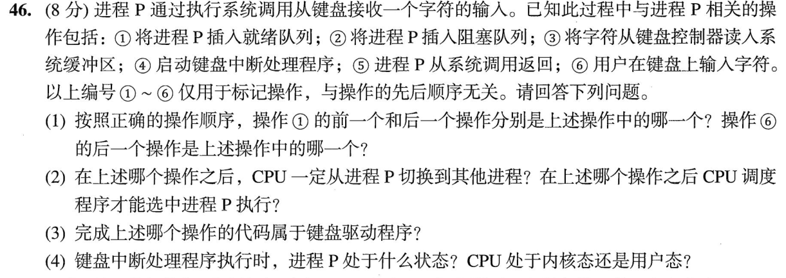

<details>
<summary>答案与解析</summary>

（1）顺序②⑥④③①⑤。①的前一个是③、后一个是⑤；⑥的下一个是④。

（2）②后进程因等待输入阻塞，CPU切换到其他可运行进程，必要时运行空闲进程。①后P进入就绪队列，才可能被调度。

（3）③读控制器并把字符放入内核缓冲区，由键盘驱动负责。

（4）进入键盘中断处理时，P因等字符而阻塞，CPU在内核态。处理到①才将P置为就绪，仍须调度才能执行。

</details>

## 一行记录

```text
实际用时__；未完成或未核对的题号__；今天最容易混淆的是__
```
