# Day 34｜组成原理＋计算机网络

[← Day 33](day33.md) · [总入口](README.md) · [Day 35 →](day35.md)

**选择题：16道，来自两份完整src题单；大题：1道。** 先做选择题，再展开题下解析。组内题目沿用src顺序；标为复做的组，已会的快速通过，重点处理上次错题。

**预计用时：70—110分钟。** 选择题及核对约40—65分钟，大题约25—35分钟，最后用5—10分钟重做今天最值得记住的一道错题。约两小时是配题目标，不是必须耗满或到点强停；计算卡住时先保留题号，先完成其余选择题。

## 选择题组1｜0816 · 组成原理

[地址翻译链：虚拟地址怎样到达数据](../src/0816.md) · 5道 · 复做第1次。

### 选择题1｜2020-15


<details>
<summary>答案与解析</summary>

**答案：D。**

Cache一般用SRAM，TLB通常是相联查找结构，不能说两者都由DRAM组成。按本题模型，缺失后的下级信息位于主存，硬件可以处理查询。

</details>

### 选择题2｜2022-15

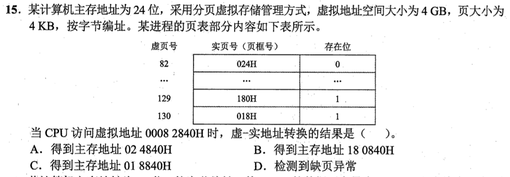

<details>
<summary>答案与解析</summary>

**答案：C。**

4KiB页使页内偏移为低12位。00082840H分成虚页号82H=130和偏移840H；虚页130存在位为1、页框018H，拼接得018840H。表中的82是十进制虚页号，不是本次的82H，不能误查其存在位0。

</details>

### 选择题3｜2024-17

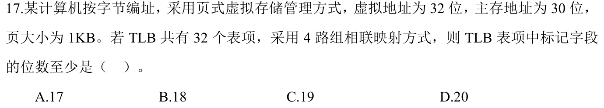

<details>
<summary>答案与解析</summary>

**答案：C。**

页大小1KiB，偏移10位，虚页号32−10=22位。TLB为32项、4路，共8组，组号占3位，Tag至少22−3=19位。TLB按虚页号查找，不能拿30位物理地址减字段；页内偏移也不存进Tag。

</details>

### 选择题4｜2024-18


<details>
<summary>答案与解析</summary>

**答案：B。**

MMU检测翻译和保护相关的TLB缺失、页面缺失、越权；Cache缺失由Cache访问与标记比较检测，不是MMU翻译的职责。

</details>

### 选择题5｜2026-19

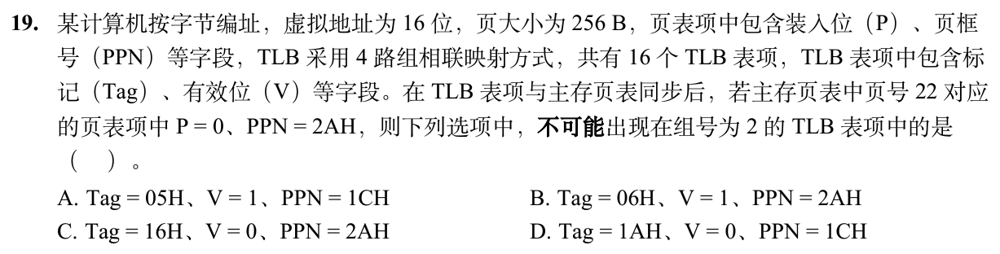

<details>
<summary>答案与解析</summary>

**答案：A。**

16项、4路即4组，虚页22=16H的组号为2，Tag=22÷4的整数商=05H。主存页表P=0意味着该页不在内存，同步后不能有Tag05H且V=1的有效TLB映射，故A不可能。B的Tag06H对应另一虚页；C、D的V=0，失效项中的旧Tag与PPN无需代表当前映射。

</details>

## 选择题组2｜0907 · 计算机网络

[端到端状态：TCP序号、窗口与拥塞](../src/0907.md) · 11道 · 复做第2次。

### 选择题6｜2020-38

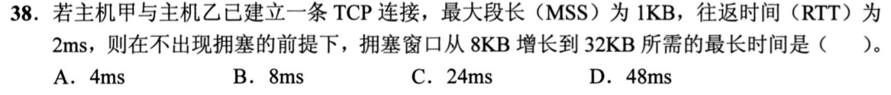

<details>
<summary>答案与解析</summary>

**答案：D。**

最长情况是从8KB起就处于拥塞避免，每个RTT只增加1个MSS，即1KB。增长24KB需要24个RTT，共24×2ms=48ms。4ms对应一直按慢开始翻倍8→16→32，是较快情况，题目问最长时间。

</details>

### 选择题7｜2020-39

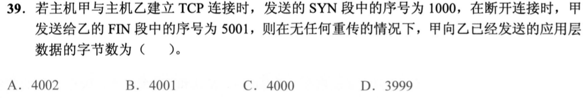

<details>
<summary>答案与解析</summary>

**答案：C。**

SYN使用序号1000，首个数据字节从1001开始；FIN的序号5001表示数据已经发到5000。应用数据量为5001−1001=4000B。SYN和FIN各占一个序号，但都不是应用数据。

</details>

### 选择题8｜2021-38

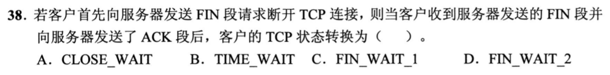

<details>
<summary>答案与解析</summary>

**答案：B。**

客户端主动关闭，发FIN后先后经过FIN_WAIT_1、FIN_WAIT_2；收到服务端FIN并发出最后ACK后进入TIME_WAIT，等待2MSL才关闭。CLOSE_WAIT属于收到对端FIN、等待本方应用关闭的一侧，不是此时的主动关闭客户端。

</details>

### 选择题9｜2021-39

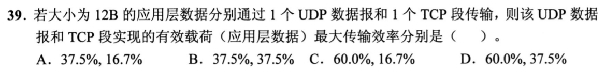

<details>
<summary>答案与解析</summary>

**答案：D。**

UDP最短首部8B，效率12/(12+8)=60%；TCP最短首部20B，效率12/(12+20)=37.5%。题目只算UDP数据报和TCP段本身，不额外加入IP首部或以太网首部；“最大”意味着TCP不带可选字段。

</details>

### 选择题10｜2021-40

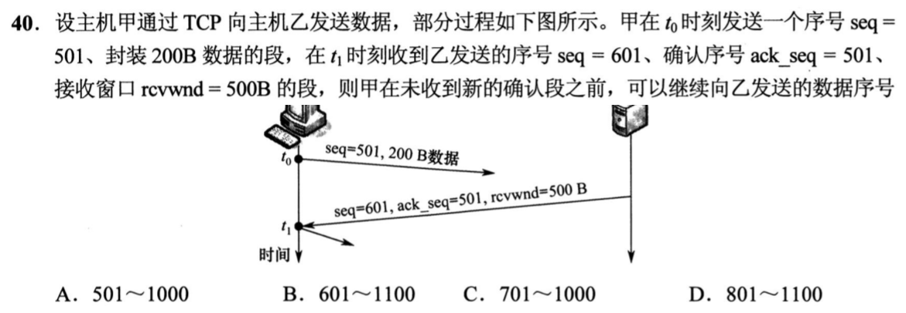

<details>
<summary>答案与解析</summary>

**答案：C。**

ack=501表示从501起仍未确认，接收窗口500B允许的序号为501～1000。甲已发送501～700共200B，所以还能新发701～1000。乙报文自己的seq=601属于反方向字节流，不能拿来确定甲的发送范围。

</details>

### 选择题11｜2022-38

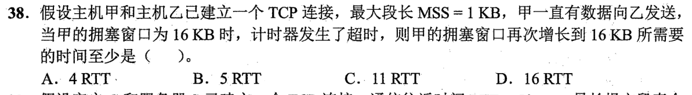

<details>
<summary>答案与解析</summary>

**答案：C。**

超时后门限减到8KB，cwnd重置为1KB。慢开始1→2→4→8用3RTT，达到门限后拥塞避免8→16每RTT增1KB，再用8RTT，共11RTT。不能超时后仍从8KB起步，也不能越过门限后继续翻倍。

</details>

### 选择题12｜2022-39

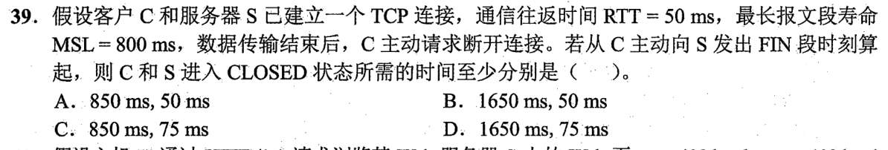

<details>
<summary>答案与解析</summary>

**答案：D。**

单程传播为25ms。服务端最快在25ms收到FIN并立即发ACK与FIN；客户端50ms收到FIN，回最后ACK并进入TIME_WAIT，等2MSL=1600ms，因此1650ms关闭。服务端75ms收到最后ACK即可关闭，不需要再等2MSL。

</details>

### 选择题13｜2024-38

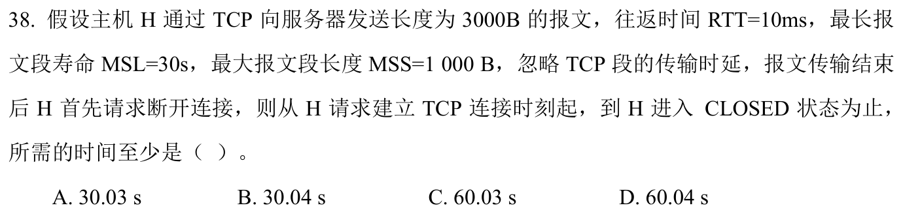

<details>
<summary>答案与解析</summary>

**答案：D。**

建连至可发数据耗时1RTT。按本题参考解采用的慢开始起始窗口1MSS，3个段分1+2两轮，耗时2RTT。主动关闭最短再花1RTT，随后等2MSL。合计60.04s。原题未明说初始拥塞窗口，若给定初始窗口至少3MSS，数据可一轮发完，结果会变为60.03s。

</details>

### 选择题14｜2024-39

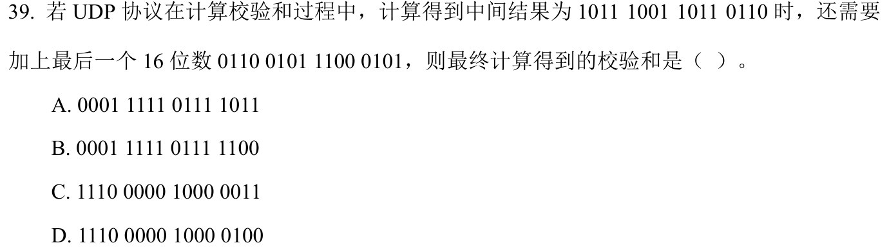

<details>
<summary>答案与解析</summary>

**答案：C。**

先做16位反码加法：B9B6H+65C5H=11F7BH；最高位进位回卷到低位，得1F7CH。最后逐位取反得E083H，即1110 0000 1000 0011。A漏了回卷且没取反，B只得到累加结果，D漏了进位回卷。

</details>

### 选择题15｜2025-38

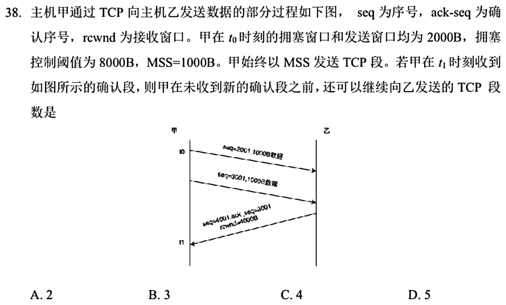

<details>
<summary>答案与解析</summary>

**答案：A。**

ack=3001确认了2001起的第一个1000B段，尚有3001～4000这一段在途。原cwnd=2000B且低于门限8000B，收到该ACK后增至3000B；接收窗口4000B，因此发送窗口为3000B。扣掉在途1000B还能新发2000B，即2段，不能把窗口3段当成还能再发3段。

</details>

### 选择题16｜2025-39

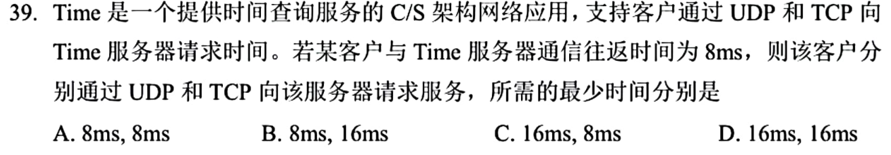

<details>
<summary>答案与解析</summary>

**答案：B。**

UDP请求和应答只花1RTT即8ms。TCP建连1RTT，第三次握手附请求，收到回应再花1RTT，共16ms。

</details>

## 解答题

### 大题1｜2025-46

[原题单 0928｜进程生命线：调度、输入与用户—内核边界](../src/0928.md)

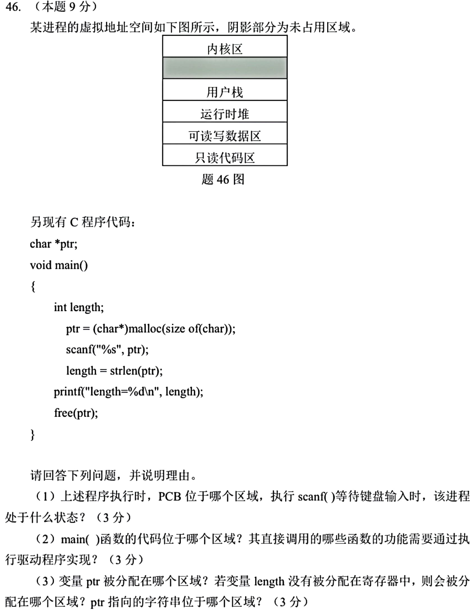

<details>
<summary>答案与解析</summary>

（1）PCB在内核区，由操作系统管理。scanf 等待键盘输入期间进程阻塞。

（2）main代码在只读代码区。题设以终端为I/O设备，scanf 读取键盘、printf 向终端输出，其底层需要系统调用和相应驱动。strlen 在用户态读字符串；malloc/free 管理进程堆，扩展堆等可能请求内核，无须依赖键盘或终端驱动。

（3）全局指针 ptr 在可读写数据区。length 未放寄存器时通常在用户栈。ptr 指向 malloc 分配的对象，位于运行时堆。题图中的分配大小只够一个 char，真实程序读普通非空字符串时还要预留结尾的空字符；这一点不改变各对象所在区。

</details>

## 一行记录

```text
实际用时__；未完成或未核对的题号__；今天最容易混淆的是__
```
