# Day 35｜数据结构＋操作系统

[← Day 34](day34.md) · [总入口](README.md) · [Day 36 →](day36.md)

**选择题：16道，来自两份完整src题单；大题：1道。** 先做选择题，再展开题下解析。组内题目沿用src顺序；标为复做的组，已会的快速通过，重点处理上次错题。

**预计用时：55—85分钟。** 选择题及核对约25—40分钟，大题约25—35分钟，最后用5—10分钟重做今天最值得记住的一道错题。约两小时是配题目标，不是必须耗满或到点强停；计算卡住时先保留题号，先完成其余选择题。

## 选择题组1｜0805 · 数据结构

[有序树：从局部旋转到多路分裂](../src/0805.md) · 9道 · 复做第1次。

### 选择题1｜2020-05

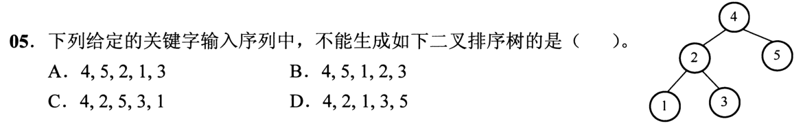

<details>
<summary>答案与解析</summary>

**答案：B。**

目标左子树根是2，故2必须在1、3之前插入。B先插1再插2，会把1变成4的左孩子，不能得到题图。

</details>

### 选择题2｜2020-10

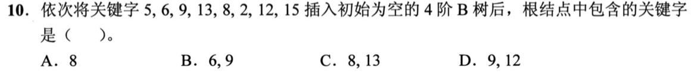

<details>
<summary>答案与解析</summary>

**参考答案：B（待逐题复核）。** 解析待补。

</details>

### 选择题3｜2021-06

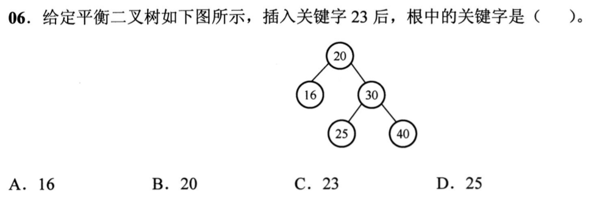

<details>
<summary>答案与解析</summary>

**参考答案：D（待逐题复核）。** 解析待补。

</details>

### 选择题4｜2021-09

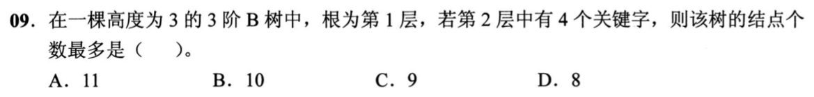

<details>
<summary>答案与解析</summary>

**参考答案：A（待逐题复核）。** 解析待补。

</details>

### 选择题5｜2022-08

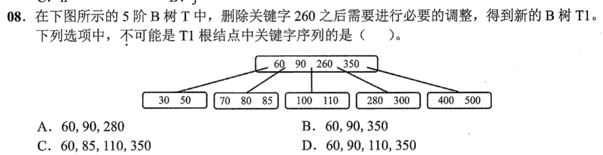

<details>
<summary>答案与解析</summary>

**参考答案：D（待逐题复核）。** 解析待补。

</details>

### 选择题6｜2023-07

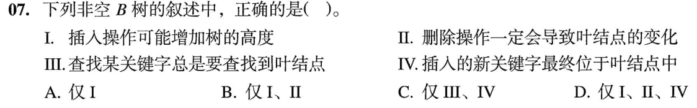

<details>
<summary>答案与解析</summary>

**答案：B。**

I插入根分裂可增高；II删除最终在叶层移除或调整关键字，会改变叶；III错，B树可在内部命中；IV错，插入关键字可分裂提升。选I、II。

</details>

### 选择题7｜2024-07

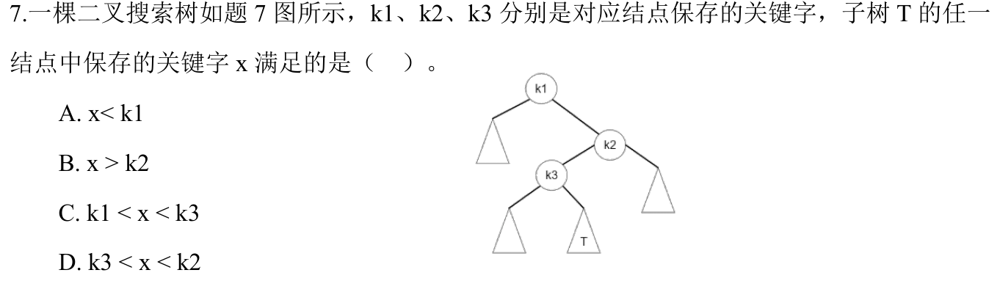

<details>
<summary>答案与解析</summary>

**答案：D。**

T在k3右侧且在k2左侧，所有x满足k3<x<k2，同时继承k1<x。D给出有效的更紧区间。

</details>

### 选择题8｜2025-08

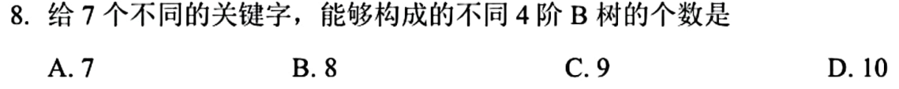

<details>
<summary>答案与解析</summary>

**参考答案：C（待逐题复核）。** 解析待补。

</details>

### 选择题9｜2026-08

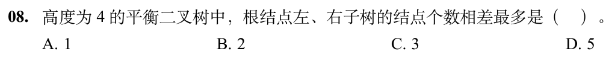

<details>
<summary>答案与解析</summary>

**答案与解析待补。**

</details>

## 选择题组2｜0831 · 操作系统

[设备服务：缓冲、磁盘与请求调度](../src/0831.md) · 7道 · 复做第2次。

### 选择题10｜2021-26

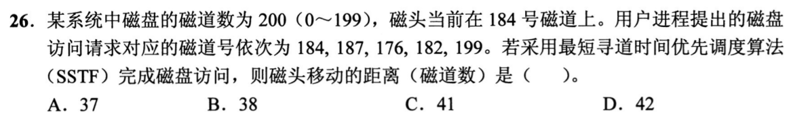

<details>
<summary>答案与解析</summary>

**参考答案：C（待逐题复核）。** 解析待补。

</details>

### 选择题11｜2022-32

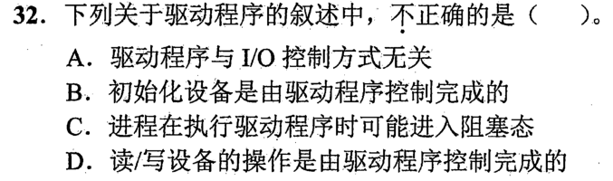

<details>
<summary>答案与解析</summary>

**参考答案：A（待逐题复核）。** 解析待补。

</details>

### 选择题12｜2023-32

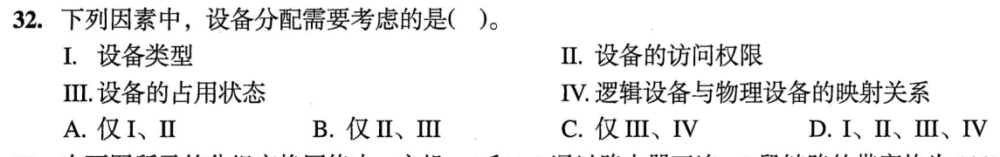

<details>
<summary>答案与解析</summary>

**参考答案：D（待逐题复核）。** 解析待补。

</details>

### 选择题13｜2024-31

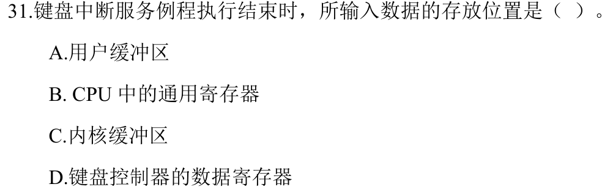

<details>
<summary>答案与解析</summary>

**答案：C。**

中断例程把字符放入内核缓冲区。CPU寄存器只是临时载体，用户缓冲区属于后续交付。

</details>

### 选择题14｜2024-32

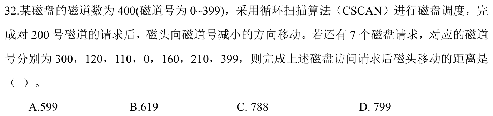

<details>
<summary>答案与解析</summary>

**参考答案：C（待逐题复核）。** 解析待补。

</details>

### 选择题15｜2026-31

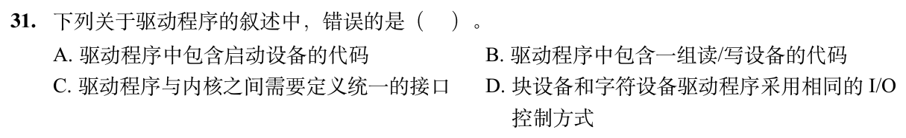

<details>
<summary>答案与解析</summary>

**答案：D。**

块设备和字符设备的传输单位与设备特性不同，I/O控制方式可以不同。它们仍可在内核规定的接口下提供启动和读写操作。

</details>

### 选择题16｜2026-32

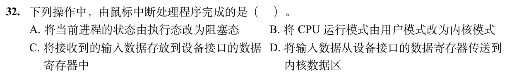

<details>
<summary>答案与解析</summary>

**答案与解析待补。**

</details>

## 解答题

### 大题1｜2025-47

[原题单 0930｜传输窗口：序号空间、确认与超时共同推进](../src/0930.md)

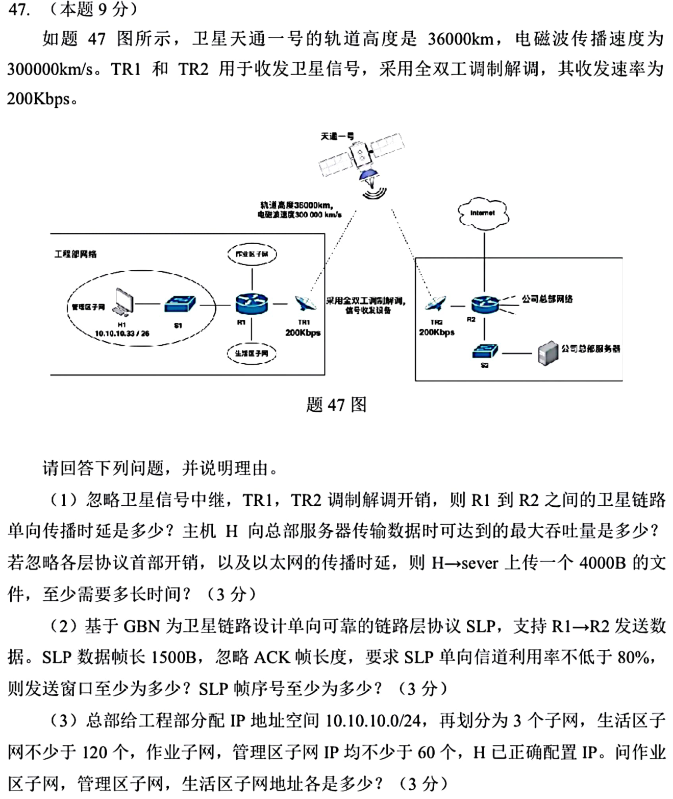

<details>
<summary>答案与解析</summary>

（1）单程传播时延为2×36000/300000=0.24s，单方向吞吐量由卫星链路限制为200kb/s。4000B序列化耗时0.16s，在题设忽略开销且按瓶颈链路下界计时的口径下，共0.40s。

（2）每帧1500×8/200000=0.06s，首帧发出到ACK返回需0.06+2×0.24=0.54s。利用率至少80%要求 W×0.06≥0.8×0.54，向上取整得8帧。GBN要求 W≤2ᵏ−1，最少4位序号。

（3）生活区需/25，另两区需/26。H1=10.10.10.33/26锁定管理区为10.10.10.0/26。作业区为10.10.10.64/26，生活区为10.10.10.128/25。

</details>

## 一行记录

```text
实际用时__；未完成或未核对的题号__；今天最容易混淆的是__
```
