# Day 36｜组成原理＋计算机网络

[← Day 35](day35.md) · [总入口](README.md) · [Day 37 →](day37.md)

**选择题：12道，来自两份完整src题单；大题：2道。** 先做选择题，再展开题下解析。组内题目沿用src顺序；标为复做的组，已会的快速通过，重点处理上次错题。

**预计用时：65—105分钟。** 选择题及核对约20—40分钟，大题约40—55分钟，最后用5—10分钟重做今天最值得记住的一道错题。约两小时是配题目标，不是必须耗满或到点强停；计算卡住时先保留题号，先完成其余选择题。

## 选择题组1｜0817 · 组成原理

[指令取数：格式、寻址与有效地址](../src/0817.md) · 4道 · 复做第1次。

### 选择题1｜2020-16

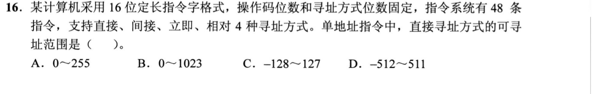

<details>
<summary>答案与解析</summary>

**答案：A。**

- **核心判据**：
  定长指令字各字段的刚性划分公式：
  $$\text{指令字长} = \text{操作码字段 OP} + \text{寻址方式特征位 Mode} + \text{形式地址码 A}$$
  - **直接寻址（Direct Addressing）**的有效地址等于形式地址码本身（$EA = A$）。在计算机底层，主存物理地址恒为**非负无符号整数**，因此 $k$ 位形式地址码在直接寻址下的寻址范围是无符号的 $[0, 2^k - 1]$。

- **正选推导**：
  1. 计算操作码位数：48 条指令 $\implies$ 操作码位数 $\ge \lceil \log_2 48 \rceil = 6$ 位；
  2. 计算寻址方式位数：4 种寻址方式 $\implies$ 寻址特征位 $\ge \lceil \log_2 4 \rceil = 2$ 位；
  3. 形式地址码字段位数：$16 - 6 - 2 = 8$ 位；
  4. 直接寻址将这 8 位形式地址直接作为无符号的主存单元地址，可寻址范围为：
     $$0 \sim 2^8 - 1 = \mathbf{0 \sim 255}$$
     选 A。

- **干扰项击穿**：
  - **C（-128～127）**：混淆了直接寻址与**相对寻址（Relative Addressing）**。相对寻址中地址码作为有符号补码位移量加到 PC 上，才会有负数偏移；直接寻址是主存物理绝对地址，绝无负数地址。
  - **B、D（0～1023 / -512～511）**：漏算了 2 位寻址方式特征位（误以为地址码占 $16 - 6 = 10$ 位）。

</details>

### 选择题2｜2022-19

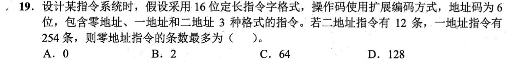

<details>
<summary>答案与解析</summary>

**答案：D。**

- **核心判据**：
  操作码扩展编码（Huffman 思想扩展码）的核心物理原则：
  - 高级（地址数多）指令的操作码作为低级（地址数少）指令的操作码**前缀**；
  - 某级指令未用满的操作码状态，可以通过吸收随后一个 6 位地址码字段，裂变扩展出 $2^6 = 64$ 倍的新状态。

- **正选推导**：
  1. **二地址指令分析**：
     - 指令字长 16 位，两个地址码各占 6 位（共 12 位），留给操作码的位数为 $16 - 12 = 4$ 位。
     - 4 位操作码最多有 $2^4 = 16$ 种编码状态；
     - 二地址指令占用了 12 条，留给一地址指令扩展的前缀数为：
       $$16 - 12 = 4\text{ 个前缀}$$
  2. **一地址指令分析**：
     - 一地址指令吸收一个 6 位地址字段作为操作码扩展，总操作码位数为 $4 + 6 = 10$ 位；
     - 4 个可用前缀能够派生出的一地址指令最大容量为：
       $$4 \times 2^6 = 4 \times 64 = 256\text{ 种状态}$$
     - 一地址指令实际占用了 254 条，留给零地址指令扩展的前缀数为：
       $$256 - 254 = 2\text{ 个前缀}$$
  3. **零地址指令分析**：
     - 零地址指令再吸收最后一个 6 位地址字段作为操作码，总操作码占满 16 位；
     - 2 个剩余前缀可裂变出的零地址指令条数最多为：
       $$2 \times 2^6 = 2 \times 64 = \mathbf{128\text{ 条}}$$
     - 选 D。

- **干扰项击穿**：
  - **B（2 条）**：典型致命误解！误以为一地址剩 2 个前缀，零地址就只能有 2 条。忽略了零地址指令会彻底吞并第二个 6 位地址码，每个前缀都能衍生出 64 条零地址指令！
  - **C（64 条）**：只将 1 个前缀进行了扩展，遗漏了剩余的另一个前缀。

</details>

### 选择题3｜2023-17

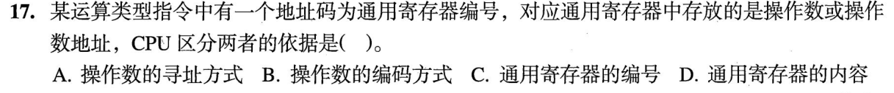

<details>
<summary>答案与解析</summary>

**答案：A。**

- **核心判据**：
  冯·诺依曼计算机的硬件控制逻辑本质：
  - 寄存器是通用的位存储单元，内部存放的 0/1 位串没有任何硬件标签或自解释属性，无法从内容本身判定其属于数据还是地址（排除 D）；
  - 通用寄存器编号（如 R0~R15）仅供译码器进行多路物理选通，与存放内容的逻辑语义无关（排除 C）；
  - **CPU 解释寄存器内容的唯一依据是指令中规定的寻址方式（Addressing Mode）**：
    - **寄存器直接寻址**：指令规定寄存器内容直接作为操作数，送入 ALU 进行运算；
    - **寄存器间接寻址**：指令规定寄存器内容作为内存地址，送入 MAR 访问主存读取操作数。

- **正选推导**：
  CPU 区分通用寄存器中存放的是操作数还是操作数地址，依据的是**操作数的寻址方式**。选 A。

</details>

### 选择题4｜2026-17

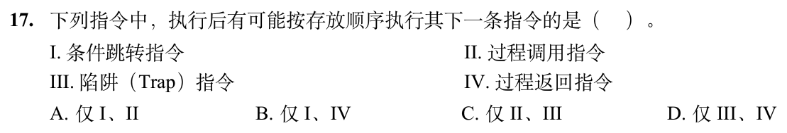

<details>
<summary>答案与解析</summary>

**答案：B。**

- **核心判据**：
  控制流转移指令执行后程序计数器（PC）的更新机制：
  - “按存放顺序执行其下一条指令”即执行时硬件满足：$\text{PC} \leftarrow \text{PC} + \text{指令长度}$。
  - 题干考查的是“**有可能**”成立的指令类型。

- **正选推导**：
  - **I 条件跳转指令（Branch）**：当测试条件不满足时，不发生跳转，硬件直接执行 $\text{PC} \leftarrow \text{PC} + 4$，**顺理成章执行下一条指令**（I 成立）。
  - **II 过程调用指令（Call）**：其无条件语义是跳转至子程序入口，并压栈保存返回地址，必定离开当前代码段，绝不会顺序执行下一条。
  - **III 陷阱指令（Trap）**：属于软中断，强制修改 PC 跳转至操作系统内核的中断向量入口，绝不可能就地顺序执行下一条。
  - **IV 过程返回指令（Return）**：执行 $\text{PC} \leftarrow \text{Pop()}$。**如果之前保存的返回地址碰巧就是当前返回指令的下一条物理存放地址**（例如递归、动态计算返回点、或者子程序在特定调用流下返回），硬件加载该地址后完全**有可能**执行下一条指令。由于设问限定“有可能”，IV 成立。
  故可能按存放顺序执行下一条指令的是 I、IV，选 B。

</details>

## 选择题组2｜0904 · 计算机网络

[局域网转发：介质竞争、MAC与交换机](../src/0904.md) · 8道 · 复做第2次。

### 选择题5｜2020-35

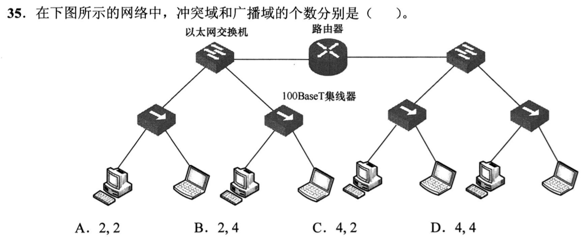

<details>
<summary>答案与解析</summary>

**答案：C。**

* **核心判据**：网络设备物理隔离层次不变量：
  * **集线器（Hub，物理层）**：本质是多端口中继器，既不能隔离冲突域，也不能隔离广播域；连接到同一个集线器上的所有节点属于同一个共享冲突域。
  * **以太网交换机（Switch，数据链路层）**：能够隔离冲突域，每个交换机端口都是一个独立的冲突域；但默认不隔离广播域。
  * **路由器（Router，网络层）**：每个端口都是一个独立的广播域，严格物理隔绝二层广播风暴。
* **正选推导**：
  1. 拓扑中 4 个集线器分别独立连接到以太网交换机的 4 个端口，各自构成 **4 个独立的共享冲突域**（交换机与路由器之间的链路属于点对点全双工专线，不计入共享冲突域）；
  2. 中间的路由器将网络物理分割为左右 **2 个广播域**；
  3. 故包含 4 个冲突域、2 个广播域，选 C。

</details>

### 选择题6｜2020-37

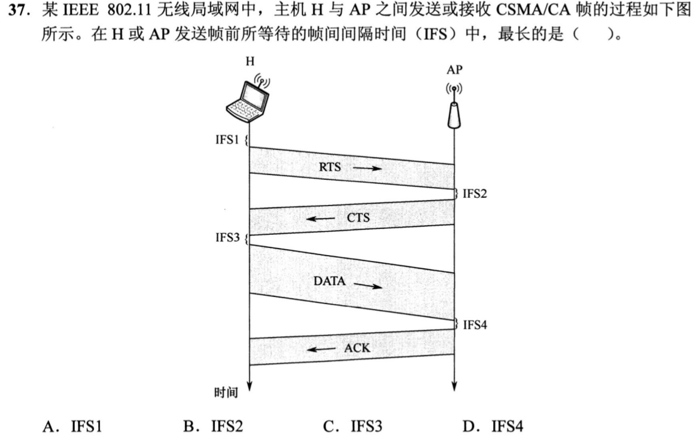

<details>
<summary>答案与解析</summary>

**答案：A。**

* **核心判据**：IEEE 802.11 协议帧间间隔（IFS）优先级控制机制：
  * **规则：帧间间隔越短，信道抢占优先级越高**；
  * **SIFS（短帧间间隔）**：持续时间最短，优先级最高。专门用于已经建立握手的会话保护（如发送 CTS、ACK、DATA 分片），确保已经取得信道的通信过程不被其他任何第三方站点打断插队；
  * **DIFS（分布式协调帧间间隔）**：持续时间最长，优先级较低。所有站点在**初次发起信道争用**（如首次发送 RTS 帧或普通数据帧）前，必须持续监测信道空闲达到 DIFS 才能启动退避计时。
* **正选推导**：
  * IFS1 是发送首个控制帧 RTS 之前必须等待的间隔，采用的是最长的 **DIFS**；
  * IFS2（回送 CTS 前）、IFS3（发送 DATA 前）、IFS4（回送 ACK 前）均处于会话持续保护期，采用的均是极短的 **SIFS**；
  * 故持续时间最长的严格是 **IFS1**，选 A。

</details>

### 选择题7｜2022-37

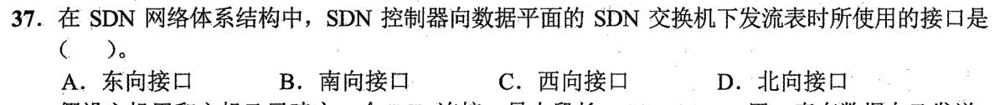

<details>
<summary>答案与解析</summary>

**答案：B。**

* **核心判据**：软件定义网络（SDN）分层平面接口定义：
  * **南向接口（Southbound API，如 OpenFlow）**：连接**控制平面（SDN 控制器）**与**数据平面（底层转发交换机）**，用于控制器下发流表项（Flow Table）和采集链路状态；
  * **北向接口（Northbound API）**：连接**控制平面**与上层**网络应用平面（业务编排、安全监控软件）**。
* **正选推导**：控制平面向数据平面下发流表规则使用的标准接口是**南向接口**，选 B。

</details>

### 选择题8｜2023-36

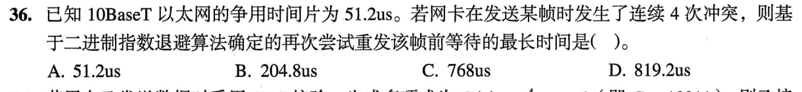

<details>
<summary>答案与解析</summary>

**答案：C。**

* **核心判据**：CSMA/CD 协议截断二进制指数退避算法（Truncated Binary Exponential Backoff）：
  * 发生第 $k$ 次冲突（$k \le 10$）时，退避时隙数 $r$ 从离散整数集合 $[0, 2^k - 1]$ 中均匀随机选取；
  * 最大退避时间对应选取最大的退避时隙数：$r_{\max} = 2^k - 1$；
  * 最大可能退避等待时间 $= r_{\max} \times 2\tau$（其中 $2\tau = 51.2\,\mu\text{s}$ 为基本争用期）。
* **正选推导**：
  * 题设发生第 4 次冲突，则 $k = 4$；
  * 随机数可选集合为 $[0, 2^4 - 1] = [0, 15]$；
  * 最大可能退避时隙数为 $r_{\max} = 15$；
  * 最大可能退避等待时间 $= 15 \times 51.2\,\mu\text{s} = \mathbf{768\,\mu\text{s}}$，选 C。
* **干扰项击穿**：
  * 误区：错把可选上界算成 $2^4 = 16$（算得 $16 \times 51.2 = 819.2\,\mu\text{s}$）。集合严格是 $[0, 2^k - 1]$，不包含 $2^k$。

</details>

### 选择题9｜2024-35

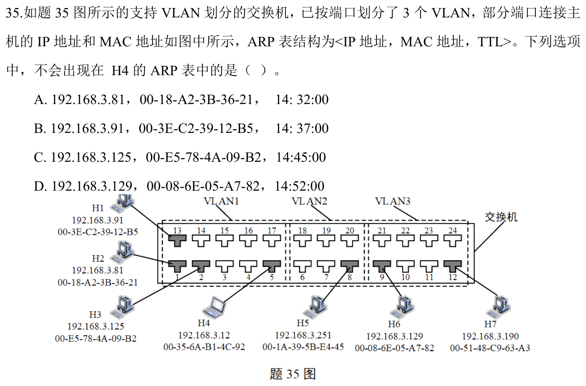

<details>
<summary>答案与解析</summary>

**答案：D。**

* **核心判据**：VLAN（虚拟局域网）的二层广播硬隔离不变量：
  * **VLAN 的物理本质是划分二层广播域**；
  * 主机发送 ARP 请求报文时，其以太网目的 MAC 地址是全 F 广播（`FF-FF-FF-FF-FF-FF`）；
  * 二层交换机在处理广播帧时，**严格限制广播帧只能在发送该帧的本 VLAN 内部泛洪，绝不允许跨越 VLAN 边界扩散**！
* **正选推导**：
  * H4 位于 **VLAN 1**，其发出的 ARP 请求广播帧只能泛洪至同属于 VLAN 1 的主机（H1、H2、H3）；
  * 主机 H6 位于 **VLAN 3**，二层广播物理隔绝，H6 根本不可能收到 H4 发送的 ARP 请求，因此 H6 绝对不会产生 ARP 应答，H4 的 ARP 缓存表中绝不可能学习到 H6 的 MAC 地址，选 D。
* **干扰项击穿**：
  * 即使跨 VLAN 主机的人工 IP 看起来配置在同一个逻辑子网内，但二层广播完全被 VLAN 隔离，没有三层路由器的介导，二层 ARP 广播根本无法互通。

</details>

### 选择题10｜2024-36

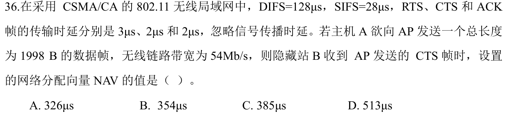

<details>
<summary>答案与解析</summary>

**答案：B。**

* **核心判据**：802.11 虚拟载波监听网络分配向量（NAV）预约模型：
  * **NAV 持续时间字段的物理定义**：当前帧之后，**直到整轮数据交互彻底收尾（收到对方最终的 ACK 确认帧）为止所需的全部剩余物理时长**；
  * 第三方站点接收到该帧后，依据 NAV 设置自己的虚拟忙等定时器，在 NAV 期间禁止尝试发射以避免碰撞。
* **正选推导**：
  1. 主机 B 收到 CTS 帧时，本轮通信后续还需要完成的动作序列为：
     $$\text{等待 SIFS} \to \text{发送 DATA 帧} \to \text{等待 SIFS} \to \text{回送 ACK 帧}$$
  2. 计算 DATA 帧的物理发送时延：
     $$t_{\text{DATA}} = \frac{1998 \times 8\text{ bit}}{54 \times 10^6\text{ bit/s}} = \frac{15984}{54}\,\mu\text{s} = 296\,\mu\text{s}$$
  3. 累加全部后续保留时延：
     $$\text{NAV} = \text{SIFS} + t_{\text{DATA}} + \text{SIFS} + t_{\text{ACK}} = 28\,\mu\text{s} + 296\,\mu\text{s} + 28\,\mu\text{s} + 2\,\mu\text{s} = \mathbf{354\,\mu\text{s}}$$
  * 故选 B。
* **干扰项击穿**：
  * 已经完成的 RTS 和 CTS 耗时绝不能计入未来预约时长；最初争用信道的 DIFS 也属于前置开销，不包含在 NAV 预约范围内。

</details>

### 选择题11｜2025-35

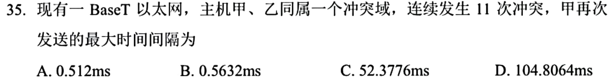

<details>
<summary>答案与解析</summary>

**答案：C。**

* **核心判据**：以太网退避算法指数截断上限原则：
  * 当冲突次数 $k \le 10$ 时，退避参数取 $k$；
  * **当冲突次数 $k > 10$ 时，退避指数被强制截断固定为 10**（即无论发生第 11 次还是第 15 次冲突，退避参数 $k$ 恒定取 10，防止退避时延无限发散）；
  * 最大退避时隙数固定为 $r_{\max} = 2^{10} - 1 = 1023$。
* **正选推导**：
  1. 发生第 11 次冲突，触发截断机制，指数取 $k = 10$；
  2. 随机数选取区间为 $[0, 2^{10} - 1] = [0, 1023]$；
  3. 最大退避时间 $= 1023 \times 51.2\,\mu\text{s} = 52377.6\,\mu\text{s} \approx \mathbf{52.38\text{ms}}$，选 C。
* **干扰项击穿**：
  * 切勿盲目套用公式算成 $2^{11} - 1 = 2047$；退避算法在 10 次冲突后必须截断封顶。

</details>

### 选择题12｜2026-36

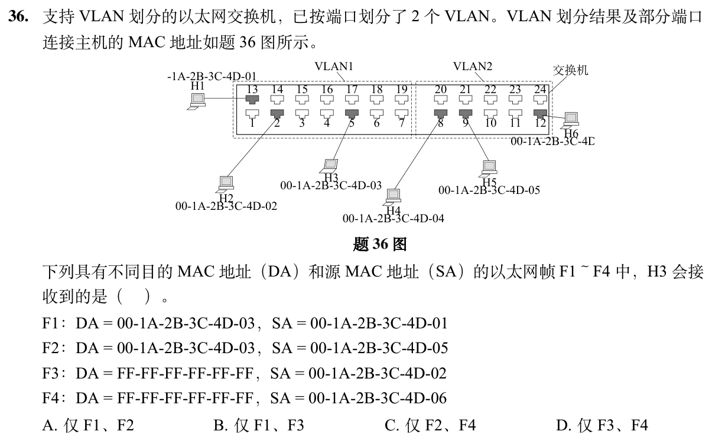

<details>
<summary>答案与解析</summary>

**答案：B。**

* **核心判据**：以太网交换机 VLAN 转发基本法则：
  * **二层交换机只在接收端口所属的 VLAN 内部进行帧转发**；
  * 任何跨越 VLAN 边界的单播或广播，在二层均会被交换机直接阻断丢弃；
  * **广播域划分先于目的 MAC 查找**：只有当源端口与目的主机同属一个 VLAN 时，单播或广播帧才可能被送达。
* **正选推导**：
  * **F1（H1 发给 H3 的单播帧）**：H1 与 H3 同属于 VLAN 1，属于同一局域网内的单播通信，H3 能收到；
  * **F2（H5 发给 H3 的单播帧）**：H5 属于 VLAN 2，虽然帧头目的 MAC 填写的是 H3，但来自不同的 VLAN 2，二层交换机绝不跨 VLAN 转发单播，H3 无法收到；
  * **F3（H2 发出的广播帧）**：H2 属于 VLAN 1，广播帧在 VLAN 1 内部全域泛洪，H3 能收到；
  * **F4（H6 发出的广播帧）**：H6 属于 VLAN 2，广播帧被严格封闭在 VLAN 2 内部，H3 无法收到。
  * 综合得出，H3 能够接收到的帧只有 **F1 和 F3**，选 B。

</details>

## 解答题

### 大题1｜2024-47

[原题单 0929｜寻址与路由：从前缀匹配到路由协议收敛](../src/0929.md)

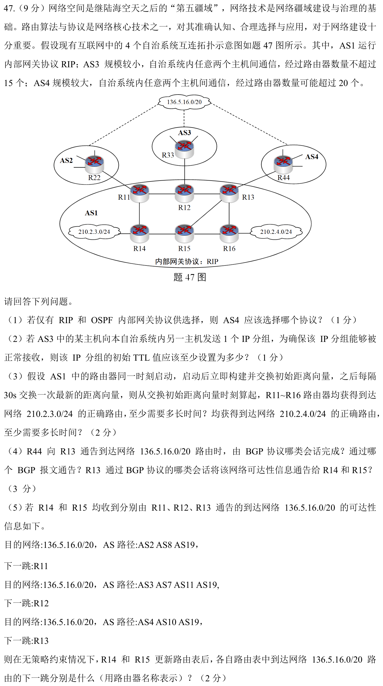

<details>
<summary>答案与解析</summary>

（1）AS4选OSPF。RIP以16为不可达，不能支持题设可能超过20台路由器的路径。

（2）AS3最多经过15台路由器，每次转发TTL减1，要到目的主机时仍可交付，初始TTL至少16。

（3）初始向量在起始时刻立即交换，此后每30s一轮。210.2.3.0/24直连R14，t=0时R11、R15得知，t=30s时R12、R13、R16得知，全网至少30s。210.2.4.0/24直连R16，t=0时R13、R15得知，t=30s时R12、R14得知，t=60s时最远的R11得知，全网至少60s。不能把“初次立即交换”再额外记为30s。

（4）R44→R13为外部BGP（eBGP）会话，用UPDATE报文通告；R13向同一AS中的R14、R15通过内部BGP（iBGP）会话传播可达性。

（5）先比AS_PATH长度，R11与R13通告的路径均为3个AS，R12通告为4个AS，先排除R12。在题设无其他策略差异时，比较到出口的内部开销。R14到R11一跳，到R13两跳，选R11；R15到R13一跳，到R11两跳，选R13。先选外部路径属性，再用内部距离打破平局，不能一开始只看出口离自己多近。

</details>

### 大题2｜2023-47

[原题单 0930｜传输窗口：序号空间、确认与超时共同推进](../src/0930.md)

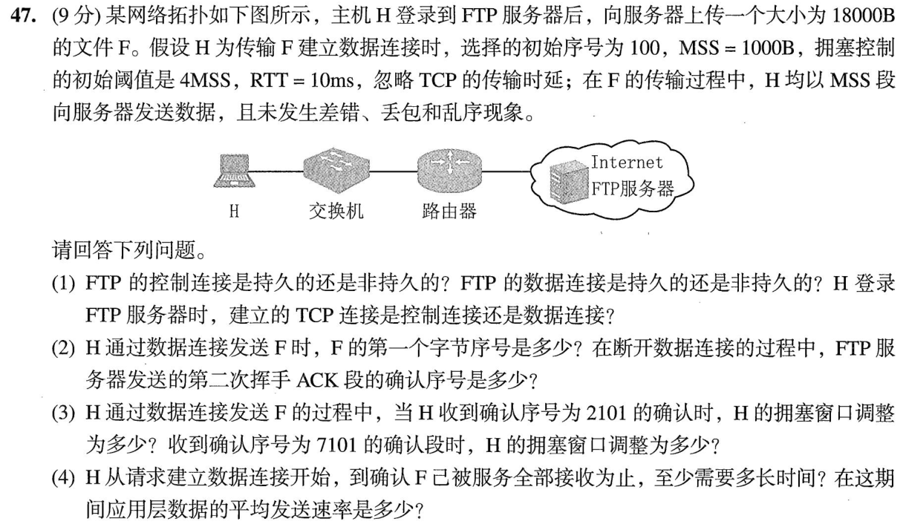

<details>
<summary>答案与解析</summary>

（1）FTP控制连接在整个会话期间保持，属于持续连接；数据连接用于本次文件传输，传完关闭，属于非持续连接。登录时建立的是控制连接。

（2）数据连接初始序号100，SYN占一个序号，文件首字节序号为101。18000B传完后下一字节序号18101，H的FIN又占一个序号；服务器对H的FIN发出的第二次挥手ACK，确认号为18102。

（3）原题只给慢开始门限。按这道题参考解采用的初始 cwnd=1MSS 推算。ACK1101确认第1段，窗口增为2MSS；随后ACK2101确认第2段，仍处慢开始，增为3MSS，即3000B。第一轮1段、第二轮2段后窗口达到门限4MSS。第三轮确认完第4—7段（ACK7101）后，按题目常用拥塞避免模型增为5MSS，即5000B。

（4）忽略发送时延，RTT=10ms，收到SYN+ACK后即可携带第三次握手ACK开始发数据：

| 从请求建连起 | 本轮发送段数 | 累计发送段数 |
|---|---:|---:|
| 10ms | 1 | 1 |
| 20ms | 2 | 3 |
| 30ms | 4 | 7 |
| 40ms | 5 | 12 |
| 50ms | 6 | 18 |
| 60ms | 收到最后一批确认 | 18 |

因此从请求建连到确认文件全部收到至少60ms，平均应用数据速率18000B/0.06s=300000B/s=2.4Mb/s。题目截止到文件确认，不再加断开连接耗时，也不能把FTP早已完成的登录再算一遍。

</details>

## 一行记录

```text
实际用时__；未完成或未核对的题号__；今天最容易混淆的是__
```
