# Day 37｜数据结构＋操作系统

[← Day 36](day36.md) · [总入口](README.md) · [Day 38 →](day38.md)

**选择题：19道，来自两份完整src题单；大题：1道。** 先做选择题，再展开题下解析。组内题目沿用src顺序；标为复做的组，已会的快速通过，重点处理上次错题。

**预计用时：60—95分钟。** 选择题及核对约30—50分钟，大题约25—35分钟，最后用5—10分钟重做今天最值得记住的一道错题。约两小时是配题目标，不是必须耗满或到点强停；计算卡住时先保留题号，先完成其余选择题。

## 选择题组1｜0806 · 数据结构

[图的骨架：表示、遍历与连通](../src/0806.md) · 6道 · 复做第1次。

### 选择题1｜2020-06

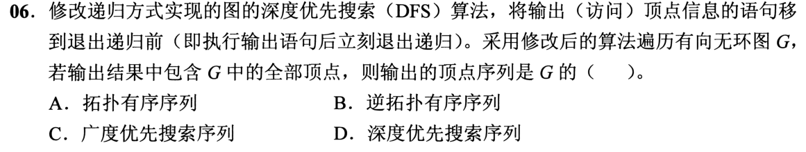

<details>
<summary>答案与解析</summary>

**答案：B。**

* **核心判据**：DFS 递归退栈与拓扑序列的逆序对应原理：
  * 在有向无环图（DAG）中，对任意有向边 $\langle u, v \rangle$，$v$ 是 $u$ 的后继；
  * 当 DFS 访问到 $u$ 时，它会沿着边递归遍历 $u$ 的所有后继节点。只有当以 $v$ 为起点的子图搜索全部完成并从递归函数返回之后，$u$ 才会结束其后继遍历；
  * 若将输出顶点的操作移到**退出递归前**（即后序遍历位置），则对于任何有向边 $\langle u, v \rangle$，$v$ 必然先于 $u$ 退出递归并输出；
  * 因此，每一个后继节点必定排在其前驱节点之前输出，所得序列严格为图 $G$ 的**逆拓扑有序序列**。
* **正选推导**：
  * 设算法函数框架为：
    $$\text{DFS}(u): \; \text{visited}[u]=\text{true}; \; \forall v \in \text{Adj}[u], \text{if}(!\text{visited}[v]) \; \text{DFS}(v); \; \mathbf{print}(u);$$
  * 在 DAG 中无环，不存在回溯到自身祖先的反向边。任意顶点 $u$ 调用退出前，其所有可达后继均已完全退出并输出完毕。
  * 输出序列中终点始终位于起点之前，完全符合逆拓扑序定义，选 B。
* **干扰项击穿**：
  * **A项（拓扑有序序列）**：拓扑有序要求前驱在前、后继在后。将输出放在进入递归处（先序）并不能保证拓扑序（因为前驱节点可能跨分支滞后访问）；获得拓扑序的标准做法是对逆拓扑序使用栈进行逆序反转，或使用基于入度为 0 的 Kahn 算法。
  * **C项（广度优先搜索序列）**：BFS 依靠 FIFO 队列按距离逐层展开，递归 DFS 走的是系统调用栈（LIFO），两者遍历机制完全不同。
  * **D项（深度优先搜索序列）**：常规所称的 DFS 序列是顶点**首次被访问（先序入栈）**时的序列。将输出移至退出递归前（后序出栈）彻底反转了先后次序。

</details>

### 选择题2｜2022-06

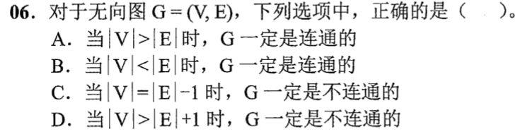

<details>
<summary>答案与解析</summary>

**答案：D。**

* **核心判据**：无向图连通性与生成树边数下界不变量：
  * 任意包含 $|V|$ 个顶点的无向连通图，必定包含至少一棵支撑生成树；
  * 一棵树恰好有 $|V|-1$ 条边。因此，无向图连通的**绝对必要条件**为：
    $$|E| \ge |V| - 1$$
  * 其**逆否命题**恒成立：若边数严格不足以构成一棵生成树，即 $|E| < |V| - 1$（移项整理得 $|V| > |E| + 1$），则该无向图**绝不可能连通**（连通分量数 $k \ge |V| - |E| > 1$）。
* **正选推导**：
  * 设无向图 $G$ 包含 $k$ 个极大连通分量 $G_1, G_2, \dots, G_k$。
  * 每个连通分量各有一棵生成树，边数满足 $|E_i| \ge |V_i| - 1$。
  * 全图总边数：$|E| = \sum_{i=1}^k |E_i| \ge \sum_{i=1}^k (|V_i| - 1) = |V| - k$；
  * 变形可得连通分量数的物理下界：
    $$k \ge |V| - |E|$$
  * 当 $|V| > |E| + 1$ 时，$k \ge |V| - |E| > 1$，连通分量个数至少为 2，全图必然不连通，D 选项为真命题。
* **干扰项击穿**：
  * **A项（$|V|>|E|$ 时必连通）**：反例极易构造，如 $|V|=3, |E|=1$（两个点连一条边，第三个点为孤立点），此时 $|V|>|E|$ 显然不连通。
  * **B项（$|V|<|E|$ 时必连通）**：边多可以局部形成密集回路，而外部存在孤立点。例如 4 个顶点，其中 3 个顶点两两连边构成三角形环（包含 3 条边），再在其中加重边使得 $|E|=4$，但第 4 个顶点始终孤立不连通。
  * **C项（$|V|=|E|-1$ 时必不连通）**：即 $|E|=|V|+1$。例如 4 个顶点构成的简单连通图包含 5 条边（完全图 $K_4$ 去掉一条边），全图高度连通，“必不连通”结论荒谬。

</details>

### 选择题3｜2023-06


<details>
<summary>答案与解析</summary>

**答案：B。**

* **核心判据**：最小生成树（MST）与单源最短路径（SPT）的目标泛函根本差异：
  * **生成树目标**：最小化全图所有边的**总权值和**（$\min \sum_{e \in T} w(e)$），它对特定源点到各顶点的单条路径长度没有任何保证；
  * **等权图的特殊性质**：当全图所有边权值均为 1 时，任意一棵包含 $|V|-1$ 条边的生成树其总权值均为 $|V|-1$。这意味着**原图中的任意生成树都是最小生成树**！显然，随意挑选的一棵生成树根本无法保证源点到目标顶点的路径长度最短；
  * **BFS 的最短路径特性**：广度优先搜索依赖 FIFO 队列推进，每次按边数层次递增。当边权全为 1 时，路径权值和即为边数，顶点**首次被访问出队时的路径必然是边数最少的最短路径**。
* **正选推导**：
  * 在所有边权均为 1 的图中：
    * 路径权值等于路径所含边数；
    * BFS 算法从源点出发，距离为 1 的顶点最先入队并访问，接着是距离为 2 的顶点……满足单调性与无权最短路径充要条件，时间复杂度为最优的 $O(|V|+|E|)$，III 必然正确。选 B。
* **干扰项击穿**：
  * **反例击穿 Prim 与 Kruskal（I、II 错误）**：
    * 构造 4 个顶点构成的环形加弦图：顶点 $A, B, C, D$，边为 $(A, B), (B, C), (C, D), (D, A)$ 以及直连对角弦 $(A, C)$，所有边权均为 1；
    * 求从源点 $A$ 到 $C$ 的最短路径：原图中直连边 $(A, C)$ 长度为 1；
    * 运行 Prim 或 Kruskal 算法时，由于所有边权均为 1，选边完全由遍历顺序决定。若算法选择生成树边为 $(A, B), (B, C), (C, D)$（总权值为 3，是一棵合法的最小生成树）；
    * 此时在生成树上，从 $A$ 到 $C$ 的唯一路径是 $A \to B \to C$，路径权值为 2 $\ne$ 最短距离 1！
    * 证明 MST 树上路径不能保证为原图单源最短路径。

</details>

### 选择题4｜2024-04

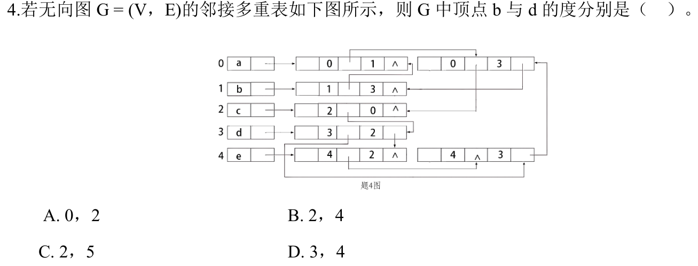

<details>
<summary>答案与解析</summary>

**答案：B。**

* **核心判据**：邻接多重表（Adjacency Multilist）的物理存储语义：
  * 邻接多重表是无向图的链式存储结构，每条无向边只用**唯一的一个边节点**表示；
  * 边节点标准结构为：`[mark | ivex | ilink | jvex | jlink]`，其中 `ivex` 与 `jvex` 记录该边连接的两个顶点下标；`ilink` 指向下一条依附于顶点 `ivex` 的边，`jlink` 指向下一条依附于顶点 `jvex` 的边；
  * 某个顶点 $v$ 的**度（Degree）**，在物理本质上等于**全图中所有包含该顶点下标（无论作为 ivex 还是作为 jvex）的边节点总数**。
* **正选推导**：
  * 顶点与下标对应：0: a, 1: b, 2: c, 3: d, 4: e。
  * **求顶点 b（下标 1）的度**：
    * 检索题图全部边节点中包含下标 1 的边：
      1. 边节点 `[0 | 1]`（连接 a 与 b）；
      2. 边节点 `[1 | 3]`（连接 b 与 d）；
      3. 其余边节点均不含 1；
    * 依附于 b 的边恰好有 2 条，因此顶点 b 的度为 **2**。
  * **求顶点 d（下标 3）的度**：
    * 检索题图全部边节点中包含下标 3 的边：
      1. 边节点 `[0 | 3]`（连接 a 与 d）；
      2. 边节点 `[1 | 3]`（连接 b 与 d）；
      3. 边节点 `[3 | 2]`（连接 d 与 c）；
      4. 边节点 `[4 | 3]`（连接 e 与 d）；
    * 依附于 d 的边恰好有 4 条，因此顶点 d 的度为 **4**。
  * 综上，b 与 d 的度分别为 2 和 4，选 B。
* **干扰项击穿**：
  * **C项（2, 5）**：错误地把顶点 3 表头指针或某个指针跨跳多算了一次，或者误将邻接多重表的共享指针当成独立边节点。
  * **A/D项**：只追踪了顶点自身单向引出的边，忽略了该顶点出现在 `jvex` 域时的关联边。

</details>

### 选择题5｜2025-06

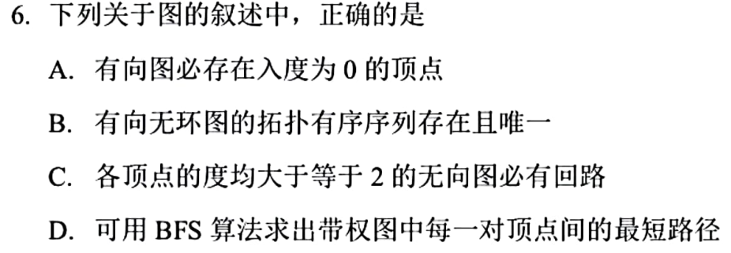

<details>
<summary>答案与解析</summary>

**答案：C。**

* **核心判据**：无向无环图的极值度数定理（握手定理推论）：
  * 在任何无向无环图（由若干棵树构成的森林，且含边）中，设任意一个连通分支为一棵包含 $n \ge 2$ 个顶点的树，边数恒为 $n-1$；
  * 由握手定理，该连通分支所有顶点的度数之和为 $2(n-1) = 2n-2$；
  * 顶点平均度数为 $\frac{2n-2}{n} = 2 - \frac{2}{n} < 2$。根据鸽巢原理，**无向无环图中必定至少存在度数 $\le 1$ 的叶节点（度为 1 或孤立点度为 0）**；
  * 其**逆否命题**：若一个无向图的所有顶点度数均满足 $d(v) \ge 2$，则该图绝不可能是一棵树或森林，**必定包含至少一条回路**！
* **正选推导**：
  * 路径推演法：任选图中的一个顶点 $v_1$。由于 $d(v_1) \ge 2$，必有一条边引向 $v_2$；在 $v_2$ 处，除进来的边外至少还有一条边可引向 $v_3$……以此类推，路径可一直向前延伸。
  * 由于有限图顶点数有限，不可能无限探索新顶点，这条延伸路径必然会在有限步内访问到一个之前已经访问过的顶点，从而形成闭合简单回路。故 C 正确。
* **干扰项击穿**：
  * **A项（有向图必存在入度为 0 的顶点）**：反例为有向回路。如 3 个顶点构成的有向环 $A \to B \to C \to A$，每个顶点的入度与出度均为 1，全图不存在入度为 0 的点。
  * **B项（DAG 的拓扑有序序列存在且唯一）**：拓扑序列存在但**不一定唯一**。只要图中存在任意一对没有先后拓扑依赖约束的顶点（如两个独立的入度为 0 的顶点，或菱形分叉），它们的输出先后次序可以任意对调，产生多种拓扑序列。只有当拓扑排序过程中任何时刻入度为 0 的顶点始终唯一时，拓扑序列才唯一。
  * **D项（可用 BFS 求带权图最短路径）**：BFS 基于 FIFO 队列分层推进，只对**无权图或所有边权均相等**的图有效。在一般带权图中，边数少的路径权值和未必小于边数多的路径，必须使用 Dijkstra 算法或 Floyd 算法。

</details>

### 选择题6｜2026-06

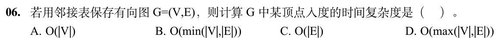

<details>
<summary>答案与解析</summary>

**答案：D。**

* **核心判据**：有向图邻接表单向出边存储的非对称检索代价：
  * 标准邻接表（Adjacency List）为每个顶点建立一个单链表，存储的是以该顶点为起点的**所有出边**；
  * 要计算某个特定顶点 $v$ 的**入度（In-degree）**，必须找出全图中所有指向 $v$ 的有向边 $\langle u, v \rangle$；
  * 由于缺乏反向索引，必须**遍历全图全部 $|V|$ 个顶点的边链表头，并沿着单链表逐一扫描全部 $|E|$ 个边节点**，核对目的顶点是否为 $v$；
  * 因此，总操作量为遍历 $|V|$ 个表头数组项 + 遍历全部 $|E|$ 个边节点，其渐进时间复杂度为 $O(|V| + |E|)$。
* **正选推导**：
  * 在大 $O$ 复杂度数学定义中，对于两个非负自变量 $|V|$ 与 $|E|$：
    $$\max(|V|, |E|) \le |V| + |E| \le 2\max(|V|, |E|)$$
  * 因此，$O(|V| + |E|)$ 与 $O(\max(|V|, |E|))$ 严格等阶，D 选项表达正确。
* **干扰项击穿**：
  * **为什么不能写成 $O(|E|)$（C项错误）**：
    * 考察**极端极稀疏图**（如完全无边的无向/有向图，此时 $|E|=0$）：全图依然有 $|V|$ 个顶点表头。算法必须用一个循环逐一检查这 $|V|$ 个指针是否为 NULL，循环必须执行 $|V|$ 次，耗时为 $\Theta(|V|)$。若复杂度标为 $O(|E|)$，在 $|E|=0$ 时将导出 $O(0)$ 的荒谬结论。
  * **A项（$O(|V|)$）**：仅适用于完全无边的情况；在稠密图中，边数多达 $|E| = \Theta(|V|^2)$，逐个检查边节点需要 $O(|V|^2)$，远超 $O(|V|)$。
  * **B项（$O(\min(|V|, |E|))$）**：人为缩小下界，没有任何理论依据。

</details>

## 选择题组2｜0825 · 操作系统

[执行生命线：进程、线程、状态与调度](../src/0825.md) · 13道 · 复做第2次。

### 选择题7｜2020-26

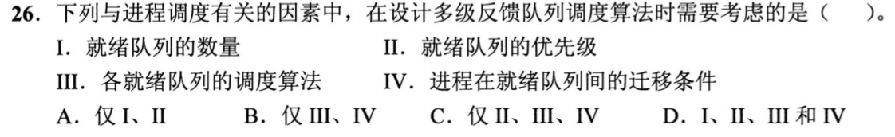

<details>
<summary>答案与解析</summary>

**答案：D。**

- **核心判据**：
  多级反馈队列（Multi-Level Feedback Queue, MLFQ）调度算法是现代通用操作系统中最精巧的自适应 CPU 调度架构，由五个基本维度完整定义：
  1. 就绪队列的数量；
  2. 每个就绪队列的优先级划分；
  3. 各就绪队列内部的调度策略（如各级分配不同长度的时间片，高优先级队列时间片短，低优先级队列时间片长或采用 FCFS）；
  4. 进程在队列间降级的迁移规则（如时间片用完降级）；
  5. 进程在队列间升级的迁移规则（如等待时间过长防止饥饿的老化机制）。

- **正选推导**：
  - **I 必须考虑**：系统必须确定划分几级就绪队列以平衡调度的细粒度与控制开销；
  - **II 必须考虑**：系统必须明确不同队列之间的调度顺序（如严格高优先级队列优先于低优先级队列抢占）；
  - **III 必须考虑**：各级队列内部采用何种算法（如时间片大小设为多少）决定了短作业与交互式进程的响应延迟；
  - **IV 必须考虑**：进程用完时间片后如何降级、长时间未调度如何升级，这是构成“动态反馈（Feedback）”的本质机制。缺少 IV，算法就退化为静态多级队列。
  四项全为必需设计因素，选 D。

</details>

### 选择题8｜2020-29

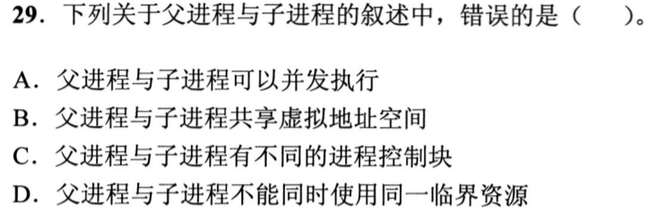

<details>
<summary>答案与解析</summary>

**答案：B。**

- **核心判据**：
  **进程是系统进行资源分配和保护的独立实体**。每个进程都拥有完全独立且私有的**虚拟地址空间**（拥有独立的页表结构与不同的 CR3 / SATP 页表基址寄存器）。
  “共享虚拟地址空间”是线程的本质特征，绝非进程的特征。

- **正选推导**：
  B 项断言“父进程与子进程共享虚拟地址空间”是严重的致命错误。调用 `fork()` 创建子进程时，操作系统虽然采用写时复制（Copy-on-Write）技术在物理内存层面上复用只读页帧，但子进程与父进程在逻辑和 MMU 页表上是两个完全隔离的虚拟地址空间。任何一方修改私有内存，都会触发写保护中断生成独立的物理副本，绝不相互影响。故 B 项叙述错误，正选。

- **干扰项击穿**：
  - **A 项正确**：`fork()` 完成后，父子进程是独立的调度单位，由操作系统调度器分派在多核 CPU 上物理并行或在单核 CPU 上微观交替并发执行。
  - **C 项正确**：操作系统为父、子进程分别分配独立的 PID 和专用的 PCB（进程控制块），各自记录独立的程序计数器、寄存器上下文与状态。
  - **D 项正确**：临界资源（如打印机、共享临界区代码段）具有排他性访问属性，任何进程访问时都必须遵守互斥原语，亲子进程关系并不能豁免同步互斥规则。

</details>

### 选择题9｜2021-24

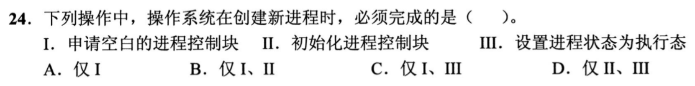

<details>
<summary>答案与解析</summary>

**答案：B。**

- **核心判据**：
  操作系统创建新进程的标准原语流程为：
  $$\text{申请空白 PCB} \longrightarrow \text{为进程分配资源} \longrightarrow \text{初始化 PCB} \longrightarrow \text{插入就绪队列（置为就绪态）}$$
  新进程创建完成后，由于 CPU 正在被当前运行的父进程或内核执行体占用，新进程尚未获得 CPU 调度权，**绝不可能直接设置为执行态**。

- **正选推导**：
  - **I 必须完成**：PCB 是进程存在的唯一标识，创建进程必须首先向内核申请一个空闲 PCB 槽位并赋予唯一 PID。
  - **II 必须完成**：必须为 PCB 初始化状态、优先级、CPU 初始寄存器上下文（PC、通用寄存器）、虚拟内存映射与打开文件列表。
  - **III 错误**：新进程创建后的初始合法状态只能是**就绪态（Ready）**，等待调度程序分派处理机；只有调度程序选中它后，它才能跃迁至执行态。
  故必须完成的是 I、II，选 B。

</details>

### 选择题10｜2021-25

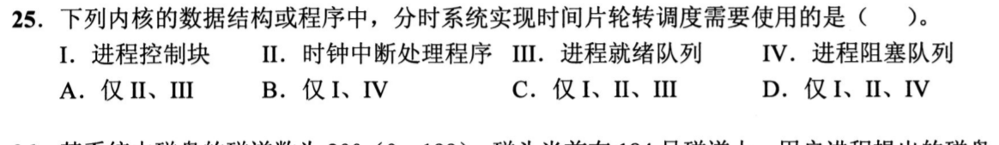

<details>
<summary>答案与解析</summary>

**答案：C。**

- **核心判据**：
  时间片轮转（Round-Robin, RR）调度算法的硬件与内核驱动三角模型：
  1. **时钟中断处理程序（驱动核心）**：硬件定时器按固定周期的时钟滴答（Tick）发出外部中断，内核时钟中断处理程序每次递减当前进程的时间片计数；当计数归零时激活调度标志；
  2. **进程控制块 PCB（状态载体）**：保存被剥夺 CPU 进程的上下文，以便下次轮到时平滑恢复现场；
  3. **进程就绪队列（排队结构）**：维护等待 CPU 的进程队列，用完时间片的进程插入队尾，队头进程出队分派 CPU。
  **阻塞队列（IV）**是为了让等待 I/O 或同步事件的进程挂起而设立的，属于进程阻塞与唤醒机制，并非时间片轮转算法本身的必要基础构件（即便系统内全为纯计算进程、系统没有任何阻塞事件，时间片轮转依然能独立完整运行）。

- **正选推导**：
  实现时间片轮转调度必需的核心内核结构和程序为 I、II、III，选 C。

</details>

### 选择题11｜2021-27

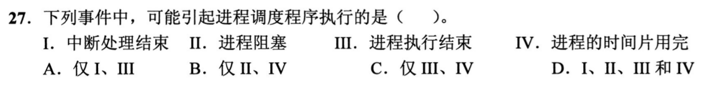

<details>
<summary>答案与解析</summary>

**答案：D。**

- **核心判据**：
  进程调度程序执行的时机分为两类：
  1. **非剥夺时机（主动让出）**：当前运行进程无法继续执行（如进程终止、主动调用 `exit()`、发生阻塞事件进入等待队列）；
  2. **剥夺时机（被动抢占）**：硬件中断发生后系统状态改变（如时钟中断检测到时间片耗尽、I/O 完成中断唤醒了更高优先级的就绪进程）。在中断返回用户空间前夕，内核检查调度标志位，若成立则引发调度。

- **正选推导**：
  - **I 可能引起**：外设 I/O 结束或通信到达触发中断，中断服务程序执行后可能会将某个被阻塞的高优先级进程唤醒放入就绪队列。在中断返回用户态时，内核检测到存在更高优先级就绪进程，立即调用调度程序引发抢占。
  - **II 可能引起**：进程请求不可用资源（如读磁盘、申请互斥锁失败）而阻塞，当前进程无法推进，必须由调度程序分派另一个就绪进程。
  - **III 可能引起**：进程执行完毕正常或异常退出，释放 CPU，必须由调度程序选取下一个就绪进程。
  - **IV 可能引起**：时钟中断递减时间片至 0，剥夺当前进程执行权并移入就绪队列尾部，调度程序执行选出下一个进程。
  四项均可能引起调度程序执行，选 D。

</details>

### 选择题12｜2022-23

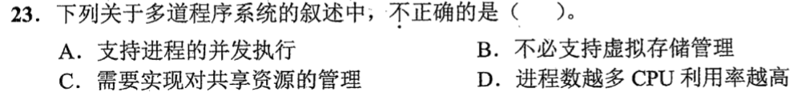

<details>
<summary>答案与解析</summary>

**答案：D。**

- **核心判据**：
  多道程序度（Degree of Multiprogramming）对 CPU 利用率的影响呈现经典的**倒 U 型曲线**：
  - 初期：适度增加道数可利用一个进程等待 I/O 的重叠时间让其他进程占用 CPU，从而提高 CPU 利用率；
  - 极值点之后：由于物理内存容量有限，并发进程过多会导致每个进程分配到的物理页框数远低于其工作集（Working Set），系统频繁产生缺页异常，使得所有进程几乎全部陷入漫长的换页等待中，导致**系统抖动/颠簸（Thrashing）**，此时 CPU 利用率暴跌至接近零。

- **正选推导**：
  D 项断言“进程数越多 CPU 利用率越高”彻底违背了操作系统资源饱和与抖动机理，错误，正选。

- **干扰项击穿**：
  - **A 项正确**：多道程序系统的根本目的正是支持多个进程在内存中宏观并行、微观交替的并发执行。
  - **B 项正确**：早期多道批处理系统采用固定分区或动态分区分配管理内存，并不具备分页、请求调页或虚存置换机制，多道系统绝不强制依赖虚拟存储。
  - **C 项正确**：多个并发进程竞争共享 CPU、内存和各种外部设备，操作系统必须提供互斥、同步、死锁防护等资源管理模块。

</details>

### 选择题13｜2022-25

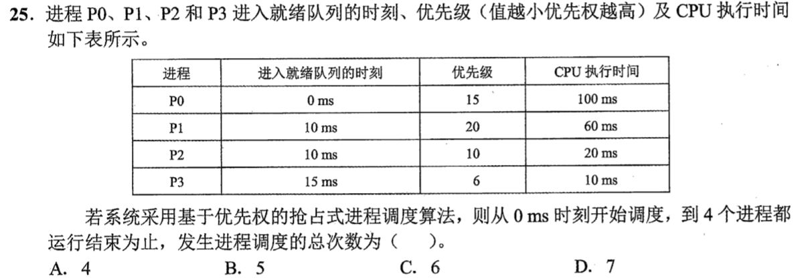

<details>
<summary>答案与解析</summary>

**答案：C。**

- **核心判据**：
  “发生进程调度的总次数”的物理含义为：**CPU 发生上下文切换或初次分派新进程投入运行的次数**。
  仅当 CPU 的实际控制权发生交接时计为 1 次调度。题目明确规定：**优先级数值越小，优先权越高**。

- **正选推导**：
  按时间轴演进严格追踪每个调度事件：
  - **0 ms**：就绪队列仅有 P0（优 15）。**第 1 次调度：分派 P0 投入运行**。P0 总需 100ms。
  - **10 ms**：P1（优 20）和 P2（优 10）到达就绪队列。
    比较优先级：当前运行的 P0(15) 弱于 P2(10)。P2 发生抢占，P0 暂停切回就绪态（P0 已运行 10ms，剩余 90ms）。
    **第 2 次调度：分派 P2 投入运行**。P2 总需 20ms。
  - **15 ms**：P3（优 6）到达就绪队列。
    比较优先级：P3(6) 高于当前运行的 P2(10)。P3 发生抢占，P2 暂停切回就绪态（P2 已运行 5ms，剩余 15ms）。
    **第 3 次调度：分派 P3 投入运行**。P3 总需 10ms。
  - **25 ms**：P3 运行 10ms 顺利结束退出。
    就绪队列中剩下 P2(优 10, 剩 15ms)、P0(优 15, 剩 90ms)、P1(优 20, 需 60ms)。
    优先级最高为 P2。**第 4 次调度：重新选中 P2 投入运行**。
  - **40 ms**：P2 运行 15ms 顺利结束退出。
    就绪队列中剩下 P0(优 15, 剩 90ms)、P1(优 20, 需 60ms)。
    优先级最高为 P0。**第 5 次调度：重新选中 P0 投入运行**。
  - **130 ms**：P0 运行 90ms 顺利结束退出。
    就绪队列中仅剩 P1(优 20, 需 60ms)。
    **第 6 次调度：选中 P1 投入运行**。
  - **190 ms**：P1 运行 60ms 结束，所有进程退出，系统任务清空。
  
  累计调度发生时刻为：0ms(P0), 10ms(P2), 15ms(P3), 25ms(P2), 40ms(P0), 130ms(P1)，共 **6 次**调度。选 C。

- **干扰项击穿**：
  - **A（4 次）**：典型错觉，误以为 4 个进程只被调度 4 次，彻底忽略了被剥夺抢占后的二次恢复分派。
  - **B（5 次）**：在 10ms 时误以为同时间到达的 P1、P2 只选一个不影响调度，或漏算了 P2 恢复执行。
  - **D（7 次）**：将 10ms 时 P1 的到达错误计入了一次空调度，或者在 190ms 全部进程结束关机时额外多计了一次调度。

</details>

### 选择题14｜2022-28


<details>
<summary>答案与解析</summary>

**答案：D。**

- **核心判据**：
  进程状态跃迁的因果判定法则：
  - **执行态 $\to$ 阻塞态**：进程由于**主动请求某项服务或等待外部资源/事件到来**而无法继续运行，主动放弃处理机进入等待队列；
  - **执行态 $\to$ 就绪态**：进程**自身的计算条件完全齐备**，仅仅是因为 CPU 时间片用尽或被更高优先级的抢占式进程强行剥夺了处理机。

- **正选推导**：
  - **I 读文件**：发起文件 I/O 系统调用，因磁盘读取涉及毫秒级外设操作，数据尚未就绪，进程被内核置入该设备的等待队列，变为**阻塞态**。
  - **III 申请外设**：若所请求的独占外设（如打印机）已被其他进程占用，进程申请失败，被挂入该外设的阻塞队列，变为**阻塞态**。
  - **IV 执行 wait() 操作**：若信号量当前资源计数 $S \le 0$，说明无可用资源，执行 P(wait) 的进程被插入该信号量的等待队列，变为**阻塞态**。
  - **II 时间片用完**：进程自身处于完全就绪状态，仅因时钟配额耗尽而被时钟中断处理程序移入**就绪队列（Ready）**，绝不会变为阻塞态。
  故可能导致变为阻塞态的是 I、III、IV，选 D。

</details>

### 选择题15｜2023-27

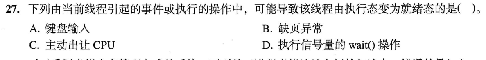

<details>
<summary>答案与解析</summary>

**答案：C。**

- **核心判据**：
  线程状态跃迁的物理分水岭：
  - **由执行态变为就绪态**：意味着该线程**没有等待任何外部 I/O 或资源事件**，其自身始终具备随时被 CPU 调度的全部就绪条件，只是自愿放弃或被迫出让当前的执行权限；
  - **由执行态变为阻塞态**：意味着该线程执行必须依赖的资源暂不可用，脱离 CPU 且不能直接被调度。

- **正选推导**：
  C 选项：当前线程执行类似 `sched_yield()` / `pthread_yield()` 系统调用**主动出让 CPU**，其语义是放弃当前剩余的时间片，将处理机礼让给其他同级就绪任务，但该线程自身计算条件完备，被内核重新放回就绪队列尾部，**直接转入就绪态**。选 C。

- **干扰项击穿**：
  - **A（键盘输入）**：线程请求读取键盘输入，因等待人类击键 I/O 事件而被操作系统置为**阻塞态**。键盘输入完成后引发中断唤醒它转入就绪态，并不是当前线程直接由执行态切入就绪态。
  - **B（缺页异常）**：访存发生缺页中断，线程必须等待操作系统从外存换入该物理页框，期间线程被置为**阻塞态**。
  - **D（执行 wait() 操作）**：若同步信号量计数不足，线程将被挂入信号量阻塞等待队列，转入**阻塞态**。

</details>

### 选择题16｜2023-29

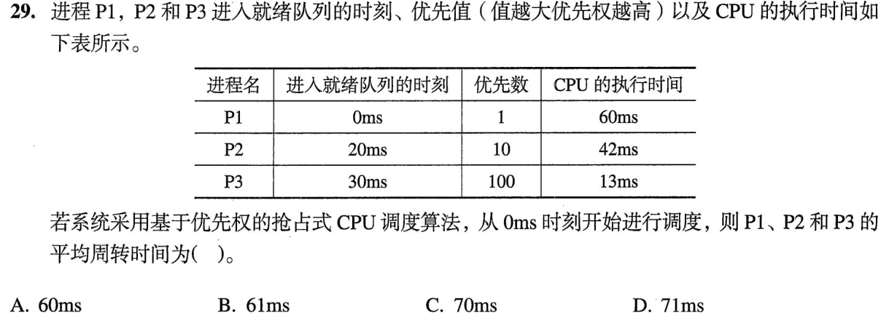

<details>
<summary>答案与解析</summary>

**答案：B。**

- **核心判据**：
  $$\text{周转时间} = \text{完成时刻} - \text{到达时刻}$$
  $$\text{平均周转时间} = \frac{\sum_{i=1}^n \text{周转时间}_i}{n}$$
  注意本题优先级规则：“**优先数值越大，优先权越高**”。

- **正选推导**：
  模拟抢占式调度执行时间线：
  1. **0 ms**：P1 到达（优先数 1），开始运行。
  2. **20 ms**：P2 到达（优先数 10 > 1），抢占 CPU。P1 暂停切入就绪（P1 已运行 20ms，剩余 $60 - 20 = 40$ ms）。
  3. **30 ms**：P3 到达（优先数 100 > 10），抢占 CPU。P2 暂停切入就绪（P2 已运行 $30 - 20 = 10$ ms，剩余 $42 - 10 = 32$ ms）。
  4. **30 ~ 43 ms**：P3 运行 13ms，于 **43 ms** 结束退出。
  5. **43 ms**：CPU 归还给就绪队列中优先数最高的 P2（优先数 10 > 1）。P2 运行其剩余的 32ms：
     $$\text{P2 完成时刻} = 43 + 32 = \mathbf{75}\text{ ms}$$
  6. **75 ms**：CPU 归还给 P1。P1 运行其剩余的 40ms：
     $$\text{P1 完成时刻} = 75 + 40 = \mathbf{115}\text{ ms}$$
  7. 各进程周转时间严格计算：
     - P1 周转时间 $= 115 - 0 = 115$ ms
     - P2 周转时间 $= 75 - 20 = 55$ ms
     - P3 周转时间 $= 43 - 30 = 13$ ms
  8. 计算平均周转时间：
     $$\text{平均周转时间} = \frac{115 + 55 + 13}{3} = \frac{183}{3} = 61\text{ ms}$$
     选 B。

- **干扰项击穿**：
  - **A（60 ms）**：算术计算粗心错误，误将 183 除以 3 估算为 60。
  - **C（70 ms）**：典型严重错误，忘记减去各进程的到达时刻，直接把完成时刻拿来求平均（$(115 + 75 + 43)/3 = 77.6$ 的算错变体）。
  - **D（71 ms）**：在计算周转时间时，把 P3 抢占期间 P2 已经消耗的 10ms 漏扣，导致算出的总周转时间虚增。

</details>

### 选择题17｜2024-24

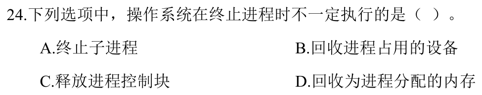

<details>
<summary>答案与解析</summary>

**答案：A。**

- **核心判据**：
  进程终止时的内核资源清理模型：
  - **自身资源必须强制回收**：进程退出时，操作系统必须立即彻底回收该进程私有的全部软硬件资源（释放其占用的物理内存页框、页表、回收打开的文件描述符与外设），并在父进程读取其退出码后注销并回收其 PCB，杜绝内存泄漏和系统僵尸死锁。
  - **子进程的家族关系机制**：父进程终止时，操作系统**不一定会连带终止其子进程**。现代操作系统（如 UNIX/Linux）普遍允许子进程脱离父进程独立生存，内核通过“托孤机制”将这些子进程的父进程重新指定为 `init` 进程（PID 1）或 `systemd`（孤儿进程），子进程生命周期不受父进程退出的强制约束。

- **正选推导**：
  操作系统在终止父进程时是否级联杀死子进程并非绝对强制的必要行为，可以根据系统设计选择托孤独立运行，故 A 选项“不一定执行”，正选。

- **干扰项击穿**：
  - **B、D 必须执行**：若操作系统不回收被终止进程占用的设备与内存，这些物理资源将永久处于锁定泄漏状态，导致系统可用资源单调衰减直至崩溃。
  - **C 必须执行**：PCB 是内核中有限的宝贵数据结构，进程生命周期彻底结束后，其 PCB 槽位必须被回收清空以供后续新进程分配复用。

</details>

### 选择题18｜2025-25

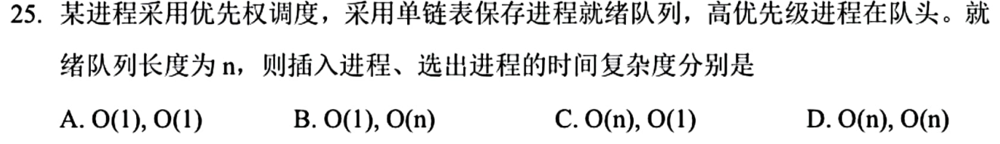

<details>
<summary>答案与解析</summary>

**答案：C。**

- **核心判据**：
  底层单链表维护有序序列的时间复杂度物理机理：
  - **选出最高优先级进程**：题干明确指出“**高优先级进程在队头**”。调度器选取最高优先级进程投入运行时，只需直接读取并摘取单链表的首元结点（`head->next`），通过修改头指针在常数步内完成出队，时间复杂度为 **$O(1)$**。
  - **插入新就绪进程**：新就绪进程的优先级大小任意，要在单链表中维持“按优先级单调递减”的绝对有序性，由于**单链表不支持随机寻址**（无法进行折半查找），必须从头指针开始逐个向后遍历节点比较优先级，寻找其正确的插入位置。最坏和平均情况下需遍历 $O(n)$ 个节点，时间复杂度为 **$O(n)$**。

- **正选推导**：
  插入进程为 $O(n)$，选出进程为 $O(1)$，选 C。

- **干扰项击穿**：
  - **A、B（插入为 O(1)）**：混淆了无序队列的常数插入。若插入仅需 $O(1)$，新进程只能盲目插在链表头或尾，队列将失去有序性，队头就无法保证是最高优先级。
  - **D（选出为 O(n)）**：无视了“高优先级进程在队头”的题设约束，误以为选出进程还需要全链表遍历找最大值。

</details>

### 选择题19｜2026-25

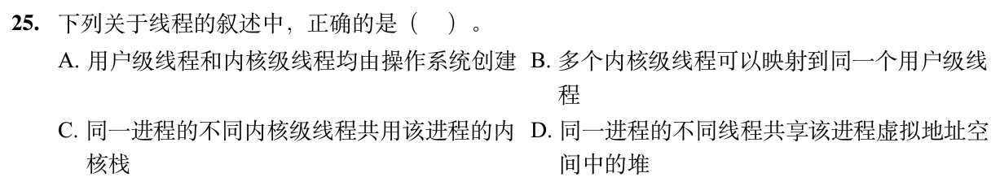

<details>
<summary>答案与解析</summary>

**答案：D。**

- **核心判据**：
  线程与进程的核心物理界限：
  - **线程共享**：同一进程内的所有线程拥有并共享该进程的统一虚拟地址空间，包括**代码段、全局/静态数据段、以及动态内存分配的堆（Heap）**，以及系统打开的文件描述符等；
  - **线程私有**：每个线程必须拥有自身专用的**程序计数器（PC）、通用寄存器上下文、以及独立的调用栈（用户栈与内核栈）**，以确保函数调用链与控制流状态的独立安全。

- **正选推导**：
  D 选项：“同一进程的不同线程共享该进程虚拟地址空间中的堆”。由 `malloc()`/`new` 分配的堆内存直接坐落在进程共享地址空间内，任何线程持有该内存指针均可合法并发读写，完全符合线程内存共享模型。D 项叙述正确，正选。

- **干扰项击穿**：
  - **A 错误**：用户级线程（ULT）完全由用户空间的线程库在用户态创建与管理，操作系统内核对其毫无感知，不经由操作系统创建。
  - **B 错误**：经典线程模型为多对一（多个用户级线程映射到一个内核线程）、一对一、多对多（多个用户线程映射到多个内核线程）。不存在“多个内核线程映射到同一个用户线程”的倒置拓扑。
  - **C 错误**：内核级线程作为操作系统独立的调度实体，当线程陷入内核态执行系统调用或中断时，必须依赖各自专属的私有**内核栈（Kernel Stack）**保存各自的中断现场与调用帧；若共用内核栈，会导致严重的调用栈覆盖崩溃。

</details>

## 解答题

### 大题1｜2026-47

[原题单 0930｜传输窗口：序号空间、确认与超时共同推进](../src/0930.md)

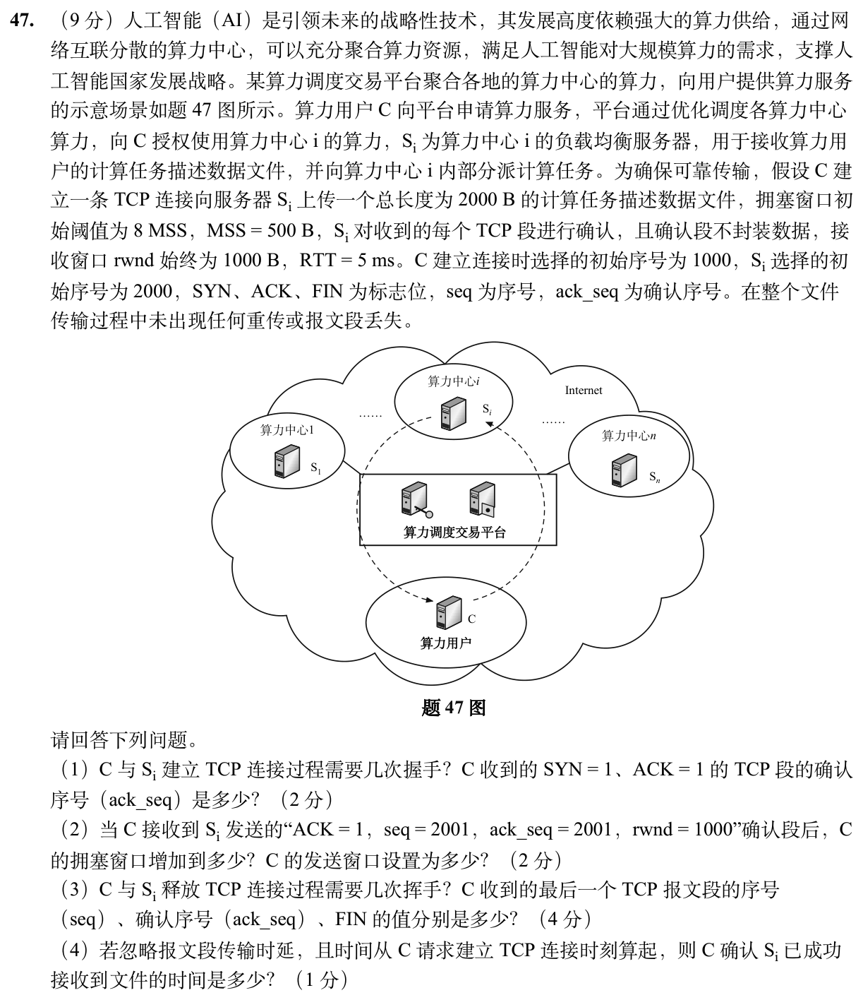

<details>
<summary>答案与解析</summary>

* **核心判据**：
  1. **TCP 连接生命周期与标志位序号消耗规则**：
     - **建立连接（三次握手）** 与 **释放连接（四次挥手）**；
     - **SYN 段和 FIN 段** 虽不承载应用层数据载荷，但**均强制消耗 1 个序列号**；
     - 纯 ACK 确认段（不携带数据）**不消耗任何序列号**；
     - 确认序号 `ack_seq` 遵循累积确认语义，取值为“期望收到的下一个字节的起始序号”。
  2. **TCP 窗口流控双轨约束定理**：
     - **拥塞窗口（cwnd）增长**：在慢开始阶段（$cwnd < ssthresh$），每收到 1 个有效 ACK，拥塞窗口单调增加 1 个 MSS；
     - **发送窗口实际大小（SND.WND）**：严格受限于发送端算力与接收端缓冲区的物理短板：
       $$\text{发送窗口 } W = \min(cwnd, rwnd)$$
  3. **RTT 离散步进传输时延模型**：
     - 忽略线路发送传输时延时，每一个往返时间 RTT 对应一次完整的“发送窗口数据 $\to$ 对端处理 $\to$ 接收返回 ACK”闭环；
     - 握手建连占用 1 个 RTT；数据传输占用轮次由每轮允许发送的报文段数与文件总段数共同决定。

* **正选推导**：
  * **（1）建连握手次数与 SYN+ACK 确认序号**：
    - C 与 Si 建立 TCP 连接过程需要 **3 次握手**；
    - C 发出的第 1 次握手（SYN=1）初始序号为 1000，因 SYN 占 1 个序号，Si 在第 2 次握手返回的 SYN+ACK 段中，确认序号为：
      $$ack\_seq = 1000 + 1 = \mathbf{1001}$$

  * **（2）拥塞窗口与发送窗口计算**：
    - **拥塞窗口（cwnd）**：
      - 初始 $cwnd = 1\text{ MSS} = 500\text{ B}$，慢开始门限 $ssthresh = 8\text{ MSS} = 4000\text{ B}$；
      - C 发送第 1 段数据（500B）后收到确认，属于慢开始，$cwnd$ 增至 $2\text{ MSS}$；
      - 随后 C 发送第 2 段数据（500B），收到 Si 发来的 `ack_seq = 2001` 确认段；
      - 此时依然处于慢开始阶段（$cwnd < ssthresh$），每收到 1 个确认段，$cwnd$ 增加 1 MSS：
        $$cwnd = 2\text{ MSS} + 1\text{ MSS} = 3\text{ MSS} = \mathbf{1500\text{ B}}$$
    - **发送窗口大小**：
      - 题干明确接收方通告窗口 $rwnd$ 始终为 1000 B；
      - 发送窗口取拥塞窗口与接收窗口的极小值：
        $$W = \min(cwnd, rwnd) = \min(1500\text{ B}, 1000\text{ B}) = \mathbf{1000\text{ B}} \quad (\text{即 } 2\text{ MSS})$$

  * **（3）连接释放挥手次数与最后一个报文段头部字段**：
    - 释放连接过程需要 **4 次挥手**；
    - **分析 C 收到的最后一个 TCP 报文段**：
      - 该报文段为 Si 发送给 C 的 FIN 段（或 FIN+ACK 段，表示服务端也请求关闭向 C 的连接）；
      - **序号（seq）**：Si 在整个会话中仅作为数据接收方，从未发送任何应用数据（仅在握手阶段发送了消耗 1 个序号的 SYN，从 seq=2000 变为 2001），故其发送序号始终保持为 **`seq = 2001`**；
      - **确认序号（ack_seq）**：文件总大小 2000 B，数据占据的字节区间为 $1001 \sim 3000$。C 发送完文件后，主动发起断开连接并发送 FIN 段，该 FIN 占用序号 3001。Si 发送的释放连接段对 C 的 FIN 进行确认，其确认序号为：
        $$ack\_seq = 3001 + 1 = \mathbf{3002}$$
      - **FIN 标志位**：因为是服务端发起的关闭连接报文段，故 **`FIN = 1`**。

  * **（4）确认文件成功接收的总耗时推导**：
    - 忽略报文段传输时延，以 RTT = 5ms 为离散时间刻度进行严格推进：
      1. $0 \sim 5\text{ ms}$（第 1 个 RTT）：C 发起 SYN 并收到 SYN+ACK，TCP 连接成功建立；
      2. $5 \sim 10\text{ ms}$（第 2 个 RTT）：此时 $cwnd = 1\text{ MSS}$，C 发送第 1 个数据段（500 B，累计 500 B）；5ms 后收到确认，累计确认 500 B；
      3. $10 \sim 15\text{ ms}$（第 3 个 RTT）：此时 $cwnd$ 增至 2 MSS，发送窗口为 2 MSS，C 发送第 2 和第 3 个数据段（各 500 B，累计发送 1500 B）；5ms 后收到确认，累计确认 1500 B；
      4. $15 \sim 20\text{ ms}$（第 4 个 RTT）：剩余数据仅剩 500 B，C 发送第 4 个数据段（500 B，累计 2000 B，全文件发送完毕）；5ms 后 C 收到 Si 返回的最终确认段；
    - 综上，C 确认 Si 成功接收全部文件至少需要经历 4 个 RTT：
      $$T = 4 \times 5\text{ ms} = \mathbf{20\text{ ms}}$$

* **误区警示**：
  * **误区 1（混淆拥塞窗口与发送窗口）**：第（2）问中，$cwnd$ 确实按慢开始算法涨到了 1500B，但很多考生误把发送窗口也写成 1500B。发送窗口必须受 $rwnd=1000\text{ B}$ 的硬上限卡死，只能取 1000B。
  * **误区 2（挥手确认号漏算 FIN 消耗的 1 个序号）**：数据发完后末尾字节是 3000，许多人直接写 `ack_seq = 3001`。必须记住：C 主动关闭发送的 FIN 段消耗了 3001 这个序号，Si 回复必须对其加 1 确认，即 3002。

</details>

## 一行记录

```text
实际用时__；未完成或未核对的题号__；今天最容易混淆的是__
```
