# Day 38｜组成原理＋计算机网络

[← Day 37](day37.md) · [总入口](README.md) · [Day 39 →](day39.md)

**选择题：16道，来自两份完整src题单；大题：1道。** 先做选择题，再展开题下解析。组内题目沿用src顺序；标为复做的组，已会的快速通过，重点处理上次错题。

**预计用时：60—95分钟。** 选择题及核对约30—50分钟，大题约25—35分钟，最后用5—10分钟重做今天最值得记住的一道错题。约两小时是配题目标，不是必须耗满或到点强停；计算卡住时先保留题号，先完成其余选择题。

## 选择题组1｜0818 · 组成原理

[程序层级：从源程序到CPU真正执行的对象](../src/0818.md) · 9道 · 复做第1次。

### 选择题1｜2020-12

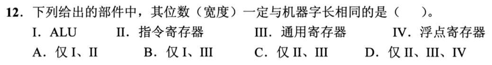

<details>
<summary>答案与解析</summary>

**答案：B。**

机器字长通常对应CPU一次处理的基本整数位数，ALU与通用寄存器宽度据此设计，选Ⅰ、Ⅲ。IR宽度取决于指令长度，指令可多字或变长；浮点寄存器宽度取决于浮点格式，也不必与整数机器字长一致。

</details>

### 选择题2｜2021-17

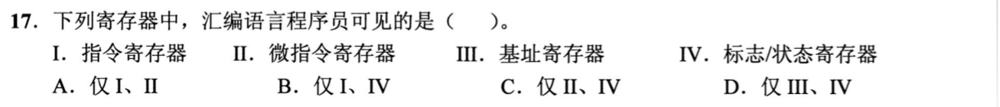

<details>
<summary>答案与解析</summary>

**答案：D。**

汇编程序可用基址寄存器参加有效地址计算，也会通过条件跳转等指令使用标志／状态寄存器，因此Ⅲ、Ⅳ可见。IR由取指控制逻辑使用，微指令寄存器属于内部控制实现，程序不直接指定它们。可见不等于每个位都允许用户程序任意改写。

</details>

### 选择题3｜2022-18

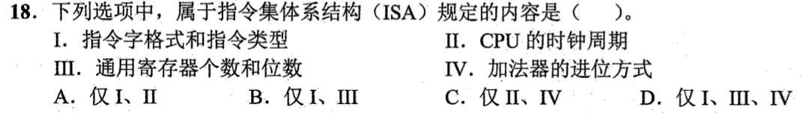

<details>
<summary>答案与解析</summary>

**答案：B。**

指令字格式和通用寄存器是软件可见的约定。时钟周期和加法器进位方式可以换实现。

</details>

### 选择题4｜2022-20

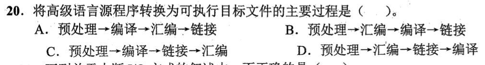

<details>
<summary>答案与解析</summary>

**答案：A。**

预处理展开宏和头文件；编译把源代码转换为汇编；汇编生成可重定位目标文件；链接合并目标与库、解析符号并重定位，得到可执行文件。汇编必须在编译之后，链接必须取得目标文件后进行。

</details>

### 选择题5｜2024-13

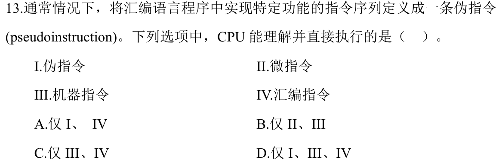

<details>
<summary>答案与解析</summary>

**答案：B。**

CPU 可译码机器指令，微程序控制器也可根据微指令产生内部控制信号。汇编文本和伪指令先由汇编器翻译。

</details>

### 选择题6｜2025-16

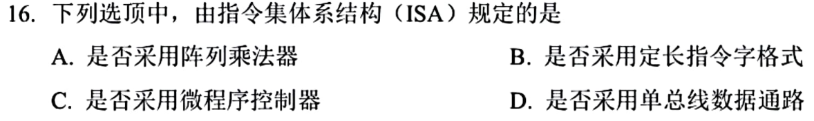

<details>
<summary>答案与解析</summary>

**答案：B。**

指令长度和格式直接决定机器码怎样解码，属于ISA对软件的约定。阵列乘法器、微程序控制器、单总线数据通路是实现指令功能的内部方案；换这些方案可以保持原机器码语义不变，因此A、C、D不由ISA强制规定。

</details>

### 选择题7｜2025-17

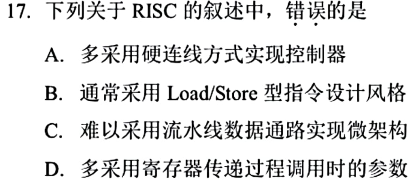

<details>
<summary>答案与解析</summary>

**答案：C。**

RISC通常采用较规整的指令、Load/Store访存和较多寄存器，适合流水实现，所以“难以采用流水线”错误。硬布线控制及用寄存器传参都是常见做法。这里说常见特征，不应扩张成所有RISC实现都必须采用相同流水级数。

</details>

### 选择题8｜2026-12

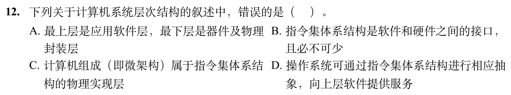

<details>
<summary>答案与解析</summary>

**答案：C。**

本题区分微架构的逻辑组织与更下层的物理实现。微架构规定流水线、运算部件、Cache及控制器怎样组织来实现ISA；电路、器件及布局布线才进一步完成物理实现，因此C把层次混在了一起。ISA是软硬件接口，操作系统利用其指令、特权和异常机制向上提供抽象服务，B、D成立；A给出上下层端点。

</details>

### 选择题9｜2026-16

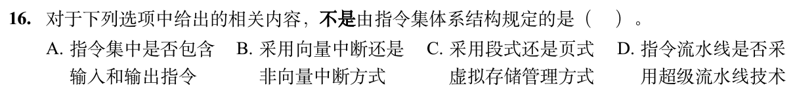

<details>
<summary>答案与解析</summary>

**答案：D。**

超流水把执行过程细分为更多流水段，属于处理器内部实现，可改变而保持相同ISA。是否包含I/O指令、怎样进入中断处理入口、虚拟地址采用何种转换格式，都影响软件可见的机器接口，A、B、C属于ISA约定。

</details>

## 选择题组2｜0902 · 计算机网络

[信号与速率：带宽怎样限制可传数据](../src/0902.md) · 7道 · 复做第2次。

### 选择题10｜2020-34

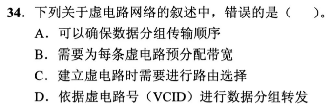

<details>
<summary>答案与解析</summary>

**答案：B。**

虚电路先建立路径，再按VCID沿这条路径转发，通常保证分组按序到达，A、C、D成立。但它仍是分组交换，不要求像电路交换那样为每条连接预先独占固定带宽，B把两者混淆了。支持带宽预留不等于每条虚电路都必须预留。

</details>

### 选择题11｜2021-34

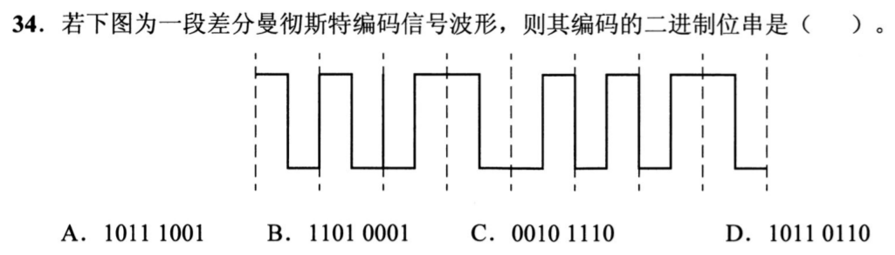

<details>
<summary>答案与解析</summary>

**答案：A。**

差分曼彻斯特看每个位起点是否跳变，而非中点方向。由图逐位判得10111001；每位中点的必有跳变只用于时钟同步。

</details>

### 选择题12｜2022-34

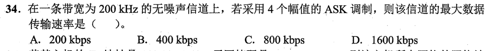

<details>
<summary>答案与解析</summary>

**答案：C。**

无噪声信道用奈奎斯特公式：最大码元速率2×200k=400kBaud；4个幅值可表示log₂4=2bit/码元，所以最大数据率800kb/s。不能把4个幅值直接乘4，也不需要套含信噪比的香农公式。

</details>

### 选择题13｜2023-34

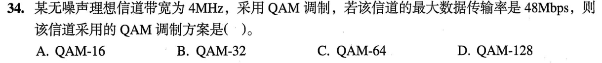

<details>
<summary>答案与解析</summary>

**答案：C。**

无噪声理想信道满足48=2×4×log₂M，得log₂M=6、M=64，即QAM-64。这里每码元承载6bit，64是可区分的调制状态总数，不是每秒码元数。

</details>

### 选择题14｜2024-34


<details>
<summary>答案与解析</summary>

**答案：C。**

FSK用不同频率表示0和1；ASK改变幅度，PSK改变相位，DPSK用相邻码元相位差。

</details>

### 选择题15｜2025-34

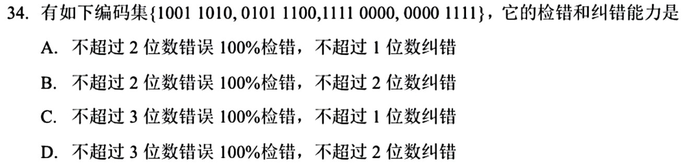

<details>
<summary>答案与解析</summary>

**答案：C。**

逐对异或：最小汉明距离为4。因此最多保证检出3位错，最多纠正1位错；两位错的纠错球会重叠，不能保证纠2位。

</details>

### 选择题16｜2026-34

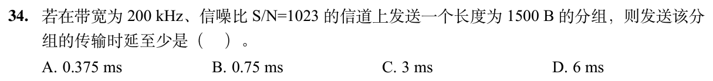

<details>
<summary>答案与解析</summary>

**答案：D。**

香农容量=200kHz×log₂(1+1023)=2Mb/s。1500B=12000bit，传输时延至少为12000÷2000000=0.006s=6ms。

先把字节乘8变成bit；再用分组比特数除以信道容量。这里求传输时延，不另外加传播时延。

</details>

## 解答题

### 大题1｜2020-47

[原题单 1002｜网络服务：配置、地址转换与应用会话](../src/1002.md)

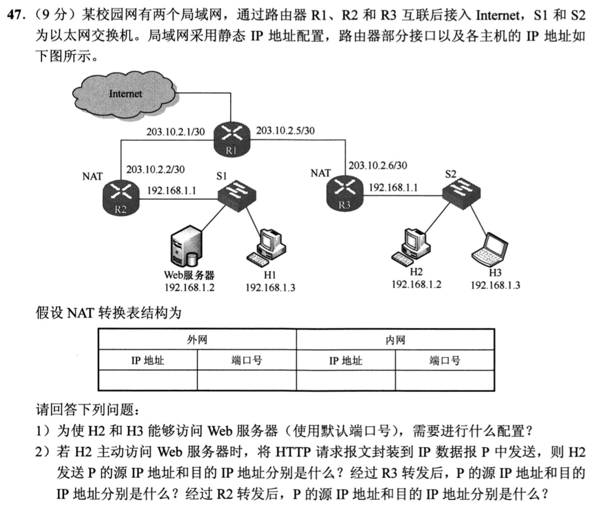

<details>
<summary>答案与解析</summary>

（1）在R2配置静态端口映射：公网`203.10.2.2:80`对应内网Web服务器`192.168.1.2:80`，让H2、H3访问`http://203.10.2.2/`。还须有正确的默认网关与出网路由：右侧主机通过R3，R3默认下一跳203.10.2.5；R2默认下一跳203.10.2.1。图中已标出R2、R3提供NAT，右侧主动连接还须有出站转换项。

（2）只跟踪题目要求的IP字段：

| 位置 | 源IP | 目的IP |
|---|---|---|
| H2发出 | 192.168.1.2 | 203.10.2.2 |
| 经R3转发 | 203.10.2.6 | 203.10.2.2 |
| 经R2转发 | 203.10.2.6 | 192.168.1.2 |

R3做源地址转换，R2按静态映射做目的地址转换。R3的外侧临时端口只需与其NAT表一致，原题未给定，不能编造固定数值。若H2直接把目的IP写成192.168.1.2，它指向右侧本地地址，无法表示左侧服务器。

</details>

## 一行记录

```text
实际用时__；未完成或未核对的题号__；今天最容易混淆的是__
```
