# Day 39｜数据结构＋操作系统

[← Day 38](day38.md) · [总入口](README.md) · [Day 40 →](day40.md)

**选择题：13道，来自两份完整src题单；大题：1道。** 先做选择题，再展开题下解析。组内题目沿用src顺序；标为复做的组，已会的快速通过，重点处理上次错题。

**预计用时：50—80分钟。** 选择题及核对约20—35分钟，大题约25—35分钟，最后用5—10分钟重做今天最值得记住的一道错题。约两小时是配题目标，不是必须耗满或到点强停；计算卡住时先保留题号，先完成其余选择题。

## 选择题组1｜0807 · 数据结构

[图上的推进：拓扑、最短路与关键路径](../src/0807.md) · 7道 · 复做第1次。

### 选择题1｜2020-07

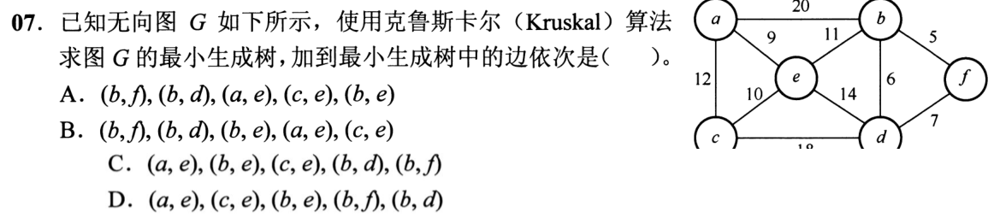

<details>
<summary>答案与解析</summary>

**参考答案：A（待逐题复核）。** 解析待补。

</details>

### 选择题2｜2020-08

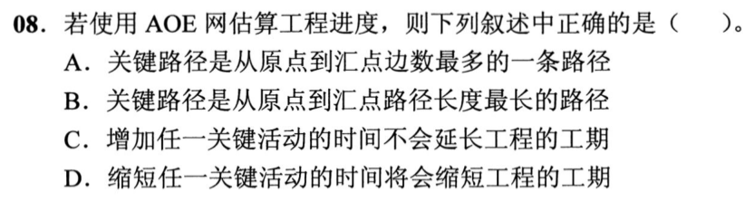

<details>
<summary>答案与解析</summary>

**参考答案：B（待逐题复核）。** 解析待补。

</details>

### 选择题3｜2021-07

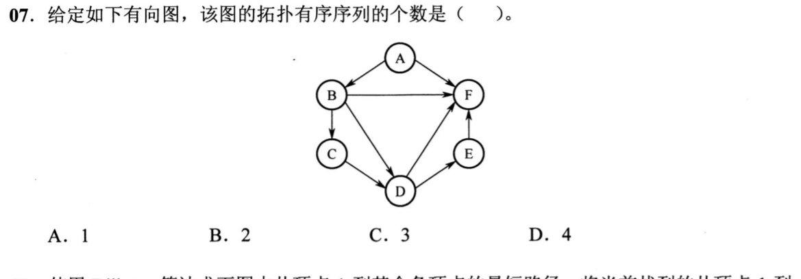

<details>
<summary>答案与解析</summary>

**参考答案：A（待逐题复核）。** 解析待补。

</details>

### 选择题4｜2021-08

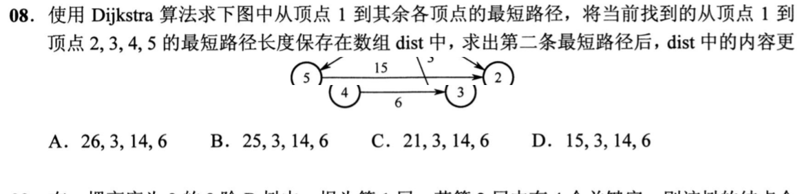

<details>
<summary>答案与解析</summary>

**参考答案：C（待逐题复核）。** 解析待补。

</details>

### 选择题5｜2022-07

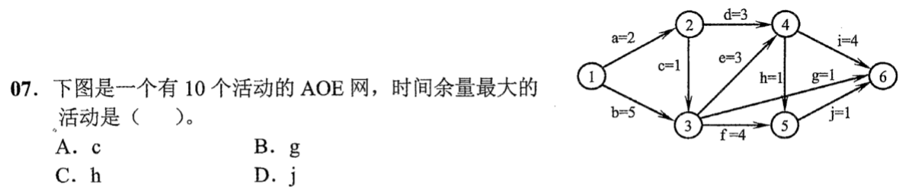

<details>
<summary>答案与解析</summary>

**答案：B。**

**直接法：** 事件1～6的最早时刻为0、2、5、8、9、12，最迟为0、4、5、8、11、12。用终点最迟减时长再减起点最早，c、g、h、j 的余量是2、6、2、2。

</details>

### 选择题6｜2023-06


<details>
<summary>答案与解析</summary>

**参考答案：B（待逐题复核）。** 解析待补。

</details>

### 选择题7｜2026-07

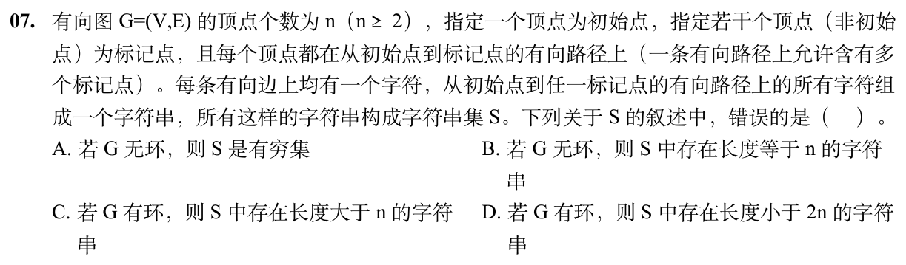

<details>
<summary>答案与解析</summary>

**答案：B。**

**直接法：** 无环时至多经过 n−1 条边，串长不会达到 n。可达且通往标记点的环能反复绕行。另取到某标记点的最短路，必不重复顶点，长度小于2n。

</details>

## 选择题组2｜0826 · 操作系统

[并发约束：把交错执行压成可证明的顺序](../src/0826.md) · 6道 · 复做第2次。

### 选择题8｜2020-32

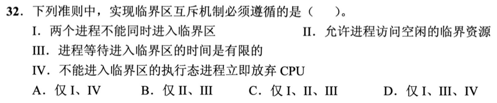

<details>
<summary>答案与解析</summary>

**参考答案：C（待逐题复核）。** 解析待补。

</details>

### 选择题9｜2024-28

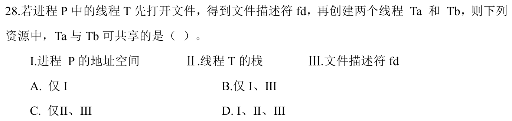

<details>
<summary>答案与解析</summary>

**参考答案：B（待逐题复核）。** 解析待补。

</details>

### 选择题10｜2024-30

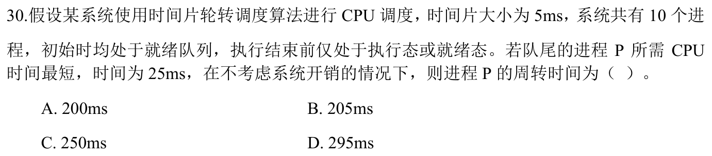

<details>
<summary>答案与解析</summary>

**参考答案：C（待逐题复核）。** 解析待补。

</details>

### 选择题11｜2025-27


<details>
<summary>答案与解析</summary>

**参考答案：D（待逐题复核）。** 解析待补。

</details>

### 选择题12｜2026-26

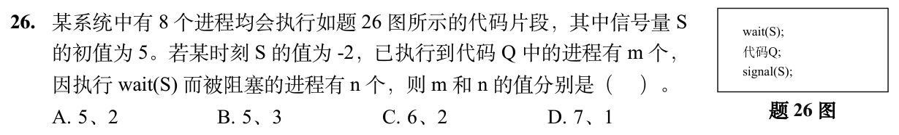

<details>
<summary>答案与解析</summary>

**答案：A。**

**直接法：** S=−2表示2个在wait处阻塞；临界代码Q最多5个并发，当前已有5个获得许可，故m=5、n=2。这里的m指已进入Q尚未归还许可的在执行者，不是历史累计次数。

</details>

### 选择题13｜2026-27

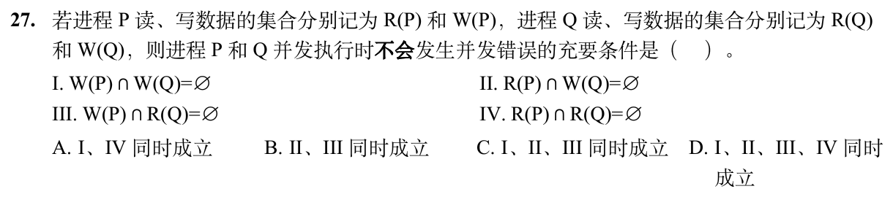

<details>
<summary>答案与解析</summary>

**答案与解析待补。**

</details>

## 解答题

### 大题1｜2021-47

[原题单 1002｜网络服务：配置、地址转换与应用会话](../src/1002.md)


<details>
<summary>答案与解析</summary>

（1）HTTP之外的应用层协议是DNS。本题常规DNS查询由DNS→UDP→IP→以太网逐层封装。ARP提供地址解析，不能混写成DNS的应用层承载协议。

（2）H1先ARP查询本地域名服务器MAC，完成DNS查询后，再ARP查询默认网关MAC，并通过网关建立TCP连接、发HTTP请求。到t1，S已学到：

| MAC地址 | 端口 |
|---|---:|
| 00-11-22-33-44-cc（H1） | 4 |
| 00-11-22-33-44-bb（DNS） | 1 |
| 00-11-22-33-44-aa（R） | 2 |

H2未发送帧，因此没有H2→端口3的表项。

（3）H2至少收到2个ARP请求广播帧：H1查DNS、H1查网关，目的MAC均为FF-FF-FF-FF-FF-FF。ARP应答已使DNS与网关的MAC被学习，DNS、TCP、HTTP后续单播不会再因为目的MAC未知而泛洪到H2。此处依题设没有无关通信，且H1的ARP表初始为空。

</details>

## 一行记录

```text
实际用时__；未完成或未核对的题号__；今天最容易混淆的是__
```
