# Day 40｜组成原理＋计算机网络

[← Day 39](day39.md) · [总入口](README.md)

**选择题：13道，来自两份完整src题单；大题：1道。** 先做选择题，再展开题下解析。组内题目沿用src顺序；标为复做的组，已会的快速通过，重点处理上次错题。

**预计用时：55—90分钟。** 选择题及核对约25—45分钟，大题约25—35分钟，最后用5—10分钟重做今天最值得记住的一道错题。约两小时是配题目标，不是必须耗满或到点强停；计算卡住时先保留题号，先完成其余选择题。

## 选择题组1｜0819 · 组成原理

[数据通路：状态元件、操作元件与控制信号](../src/0819.md) · 5道 · 复做第1次。

### 选择题1｜2021-18

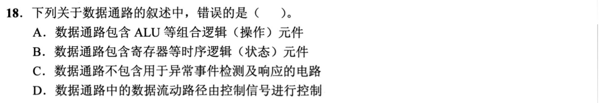

<details>
<summary>答案与解析</summary>

**参考答案：C（待逐题复核）。** 解析待补。

</details>

### 选择题2｜2022-22

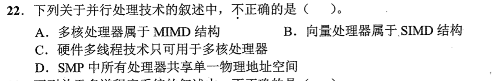

<details>
<summary>答案与解析</summary>

**答案：C。**

单核也可保留多份线程上下文并交替发射。多核可执行多条指令流，向量计算是单指令作用于多项数据，SMP共享物理地址空间。

</details>

### 选择题3｜2023-18

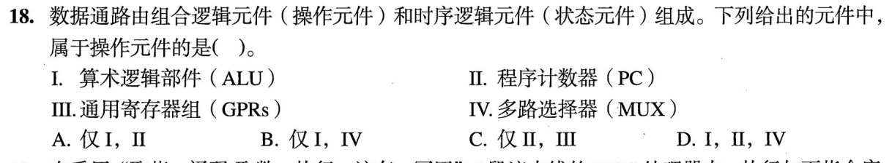

<details>
<summary>答案与解析</summary>

**参考答案：B（待逐题复核）。** 解析待补。

</details>

### 选择题4｜2025-19

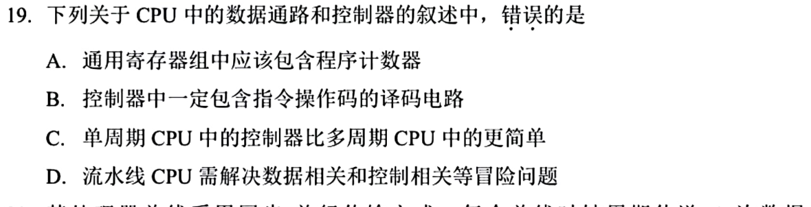

<details>
<summary>答案与解析</summary>

**答案：A。**

PC 是专用寄存器，无须放入通用寄存器组。多周期控制要分执行步骤，流水还要解决冒险。

</details>

### 选择题5｜2026-20

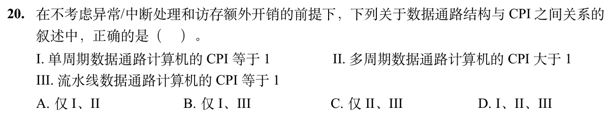

<details>
<summary>答案与解析</summary>

**答案：A（I、II）。**

单周期一条指令一拍，CPI=1；多周期一条指令分多拍执行，CPI>1，因此I、II成立。

III把流水线的理想稳态值当作任何情况下都成立。题目虽排除了异常、中断和额外访存开销，仍未排除启动、数据冒险和控制冒险。

</details>

## 选择题组2｜0905 · 计算机网络

[网络地址：子网、分片与可达范围](../src/0905.md) · 8道 · 复做第2次。

### 选择题6｜2021-35

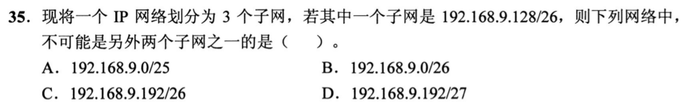

<details>
<summary>答案与解析</summary>

**参考答案：B（待逐题复核）。** 解析待补。

</details>

### 选择题7｜2022-35


<details>
<summary>答案与解析</summary>

**答案：B。**

第三字节72与192按位与得64；第四字节与0得0，所以网络地址183.80.64.0（/18）。

</details>

### 选择题8｜2022-36

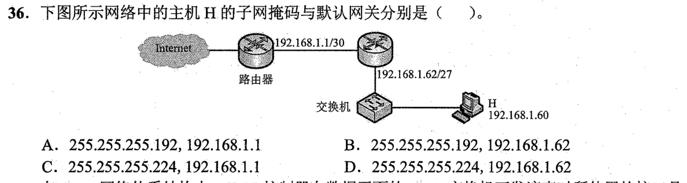

<details>
<summary>答案与解析</summary>

**参考答案：D（待逐题复核）。** 解析待补。

</details>

### 选择题9｜2023-38

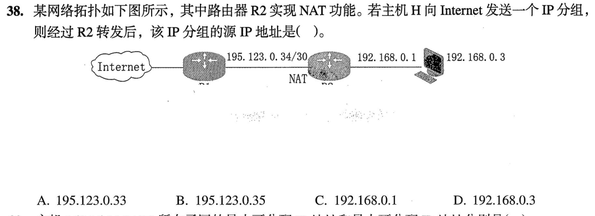

<details>
<summary>答案与解析</summary>

**答案：A。**

图中公网链路195.123.0.32/30，可用.33、.34；R1已占.34，R2的公网出口只能是.33，故NAT后源地址195.123.0.33。

</details>

### 选择题10｜2023-39

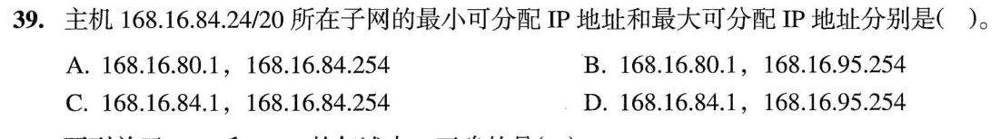

<details>
<summary>答案与解析</summary>

**参考答案：B（待逐题复核）。** 解析待补。

</details>

### 选择题11｜2023-40

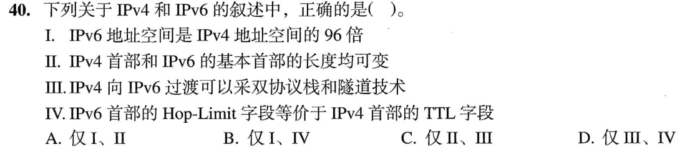

<details>
<summary>答案与解析</summary>

**答案：D。**

III双栈/隧道可过渡，IV Hop Limit等效TTL；地址空间比是2^(128−32)=2⁹⁶倍，不是96倍；IPv6基本首部固定，II错。

</details>

### 选择题12｜2025-36

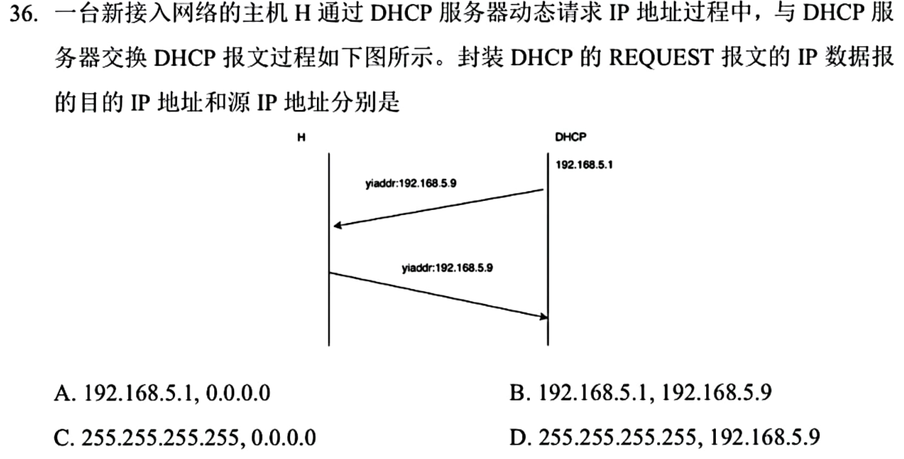

<details>
<summary>答案与解析</summary>

**答案：C。**

新接入主机对OFFER发初次REQUEST时使用源0.0.0.0、目的255.255.255.255广播，通知各服务器选择结果。题目问目的在前、源在后，顺序别倒。

</details>

### 选择题13｜2026-39

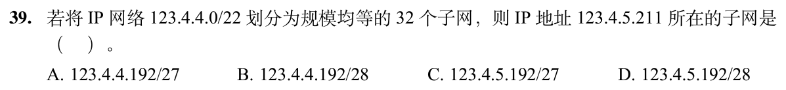

<details>
<summary>答案与解析</summary>

**答案与解析待补。**

</details>

## 解答题

### 大题1｜2022-47

[原题单 1002｜网络服务：配置、地址转换与应用会话](../src/1002.md)

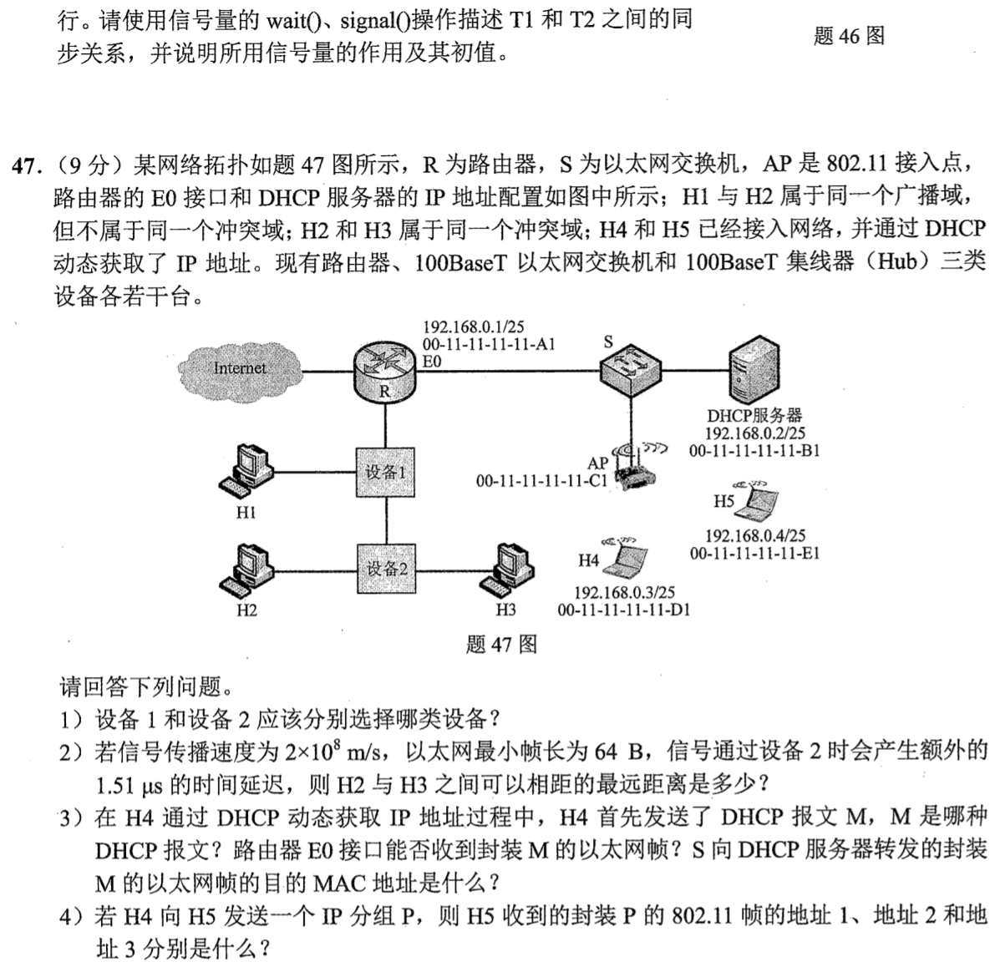

<details>
<summary>答案与解析</summary>

（1）设备1选100BaseT交换机，设备2选100BaseT集线器。交换机隔离冲突，未划VLAN时仍转发广播；集线器各端口共用冲突域。

（2）64B在100Mb/s上传输用5.12μs。若相距 d，要求 2×[d/(2×10⁸)+1.51μs]≤5.12μs，得 d≤210m。

（3）M是 DHCP Discover。S 对广播帧泛洪，E0 能收到。发往服务器端口的帧目的MAC仍为 FF-FF-FF-FF-FF-FF。

（4）H5收到的是AP发出的帧。地址1为接收者H5（00-11-11-11-11-E1），地址2为发送者AP（00-11-11-11-11-C1），地址3为原始源H4（00-11-11-11-11-D1）。

</details>

## 一行记录

```text
实际用时__；未完成或未核对的题号__；今天最容易混淆的是__
```
