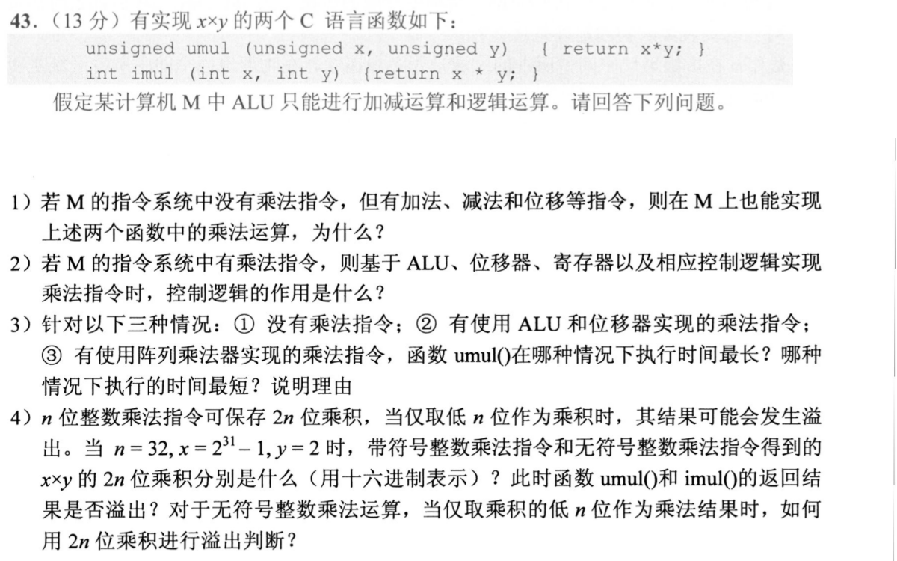
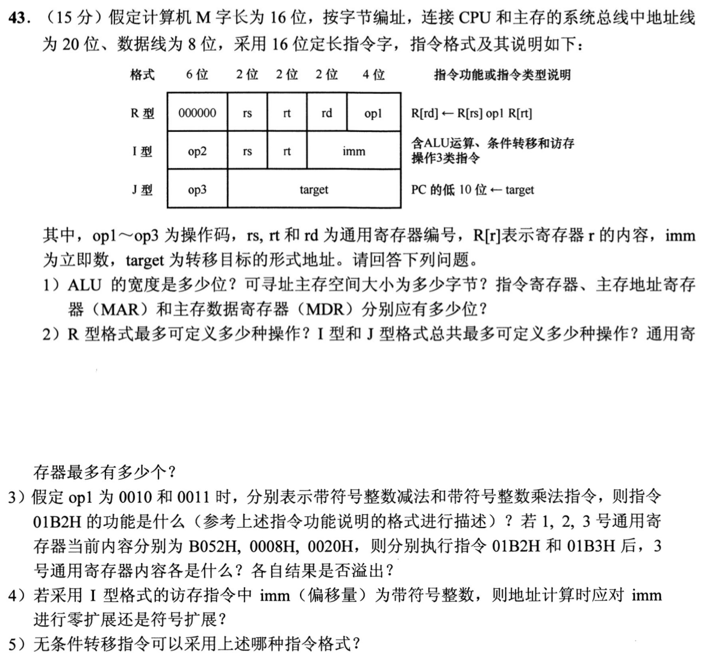

> **讲解资料页。** 本页保留原有逐题讲解与变式；旧每日安排已停用，当前任务只按[全量执行入口](../README.md)进行。不要叠加本页旧时间表。

# Day 04｜2020—2026年题，以题带学

[← Day 03](day03.md) · [总入口](../README.md) · [Day 05 →](day05.md)

> ### 🎯 本日攻坚目的
> 比较补码整数和无符号整数的大小，区分乘法的实现方式，并练差分曼彻斯特、数字调制和码距。大题写出乘法溢出判别、指令字段与部件位宽。
>
> ### 📋 本日对应解决的 src 题单
> - [src/0813.md](../../src/0813.md) 有限位运算：溢出、标志与乘除（共2题：`2021-13`、`2024-15`）→ [进入在线自测](../modules/0813.md)
> - [src/0902.md](../../src/0902.md) 差分曼彻斯特、数字调制与码距（共3题：`2021-34`、`2024-34`、`2025-34`）→ [进入在线自测](../modules/0902.md)
> - [src/0920.md](../../src/0920.md) 数据通路与部件控制大题（1题：`2020-43` 软件与硬件乘法溢出判别）
> - [src/0919.md](../../src/0919.md) 表示到汇编综合大题（1题：`2021-43` 指令格式、部件位宽与运算执行）

**当前选择题5道（原12道），配套大题2道，均为2020—2026年。** 原版每日材料在页末HTML注释中完整保留，暂不执行。

## 今天按这个顺序做

1. **回忆至多10分钟：** 只处理上次一处真实断点。
2. **选择题及补学至多50分钟：** 共5题，先作答再展开讲解；做得少、耗时短时直接进入重做或下一环节，不为凑时间补入旧题。
   - [0813｜有限位运算：先辨有符号还是无符号](../modules/0813.md)：2题。
   - [0902｜信号与编码：速率、波形和码距](../modules/0902.md)：3题。
3. **两道大题及补学至多50分钟：** 每题先独立尝试，再读折叠讲解，随后遮住重做；已能独立完成的不用耗满25分钟。
4. **闭卷检查至多10分钟：** 只留一处明天要修复的断点。

**120分钟是上限，不是必须用满的任务量，也不是已验证的完成时间。** 状态记I（独立完成）、H（引导后可重现）、U（仍不会）。时间到仍未完成，就记下真实题号和断点；不能靠继续加时把U写成完成。省下的时间用于当天错题重做，不自动增加新题。

## 大题1｜2020-43 · 软件乘法、硬件乘法与溢出

原题定位：[src/0920.md](../../src/0920.md)，以年份题号2020-43定位。



<details>
<summary>没有入口时的第一步</summary>

把乘法拆成按乘数位选择的移位与累加，再分清完整64位积和函数只保留的32位结果。

</details>

<details>
<summary>完整解法与必要补学</summary>

（1）能。二进制乘法可分解为移位与累加；有符号数可先处理符号与绝对值，再恢复符号，所以没有乘法指令不代表不能计算乘法。

（2）控制逻辑根据乘数当前位决定本轮是否加被乘数，控制寄存器装入、移位、循环计数与结束时机，使ALU、移位器和寄存器按既定顺序协同。

（3）在本题通常比较条件下，软件用多条加法/移位指令实现最慢；由阵列乘法器实现乘法指令最快；复用ALU和移位器的硬件乘法在两者之间。这里比较的是给定实现的工作量，不宣称所有机器都具有相同绝对时延。

（4）n=32，x=2^31−1，y=2，数学积为2^32−2。有符号和无符号解释下，两操作数都为正，完整64位积同为`00000000 FFFFFFFEH`。umul的32位无符号结果为FFFFFFFEH，没有超出无符号范围；imul的32位保留码同为FFFFFFFEH，但将被解释成−2，不能表示数学积，发生有符号溢出。无符号乘法只保留低n位时，完整2n位积的高n位非零便溢出。

</details>

<details>
<summary>重做后检查</summary>

为什么“最高位为1”不能独立判定无符号溢出？32位无符号数本来允许最高位为1；应检查完整乘积被截掉的高32位。

</details>

## 大题2｜2021-43 · 指令格式、部件位宽与运算

原题定位：[src/0919.md](../../src/0919.md)，按2021-43定位。



<details>
<summary>没有入口时的第一步</summary>

把字长、地址线、数据线、指令长度分别列出；它们不必相等。

</details>

<details>
<summary>完整解法与必要补学</summary>

**(1)** ALU宽16位；按字节编址、20位地址线，可寻址2²⁰B=1MiB；IR为16位，MAR为20位，MDR按8位数据总线取8位。传送一个16位字需两次8位数据传输。

**(2)** R型主操作码固定000000，op1有4位，可定义16种操作；其余6位主码共63个可给I、J型，故I型与J型总计最多63种；寄存器编号2位，共4个通用寄存器。

**(3)** 01B2H=000000 01 10 11 0010，即R[3]←R[1]−R[2]。B052H−0008H=B04AH，不溢出。01B3H仅末位操作改乘法：R[3]←R[1]×R[2]，低16位8290H；B052H按补码为−20398，乘8=−163184，超出16位带符号范围，溢出。两条指令各自以题给寄存器内容起算。

**(4)** imm有符号，计算有效地址前做符号扩展，保持其正负数值。

**(5)** 采用J型。将 target 写入PC低10位即可转移。题给I型列出的是条件转移，未规定恒真分支的具体操作；R型用于寄存器运算。

</details>

<details>
<summary>重做后检查</summary>

确认B052H×8的低16位是8290H；若把MDR误答16位，要回看数据总线一次实际传几位。

</details>

## 最后闭卷检查

1. 同一机器码按有符号与无符号解释，数值是否一定相同？
2. 完整64位积相同，为什么两个函数的32位结果可能只有有符号解释溢出？
3. 沿2021-43的指令，先写寻址得到什么，再写ALU如何处理。

不誊写整篇解答，只在纸上留一行：

```text
实际用时__分钟；选择题I__/H__/U__；大题1 I/H/U；大题2 I/H/U
未完成的题号__；明天只回看__；卡住的具体一步__
```

## 暂缓的原版材料

以下完整旧版仅在源文件注释中保存，其中旧年份题目暂不安排。

<!-- 暂缓：更新前的整份每日材料；原文保留，当前不安排。
# Day 04｜120分钟以题带学

[← Day 03](day03.md) · [总入口](README.md) · [Day 05 →](day05.md)

**总时间上限120分钟，补学、核对、纠错均含在内。** 任务是完成本日指定题，不是刷完整个原文件。状态只记独立完成I、引导后完成H、仍有断点U，不把看过或到时当掌握。

## 今天直接按这个顺序做

1. **0—10分钟：** 回忆昨天留下的一处断点；Day 1用于直接尝试首题，不先找课程。
2. **10—60分钟：** 做下面两个模块，共12道选择题。先尝试，遇到知识缺口在本页补学；模块时间按题数分配，读解答和纠错算在50分钟内。
   - [0813｜有限位运算：先辨有符号还是无符号](modules/0813.md)：4题。
   - [0902｜信号与编码：速率、波形和码距](modules/0902.md)：8题。
3. **60—110分钟：** 完成下面两道大题，每题25分钟：读题与独立尝试5分钟，卡住读折叠解法7分钟，遮住后重写或重算10分钟，核对2分钟，标状态1分钟。已能独立完成时无需等到用满。
4. **110—120分钟：** 做文末检查，只记一处最值得明天回看的断点，停止当天训练。

**防止时间失控：** 选择题45—90秒没有入口就读本页讲解；不用先去搜视频或整理新笔记。独立做对且依据正确的题立即离开；引导后仍不会的保留U，次日开头处理。120分钟到时如仍未完成，记录真实未完成题号，不能勾成通关；这也是校准本计划工作量的依据。

## 大题1｜2011-43 · 8位整数的同码异义与溢出

原题定位：[src/0919.md 第01题](../src/0919.md)。以年份题号为准，避免原计划题名错位。


<details>
<summary>没有入口时的第一步</summary>

先把134、246写成8bit；所有机器运算只保留低8位，再分别按有符号或无符号解释。

</details>

<details>
<summary>完整解法与必要补学</summary>

**(1)** x=134=86H，y=246=F6H；x−y=−112，模256为144=90H；x+y=380，模256为124=7CH。所以R1=86H、R5=90H、R6=7CH。

**(2)** m按补码解释86H为134−256=−122，n=246−256=−10；k1=m−n=−112。

**(3)** 能用同一个加法器。补码加法与无符号加法低位电路一致；减法将减数取反加一。类型主要影响结果解释及溢出判定，不要求四套算术电路。

**(4)** 有符号溢出可看最高位进位与次高位进位的异或（符号位进位和符号位出位不同），或用同号相加得异号、异号相减得与被减数异号判定。m−n=−112在[−128,127]内不溢出；m+n=−132越界，机器低8位7CH被解释为124，故只有k2=m+n溢出。无符号加减是否进/借位与有符号OF不是同一问题。

</details>

<details>
<summary>重做后检查</summary>

同一个7CH：无符号是124，补码也是124；但k2的数学结果−132与机器结果124不同，须判溢出。

</details>

## 大题2｜2021-43 · 指令格式、部件位宽与运算

原题定位：[src/0919.md 第02题](../src/0919.md)。以年份题号为准，避免原计划题名错位。


<details>
<summary>没有入口时的第一步</summary>

把字长、地址线、数据线、指令长度分别列出；它们不必相等。

</details>

<details>
<summary>完整解法与必要补学</summary>

**(1)** ALU宽16位；按字节编址、20位地址线，可寻址2²⁰B=1MiB；IR为16位，MAR为20位，MDR按8位数据总线取8位。传送一个16位字需两次8位数据传输。

**(2)** R型主操作码固定000000，op1有4位，可定义16种操作；其余6位主码共63个可给I、J型，故I型与J型总计最多63种；寄存器编号2位，共4个通用寄存器。

**(3)** 01B2H=000000 01 10 11 0010，即R[3]←R[1]−R[2]。B052H−0008H=B04AH，不溢出。01B3H仅末位操作改乘法：R[3]←R[1]×R[2]，低16位8290H；B052H按补码为−20398，乘8=−163184，超出16位带符号范围，溢出。两条指令各自以题给寄存器内容起算。

**(4)** imm有符号，计算有效地址前做符号扩展，保持其正负数值。

**(5)** 可用J型直接改PC低10位；也可用I型将条件转移设计为恒真条件，实现无条件转移。按题目要求说明格式与实现方式，不能把R型op1的算术操作擅自当已有跳转操作。

</details>

<details>
<summary>重做后检查</summary>

确认B052H×8的低16位是8290H；若把MDR误答16位，要回看数据总线一次实际传几位。

</details>

## 最后10分钟：闭卷检查与交付

1. 补码有符号溢出为什么不能只看CF？
2. 波特率乘什么得到比特率？
3. 字长16、地址线20、数据线8分别约束哪件事？

在纸上留一行即可，不抄解答、不另建整理任务：

```text
实际用时__分钟；选择题 I__/H__/U__；大题1 I/H/U；大题2 I/H/U
明天只回看：题号__；卡住的具体一步__
```

**完成与掌握分别记录。** 指定题均作答并核对、引导后能重现关键步骤，算本日执行完成；U仍存在就保留未通过项，不以此证明已掌握整个模块。扩展原题单的攻坚部分放到后续阶段；当天有余时也只在120分钟内追加。
-->
