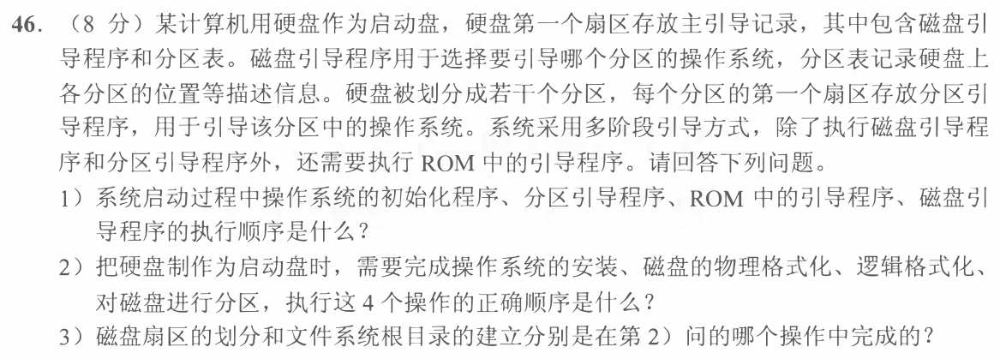
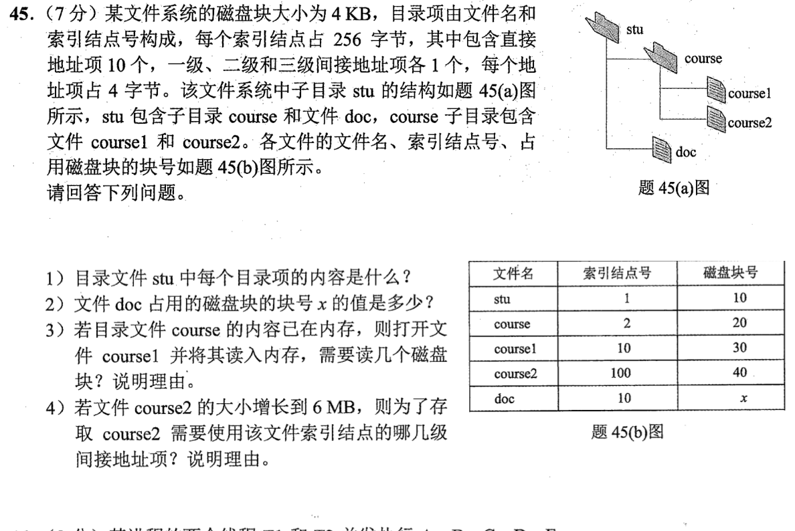

> **讲解资料页。** 本页保留原有逐题讲解与变式；旧每日安排已停用，当前任务只按[全量执行入口](../README.md)进行。不要叠加本页旧时间表。

# Day 09｜哈夫曼、共享页与文件系统

[← Day 08](day08.md) · [总入口](../README.md) · [Day 10 →](day10.md)

## 今天按这个顺序做

1. **回忆至多10分钟。** 闭卷重做昨天留的一处断点。
2. **选择题及补学至多50分钟。** 共2道指定题，先作答再展开。
   - [0804｜哈夫曼：前缀约束与结点数量](../modules/0804.md) · [原题单](../../src/0804.md) · `2022-05`
   - [0828｜内存边界：先查合法性，再做地址加法](../modules/0828.md) · [原题单](../../src/0828.md) · `2023-30`
3. **两道大题及补学至多50分钟。** 单题先独立尝试5分钟，卡住才打开提示。两题都先动笔，剩余时间用于遮住解法重做。
4. **闭卷检查至多10分钟。** 到120分钟收笔，按 I／H／U 记真实状态。

## 大题1｜2021-46 · 从固件到操作系统的启动顺序

[原题单 0927](../../src/0927.md)

没有入口时的第一步

把三处程序的位置写在纸上。CPU刚上电只能从固件入口开始，随后再找启动盘和被选分区。

完整解法与必要补学

（1）ROM引导程序 → 磁盘主引导记录中的磁盘引导程序 → 所选分区首扇区的分区引导程序 → 操作系统初始化程序。磁盘引导程序读取分区表定位要启动的分区。

（2）物理格式化 → 磁盘分区 → 逻辑格式化 → 安装操作系统。先建立可读写的扇区，再决定哪些扇区组成分区，最后在目标分区建立文件系统并安装系统。

（3）划分扇区属于物理格式化。建立文件系统根目录属于逻辑格式化。分区表描述分区范围，根目录是分区中文件系统的一部分。

重做后检查

遮住解答，从“第一段代码在哪里”起写出四段程序的位置。再用根目录依赖文件系统这一条检查后两步。

## 大题2｜2022-45 · 目录项、硬链接与间接索引

[原题单 0927](../../src/0927.md)

没有入口时的第一步

先画 名字 → inode号 → 数据块。两条名字如果落到同一个inode，就共享其中保存的数据块地址。

完整解法与必要补学

（1）题设目录项由名字与索引结点号组成。图中 stu 的两个目录项是 (course, 2) 和 (doc, 10)。

（2）doc 与 course1 的 inode 号都是10，指向同一文件数据，故 x=30。

（3）读2块。course 的目录内容已在内存，可直接获得 inode 10；读含 inode 10 的磁盘块，再读数据块30。题目只声明目录内容已缓存，因此按 inode 与数据块尚未缓存计算。

（4）6MiB 需要 6×1024/4=1536 个数据块。一块索引块可放 4096/4=1024 个地址。10个直接项加一级间接项只能覆盖1034块，余502块用二级间接，因此一级、二级都用到，三级无需使用。

重做后检查

如果 inode 10 已在内存，第（3）问只读数据块30。若恰好有1034个数据块，二级间接尚未启用。

## 最后闭卷检查

1. 定长码中不同频次会改变码长吗？
2. 两个进程共享同一页时，虚页号与物理页框号各是否必须相同？
3. 目录项和inode分别存哪一步信息？

检查答案

1. 不会。2. 虚页号可不同，映射的物理页框号相同。3. 目录项由名字找到inode号，inode再给出文件的数据块地址。

记录：实际用时__；选择 I__/H__/U__；大题1__、大题2__；下次先修的题号与卡点__。
