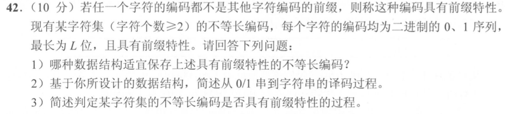

> **讲解资料页。** 本页保留原有逐题讲解与变式；旧每日安排已停用，当前任务只按[全量执行入口](../README.md)进行。不要叠加本页旧时间表。

# Day 11｜有序树、缺页成本与二叉树判定

[← Day 10](day10.md) · [总入口](../README.md) · [Day 12 →](day12.md)

## 今天按这个顺序做

1. **回忆至多10分钟。** 闭卷重做昨天留的一处断点。
2. **选择题及补学至多50分钟。** 共5道指定题，先作答再展开。
   - [0805｜有序树：沿祖先约束缩小区间](../modules/0805.md) · [原题单](../../src/0805.md) · `2020-05`、`2023-07`、`2024-07`
   - [0829｜页面驻留：缺页、工作集与置换](../modules/0829.md) · [原题单](../../src/0829.md) · `2020-28`、`2026-30`
3. **两道大题及补学至多50分钟。** 单题先独立尝试5分钟，卡住才打开提示。两题都先动笔，剩余时间用于遮住解法重做。
4. **闭卷检查至多10分钟。** 到120分钟收笔，按 I／H／U 记真实状态。

## 大题1｜2020-42 · 前缀树存储、译码和冲突检测

[原题单 0915](../../src/0915.md)

没有入口时的第一步

把0和1当作分支。想象一条短码先结束，但沿着同一个结点还能走出一条更长码。

完整解法与必要补学

（1）使用二叉前缀树。左、右边分别代表0、1，结点保留两个孩子指针和终止标记，叶结点保存对应字符。根到叶的边序列就是该字符的编码。

（2）从根依次读位并沿对应边走。抵达字符结点就输出字符、回到根，再读余下位。遇到空边或全部位读完时停在非根的内部结点，说明输入无效或末尾不完整。

（3）逐个插入码字。走的途中若遇到已标记终止的结点，已有短码是当前码的前缀。走完若当前结点已有孩子，当前码是先前长码的前缀；若该结点已标记，还要判重复。其余情况标记为终点并保存字符。两种插入顺序均检查到，遍历位数与码长之和同阶。

重做后检查

按 01→010 和 010→01 两种顺序各走一次，指出分别在走途中还是走完时发现冲突。

## 大题2｜2022-41 · 顺序存储二叉树的BST判定（闭卷重做）

[Day 01 大题2原图与讲解](day01.md)。本日只重做该题。写出下标边界、空结点处理和严格有序判定，再用“右子树中的结点小于根”的反例核对。

## 最后闭卷检查

1. 为什么只比较结点和其父结点的大小，无法验证整棵BST？
2. FIFO 和 LRU 命中时怎样更新各自队列？
3. 为什么前缀树的字符终点不能拥有孩子？

检查答案

1. 结点还受全部祖先的上下界限制。例如根40的左子树中，即使30的右孩子50比30大，它仍违反根40的上界。2. FIFO按装入先后，命中不更新先后；LRU命中要刷新最近访问顺序。3. 若终点还有子树中的字符，短码就成为后者前缀。

记录：实际用时__；选择 I__/H__/U__；大题1__、大题2__；下次先修的题号与卡点__。
