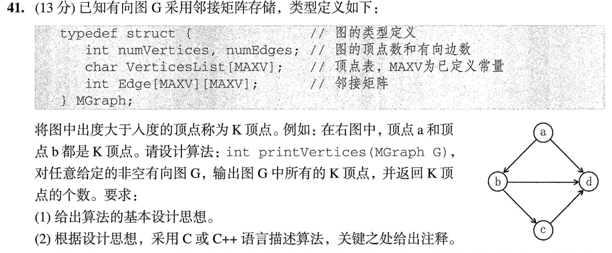
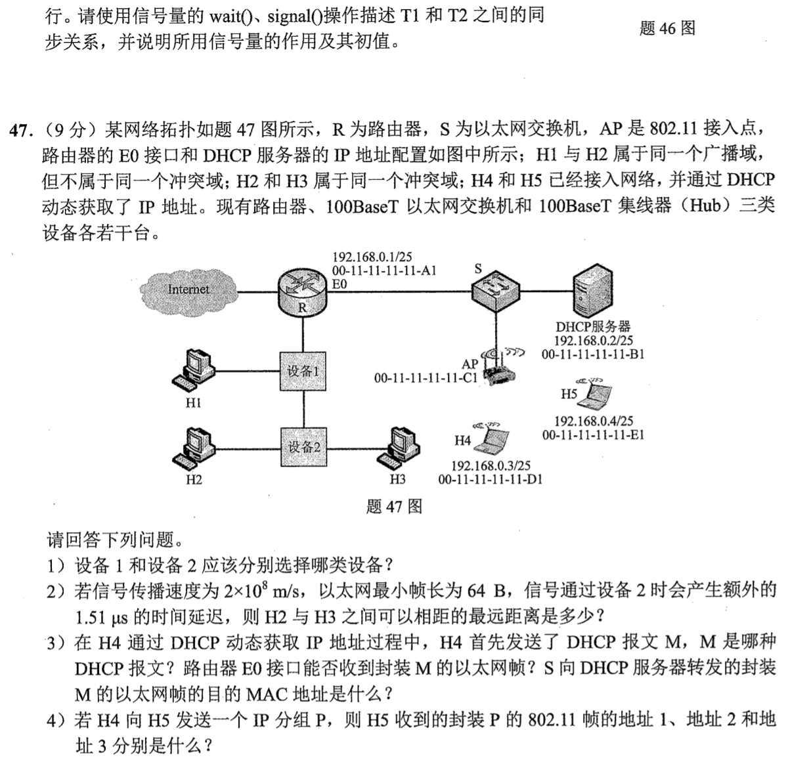

> **讲解资料页。** 本页保留原有逐题讲解与变式；旧每日安排已停用，当前任务只按[全量执行入口](../README.md)进行。不要叠加本页旧时间表。

# Day 13｜图的度数、文件路径与链路综合

[← Day 12](day12.md) · [总入口](../README.md) · [Day 14 →](day14.md)

## 今天按这个顺序做

1. **回忆至多10分钟。** 只回看昨天的一处真实断点。
2. **选择题及补学至多50分钟。** 只做以下指定题，先作答再展开。
   - [0806｜无向图的边数与邻接多重表](../modules/0806.md) · [原题单](../../src/0806.md) · 2022-06、2024-04
   - [0830｜文件按名查找与统一接口](../modules/0830.md) · [原题单](../../src/0830.md) · 2024-29、2025-28
3. **两道大题及补学至多50分钟。** 每题先独立尝试5分钟，卡住才打开提示，随后遮住重做。
4. **闭卷检查至多10分钟。** 到120分钟收笔，按 I／H／U 记真实状态。

## 大题1｜2023-41 · 邻接矩阵中的K顶点

[原题单 0916](../../src/0916.md)



<details>
<summary>没有入口时的第一步</summary>

固定顶点 i，沿第 i 行数出边，沿第 i 列数入边。

</details>

<details>
<summary>完整解法与必要补学</summary>

（1）对每个顶点分别计数，出度大于入度时输出并累加。例图中 a 的出、入度为2、0，b 为2、1，只有这两点符合。

（2）按题图无权图的0/1矩阵约定，代码如下。自环若存在，对出、入度各加一。耗时 O(n²)，辅助空间为常量。

```c
#include <stdio.h>

int printVertices(MGraph G) {
    int count = 0;
    for (int i = 0; i < G.numVertices; ++i) {
        int out = 0, in = 0;
        for (int j = 0; j < G.numVertices; ++j) {
            out += G.Edge[i][j] != 0; // 行：i 发出
            in += G.Edge[j][i] != 0;  // 列：到达 i
        }
        if (out > in) {
            printf("%c ", G.VerticesList[i]);
            ++count;
        }
    }
    return count;
}
```

</details>

<details>
<summary>重做后检查</summary>

只保留 a→b，应该输出 a 并返回1。

</details>

## 大题2｜2022-47 · 交换机、集线器、DHCP 与无线三地址

[原题单 1002](../../src/1002.md)



<details>
<summary>没有入口时的第一步</summary>

把广播域和冲突域分开画，再判断无线帧当前这一跳的发送者和接收者。

</details>

<details>
<summary>完整解法与必要补学</summary>

（1）设备1选100BaseT交换机，设备2选100BaseT集线器。交换机隔离冲突，未划VLAN时仍转发广播；集线器各端口共用冲突域。

（2）64B在100Mb/s上传输用5.12μs。若相距 d，要求 2×[d/(2×10⁸)+1.51μs]≤5.12μs，得 d≤210m。

（3）M是 DHCP Discover。S 对广播帧泛洪，E0 能收到。发往服务器端口的帧目的MAC仍为 FF-FF-FF-FF-FF-FF。

（4）H5收到的是AP发出的帧。地址1为接收者H5（00-11-11-11-11-E1），地址2为发送者AP（00-11-11-11-11-C1），地址3为原始源H4（00-11-11-11-11-D1）。

</details>

<details>
<summary>重做后检查</summary>

设备延迟来回各计一次。核对地址2与地址3分别是谁。

</details>

## 最后闭卷检查

连通图边数下界是多少？read 靠什么定位文件？

<details>
<summary>检查答案</summary>

n−1；文件描述符。

</details>

记录：实际用时__；选择 I__/H__/U__；两道大题状态__；下次先修的题号与卡点__。
