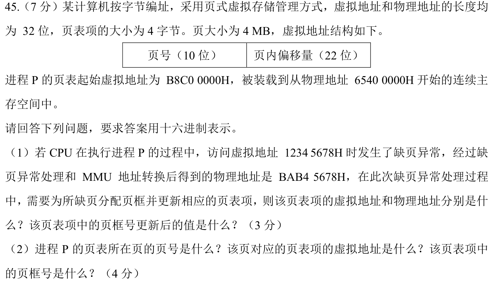
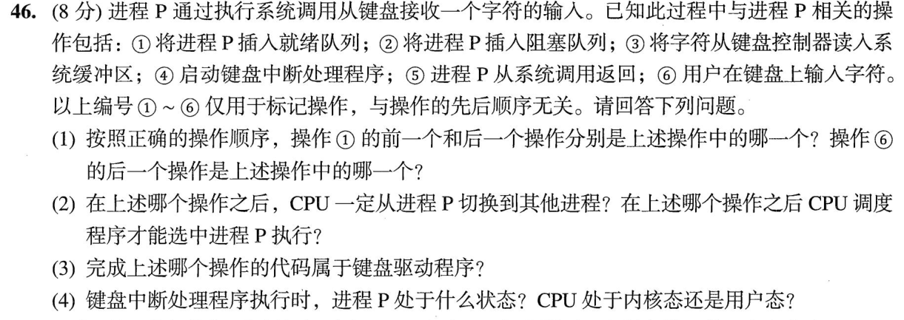

> **讲解资料页。** 本页保留原有逐题讲解与变式；旧每日安排已停用，当前任务只按[全量执行入口](../README.md)进行。不要叠加本页旧时间表。

# Day 14｜指令层级、TCP时序与内核边界

[← Day 13](day13.md) · [总入口](../README.md) · [Day 15 →](day15.md)

## 今天按这个顺序做

1. **回忆至多10分钟。** 只回看昨天的一处真实断点。
2. **选择题及补学至多50分钟。** 只做以下指定题，先作答再展开。
   - [0818｜程序层级与 ISA](../modules/0818.md) · [原题单](../../src/0818.md) · 2022-18、2024-13
   - [0907｜按事件算 TCP 建连、数据和关闭时间](../modules/0907.md) · [原题单](../../src/0907.md) · 2024-38、2025-39
3. **两道大题及补学至多50分钟。** 每题先独立尝试5分钟，卡住才打开提示，随后遮住重做。
4. **闭卷检查至多10分钟。** 到120分钟收笔，按 I／H／U 记真实状态。

## 大题1｜2024-45 · 大页页表项的虚、实地址

[原题单 0924](../../src/0924.md)

没有入口时的第一步

虚拟地址右移22位取页号，再乘4得表项字节偏移。

完整解法与必要补学

（1）1234 5678H 的页号为048H，表项偏移120H。分别加页表虚、实基址，得 B8C0 0120H、6540 0120H。BAB4 5678H右移22位，得到新页框号2EAH。

（2）B8C0 0000H右移22位得2E3H。页表共2¹⁰×4B=4KiB，且起址按4MiB对齐，整表在一页内。描述这一页的表项虚址为 B8C0 0000H+2E3H×4=B8C0 0B8CH。实际装入地址6540 0000H右移22位，得到页框号195H。

重做后检查

用页框号2EAH左移22位并加原页内偏移345678H，还原 BAB4 5678H。

## 大题2｜2023-46 · 键盘输入的阻塞、唤醒与返回

[原题单 0928](../../src/0928.md)

没有入口时的第一步

分开内核交付字符与进程重新获得CPU两个事件。

完整解法与必要补学

（1）顺序②⑥④③①⑤。①的前一个是③、后一个是⑤；⑥的下一个是④。

（2）②后进程因等待输入阻塞，CPU切换到其他可运行进程，必要时运行空闲进程。①后P进入就绪队列，才可能被调度。

（3）③读控制器并把字符放入内核缓冲区，由键盘驱动负责。

（4）进入键盘中断处理时，P因等字符而阻塞，CPU在内核态。处理到①才将P置为就绪，仍须调度才能执行。

重做后检查

画出阻塞→就绪→运行，两条箭头分别标唤醒与调度。

## 最后闭卷检查

主动关闭方发最后ACK后等多久？表项号乘4得到什么？

检查答案

2MSL；距页表基址的字节偏移。

记录：实际用时__；选择 I__/H__/U__；两道大题状态__；下次先修的题号与卡点__。
