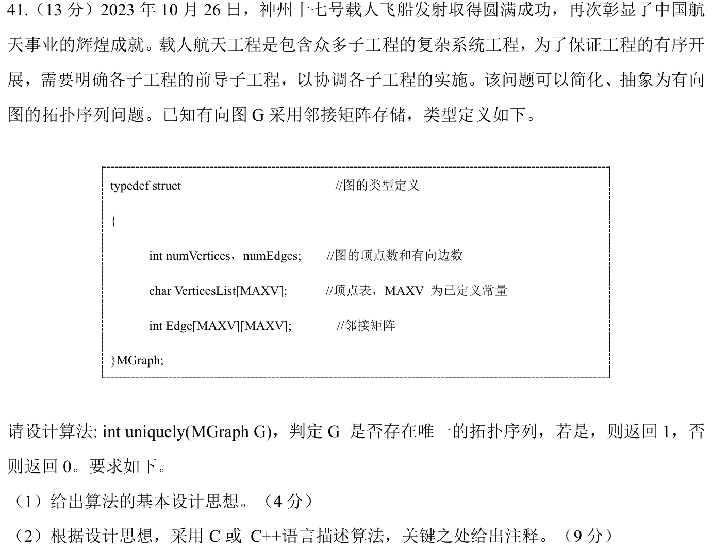

> **讲解资料页。** 本页保留原有逐题讲解与变式；旧每日安排已停用，当前任务只按[全量执行入口](../README.md)进行。不要叠加本页旧时间表。

# Day 15｜图的推进、设备服务与拓扑序

[← Day 14](day14.md) · [总入口](../README.md) · [Day 16 →](day16.md)

## 今天按这个顺序做

1. **回忆至多10分钟。** 只回看昨天的一处真实断点。
2. **选择题及补学至多50分钟。** 只做以下指定题，先作答再展开。
   - [0807｜图上的工期余量与路径长度](../modules/0807.md) · [原题单](../../src/0807.md) · 2022-07、2026-07
   - [0831｜键盘中断与设备驱动](../modules/0831.md) · [原题单](../../src/0831.md) · 2024-31、2026-31
3. **两道大题及补学至多50分钟。** 每题先独立尝试5分钟，卡住才打开提示，随后遮住重做。
4. **闭卷检查至多10分钟。** 到120分钟收笔，按 I／H／U 记真实状态。

## 大题1｜2024-41 · 拓扑序唯一性

[原题单 0916](../../src/0916.md)



<details>
<summary>没有入口时的第一步</summary>

维护当前的零入度候选。每轮取走一个顶点后才知道下一轮有几个候选。

</details>

<details>
<summary>完整解法与必要补学</summary>

（1）先统计入度，把零入度顶点入队。每轮恰有一个候选时，取该顶点并删除它的出边。空队列且还有未处理顶点说明有环。出现多个候选时，只要全图有拓扑序，每个候选都可先取，因此序列不唯一。

（2）按0/1邻接矩阵约定，辅助空间 O(n)，矩阵扫描 O(n²)。

```c
int uniquely(MGraph G) {
    int n = G.numVertices;
    int in[MAXV] = {0}, queue[MAXV];
    int head = 0, tail = 0;
    for (int u = 0; u < n; ++u)
        for (int v = 0; v < n; ++v)
            if (G.Edge[u][v] != 0) ++in[v];
    for (int v = 0; v < n; ++v)
        if (in[v] == 0) queue[tail++] = v;
    for (int removed = 0; removed < n; ++removed) {
        if (tail - head != 1) return 0;  // 候选为空或超过一个
        int u = queue[head++];
        for (int v = 0; v < n; ++v)
            if (G.Edge[u][v] != 0 && --in[v] == 0)
                queue[tail++] = v;
    }
    return 1;
}
```

</details>

<details>
<summary>重做后检查</summary>

试链 a→b→c、分叉 a→b 和 a→c、环 a→b→a，依次返回1、0、0。

</details>

## 大题2｜2021-41 · 邻接矩阵判定EL路径（闭卷重做）

[Day 01 原图与折叠讲解](day01.md)。只做原页大题1。圈出题干给定的连通性条件，写出奇度顶点计数。

## 最后闭卷检查

首轮只有一个零入度顶点，能断定拓扑序唯一吗？

<details>
<summary>检查答案</summary>

不能。首轮之后仍可能出现两个同时可选的顶点。

</details>

记录：实际用时__；选择 I__/H__/U__；两道大题状态__；下次先修的题号与卡点__。
