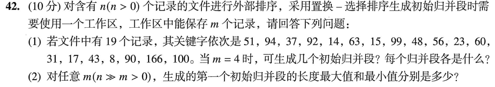

> **讲解资料页。** 本页保留原有逐题讲解与变式；旧每日安排已停用，当前任务只按[全量执行入口](../README.md)进行。不要叠加本页旧时间表。

# Day 19｜内外排序、置换选择与稳定性

[← Day 18](day18.md) · [总入口](../README.md) · [Day 20 →](day20.md)

## 今天按这个顺序做

1. **回忆至多10分钟。** 只回看昨天的一处真实断点。
2. **选择题及补学至多50分钟。** 只做以下指定题，先作答再展开。
   - [0810｜内排序：区分划分结果、比较与移动](../modules/0810.md) · [原题单](../../src/0810.md) · 2024-08、2025-10
   - [0811｜外归并：冠军、归并趟数与生成方式](../modules/0811.md) · [原题单](../../src/0811.md) · 2024-11
3. **两道大题及补学至多50分钟。** 每题先独立尝试5分钟，卡住才打开提示，随后遮住重做。
4. **闭卷检查至多10分钟。** 到120分钟收笔，按 I／H／U 记真实状态。

## 大题1｜2023-42 · 置换选择生成初始归并段

[原题单 0918](../../src/0918.md)

没有入口时的第一步

工作区分为可用于本段和冻结到下段两类。补进的值若小于刚输出的值，只能留到下一段。

完整解法与必要补学

（1）工作区初值为51、94、37、92。输出37后补14，14被冻结；输出51后补63，63仍可用于本段。继续每次取本段最小值，得到三个升序段。

- 第一段：37、51、63、92、94、99
- 第二段：14、15、23、31、48、56、60、90、166
- 第三段：8、17、43、100

（2）第一段最长 n，输入本身升序即可。最短 m，降序时每次补入都小于刚输出的值，初始 m 条出完就封段。

重做后检查

三个段长度6、9、4，合计19。排序过程中冻结项仍占工作区位置，不能再凭空读入一个候选。

## 大题2｜2021-42 · 比较计数排序的稳定性（闭卷重做）

[Day 05 原图与折叠讲解](day05.md)。只做原页大题1。给两个同值元素标上先后标签，明确等值比较时谁的计数增加。

## 最后闭卷检查

选择排序每趟移动几次？置换选择第一段能超过 m 吗？

检查答案

每趟至多一次交换。置换选择第一段最长可达 n。

记录：实际用时__；选择 I__/H__/U__；两道大题状态__；下次先修的题号与卡点__。
