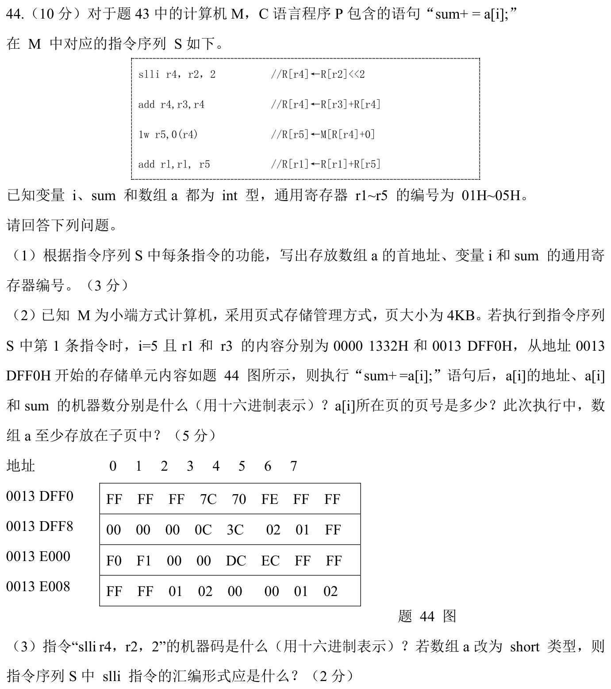

> **讲解资料页。** 本页保留原有逐题讲解与变式；旧每日安排已停用，当前任务只按[全量执行入口](../README.md)进行。不要叠加本页旧时间表。

# Day 22｜虚存攻坚｜页号、字节序与Cache索引

[← Day 21](day21.md) · [总入口](../README.md) · [Day 23 →](day23.md)

**今日判断。** 先用字节地址决定访问哪个页，再用偏移决定属于哪个Cache组。小端序只决定机器数如何从字节拼回。

## 今天按这个顺序做

1. **0–10分钟｜回收。** 闭卷重写昨天的一处断点，写不出就标U。
2. **10–35分钟｜前置题。** 重做 [Day 18 的2025-43](day18.md) 中覆盖块数和覆盖页数的推导，再用 [Day 10 大题2](day10.md) 查 slli 的指令格式。
3. **35–100分钟｜整题。** 用约30分钟首做与核对，其余用于遮住重做、验证边界。先尝试5分钟，再开提示。
4. **100–120分钟｜验收。** 回答下方条件变化，订正后闭卷再写一次。到120分钟停止。

## 大题1｜2024-44 · 追踪数组下标、访存与机器码

[原题单 0919](../../src/0919.md) · [本题共用的2024-43题图](../../bank/2024/q43.png)

没有入口时的第一步

列出四条指令后 r4、r5、r1 的意义，题目沿用 Day 10 大题2 的2024-43指令格式。

完整解法与必要补学

（1）r2 保存 i，左移2得到4i。r3 保存 a 的首址。最后一条把 r5 加回 r1，所以 r1 保存 sum。所求依次为03H、02H、01H。

（2）a[5] 地址=0013 DFF0H+5×4=0013 E004H。四字节按低址到高址是 DC、EC、FF、FF，小端拼成 FFFF ECDCH。sum 机器数为 0000 1332H+FFFF ECDCH 的低32位，即 0000 000EH。4KiB页的页号为0013EH。数组起点在0013DH页，已访问的元素在0013EH页，所以至少占2页。

（3）slli 的高7位为0，shamt=2，rs1=2，位14～12为010，rd=4，低7位0010011，机器码0021 2213H。按题目的2B short，偏移改为2i，故写 slli r4, r2, 1。

重做后检查

如果算出0013 DFF5H，漏掉了元素4B。如果把 DC 写到机器数最高字节，读反了小端。

## 闭卷变式

若 a[5] 是唯一访问的元素，页号仍是0013EH。能因此认为整个数组只跨一页吗？

检查答案

不能。数组的起始地址与 a[5] 已在不同页内，即使只读一个元素，数组的地址范围仍至少跨两页。

记录：实际用时__；两次作答状态 I／H／U__；卡住的题号与第一处断点__。
