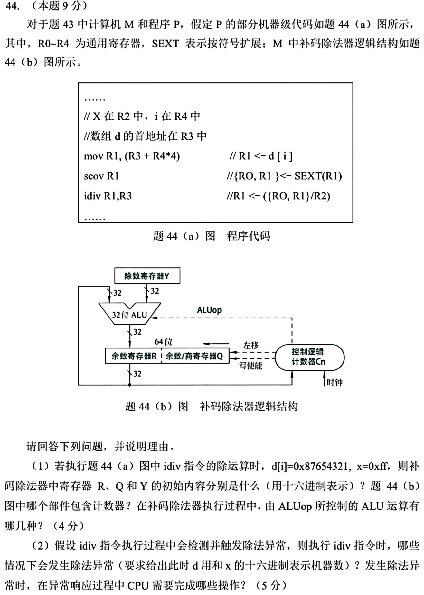

> **讲解资料页。** 本页保留原有逐题讲解与变式；旧每日安排已停用，当前任务只按[全量执行入口](../README.md)进行。不要叠加本页旧时间表。

# Day 24｜流水与异常｜结果延迟及故障返回

[← Day 23](day23.md) · [总入口](../README.md) · [Day 25 →](day25.md)

**今日判断。** 把流水的“结果还没到”与异常的“当前指令未正常完成”分开画。

## 今天按这个顺序做

1. **0–10分钟｜回收。** 闭卷重写昨天的一处断点，写不出就标U。
2. **10–35分钟｜前置题。** 从 [0820](../modules/0820.md) 任选一个旁路例子，再做 [2020-17 原题图](../../bank/2020/q17.png)，先选出理想 CPI 为1的处理器，完成后展开页末核对。
3. **35–100分钟｜整题。** 用约30分钟首做与核对，其余用于遮住重做、验证边界。先尝试5分钟，再开提示。
4. **100–120分钟｜验收。** 回答下方条件变化，订正后闭卷再写一次。到120分钟停止。

## 大题1｜2025-44 · 补码除法、计数器与异常响应

[原题单 0919](../../src/0919.md) · [本题共用的2025-43题图](../../bank/2025/q43.png)

没有入口时的第一步

共用机器字长见 [Day 18 的2025-43](day18.md)。图注给出 x 在R2，并明确以R2内容作除数；题图汇编行末的R3与注释冲突，按功能注释作答。

完整解法与必要补学

（1）被除数为32位负数，扩展到64位后高32位全1。R=FFFFFFFFH，Q=87654321H，Y=000000FFH。控制逻辑内含计数器Cn，追踪逐位运算次数。ALU在补码除法循环中做加、减；图中移位由R、Q寄存器联动实现。

（2）x=00000000H 时除零，d[i]取任意32位机器数。d[i]=80000000H 且 x=FFFFFFFFH 时，−2³¹/−1=+2³¹，超出32位有符号商范围。其他合法非零除数下，32位有符号被除数的商可表示。

检测到异常后，CPU保存可定位故障指令的断点及状态，受控进入内核态，按异常类型定位入口并转去执行异常处理程序。该除法没有正常写回结果；后续由处理程序决定终止或如何恢复。

重做后检查

如果误把80000000H当正数，先写出32位补码的范围。故障断点应能定位触发异常的除法指令。

## 闭卷变式

给定基本5段流水的 I1=load r1、I2=add r2,r1,r3，旁路打开时为什么仍可能要插一拍？

检查答案

2020-17 选B。理想条件下单周期CPU每拍完成一条指令，基本单发射流水在稳定期也每拍完成一条。多周期CPU每条指令跨多个周期，超标量理想时每拍可完成多条。

变式中 load 在访存段末才产生 r1，原排程中 add 已在同一拍的执行段需要它。推迟一拍，才能让已产生的值旁路给 add。

记录：实际用时__；两次作答状态 I／H／U__；卡住的题号与第一处断点__。
