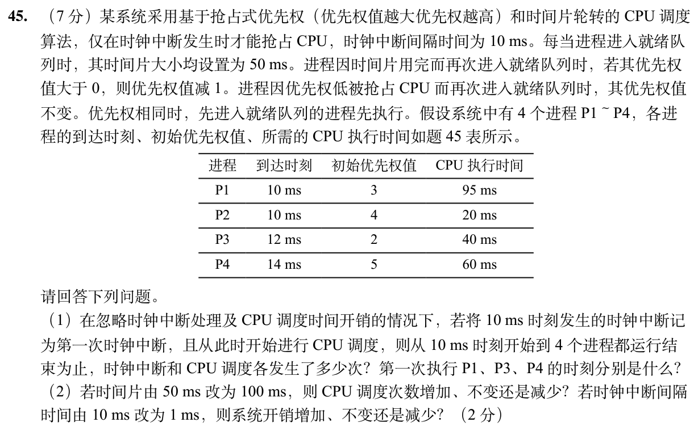

> **讲解资料页。** 本页保留原有逐题讲解与变式；旧每日安排已停用，当前任务只按[全量执行入口](../README.md)进行。不要叠加本页旧时间表。

# Day 30｜设备与调度攻坚｜设备等待、时间片与抢占

[← Day 29](day29.md) · [总入口](../README.md) · [Day 31 →](day31.md)

**今日判断。** 磁盘访问时间由机械等待和传输组成。CPU调度题则逐时钟边界检查抢占，不能把到达时刻当作切换时刻。

## 今天按这个顺序做

1. **0–10分钟｜回收。** 闭卷重写昨天的一处断点，写不出就标U。
2. **10–35分钟｜前置题。** 重做 [0831 模块](../modules/0831.md) 的驱动与缓冲题。再写出转速、每圈时长、平均旋转等待的换算。
3. **35–100分钟｜整题。** 两道题各给约30分钟，先完整写出步骤，剩余时间修正关键一步。先尝试5分钟，再开提示。
4. **100–120分钟｜验收。** 回答下方条件变化，订正后闭卷再写一次。到120分钟停止。

## 大题1｜2022-44 · 磁盘旋转与DMA（闭卷重做）

[Day 16 原图与折叠讲解](day16.md)。只做原页大题2。改成缓冲区128位，重算每扇区所需DMA请求次数。

## 大题2｜2026-45 · 抢占时点、优先级下降与时间片

[原题单 0928](../../src/0928.md)

没有入口时的第一步

每到一个时钟边界先看是否结束、用完时间片或出现更高优先级。相同优先级再比较进入就绪队列的先后。

完整解法与必要补学

（1）CPU占用时间线（ms）：10–20 P2，20–70 P4，70–80 P2，80–90 P4，90–140 P1，140–180 P3，180–225 P1。

P4在14ms到达但到20ms才能抢占。70ms时P4用完50ms时间片，优先级从5降至4，先前已入队的同优先级P2先执行。140ms时P1用完时间片，优先级从3降为2，较早入队的P3先执行。P1、P3、P4首次运行分别为90、140、20ms。从10到220ms共22次时钟中断，实际选进程的调度为7次（从首次选择算至全部完成，不计结束后选空闲进程）。

（2）时间片100ms时，P4和P1均无需因用完时间片重新入队，调度次数减少。时钟间隔改为1ms，单位时间内处理的时钟中断增多，系统开销增加。

重做后检查

四个进程CPU需求共215ms，10ms开始且无空洞，应在225ms结束。用这一点查时刻表。

## 闭卷变式

扇区仍为512B，把DMA缓冲区改为128位后，请求多少次？P4在14ms到达为何20ms才抢占？

检查答案

512/16=32次。按题设只在时钟中断时检查抢占。

记录：实际用时__；两次作答状态 I／H／U__；卡住的题号与第一处断点__。
