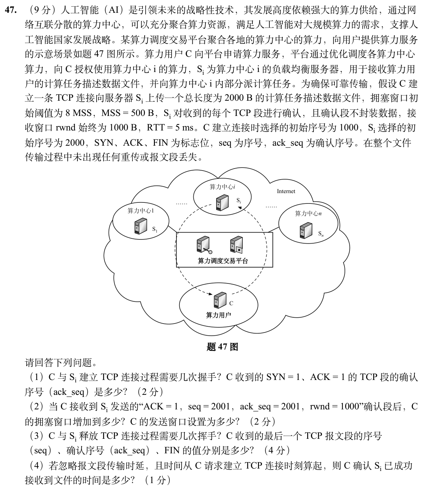

> **讲解资料页。** 本页保留原有逐题讲解与变式；旧每日安排已停用，当前任务只按[全量执行入口](../README.md)进行。不要叠加本页旧时间表。

# Day 31｜网络攻坚｜TCP窗口、序号与报文时间线

[← Day 30](day30.md) · [总入口](../README.md) · [Day 32 →](day32.md)

**今日判断。** 按字节记确认号，按段推进拥塞窗口。每轮能发多少取拥塞窗口和接收窗口的较小值。

## 今天按这个顺序做

1. **0–10分钟｜回收。** 闭卷重写昨天的一处断点，写不出就标U。
2. **10–35分钟｜前置题。** 重做 [0907](../modules/0907.md) 的2024-38，分开握手、数据轮次和TIME_WAIT。下方新题的第（4）问截止于确认文件收齐，关闭阶段另在第（3）问作答。
3. **35–100分钟｜整题。** 两道题各给约30分钟，先完整写出步骤，剩余时间修正关键一步。先尝试5分钟，再开提示。
4. **100–120分钟｜验收。** 回答下方条件变化，订正后闭卷再写一次。到120分钟停止。

## 大题1｜2026-47 · 接收窗口限制下的TCP上传和释放

[原题单 0930](../../src/0930.md)

没有入口时的第一步

把2000B切成四个500B段，序号从1001开始。按每个ACK推进拥塞窗口，再用rwnd截断。

完整解法与必要补学

（1）三次握手。C发出的SYN占用序号1000，服务器的SYN+ACK确认号为1001。

（2）ack_seq=2001已累计确认1000B，即两个500B段。按本题参考解采用的初始窗口1MSS以及题干给出的每段ACK条件，cwnd增至3MSS=1500B。发送窗口取 min(1500,1000)=1000B。窗口大小与扣掉在途数据后当前还能新发的字节数是两回事。

（3）按题目采用的客户端主动关闭、双方分别发送FIN的常规流程，四次挥手。C发送完文件后，下一个序号为3001，FIN占用这个序号，所以服务端对它确认3002。服务端未发送数据，C 收到的最后一段为服务端 FIN+ACK，seq=2001、ack_seq=3002、FIN=1。

（4）建连到可发首段1RTT。数据受窗口限制，三轮发1、2、1段，收到最后确认累计再用3RTT。合计4×5ms=20ms。

重做后检查

把数据段的首字节写为1001、1501、2001、2501。最终数据ACK是3001，收到客户端FIN后的ACK才是3002。

## 大题2｜2023-47 · FTP与TCP拥塞窗口（闭卷重做）

[Day 07 原图与折叠讲解](day07.md)。只做原页大题1。分别圈出SYN占用的一位和ACK确认的下一字节，检查按段增长与按轮描述的区别。

## 闭卷变式

若服务端的 rwnd 改为500B，其余条件相同，从发SYN到确认文件要多久？

检查答案

每轮只能发1段，数据需4RTT。加建连1RTT，共25ms。

记录：实际用时__；两次作答状态 I／H／U__；卡住的题号与第一处断点__。
