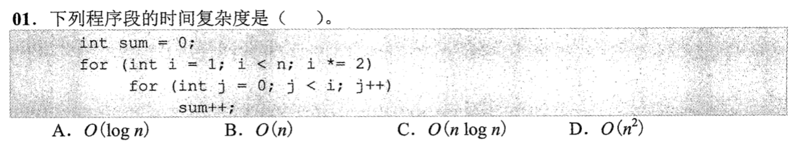
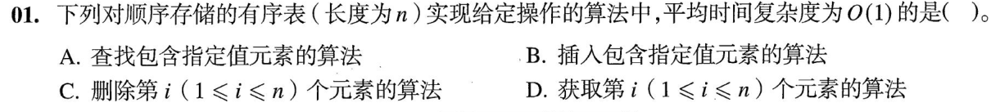
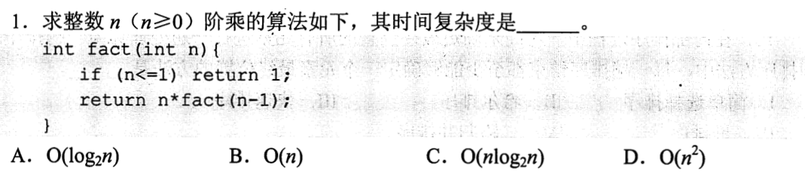
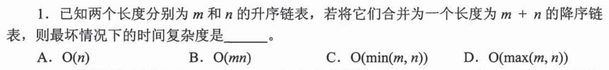
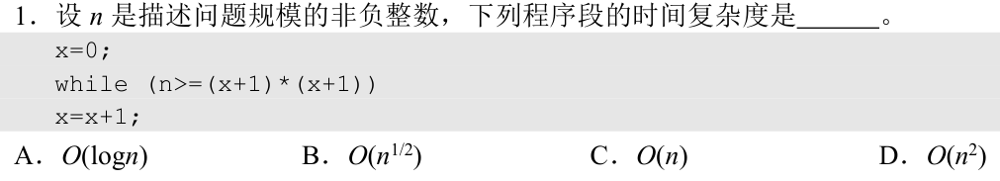

# 0731｜复杂度：先数动作，再判量级

[← 当天安排](../day01.md) · [原题单](../../src/0731.md)

**当前范围：2道2020—2026年题。** 旧题讲解在页末注释保留，暂不安排；本页是现有教学材料的年份更新，不要求刷完整份src题单。

卡住先读：完成本组所需的最少知识

复杂度先看操作如何增长。嵌套循环需要把每轮实际次数相加；外层翻倍、内层做 i 次时，总和为几何级数 O(n)。顺序表的随机访问则由“首地址＋下标×元素大小”直接定位，是 O(1)，不应把按值查找、插入和删除混为一谈。

## 01 · 2022-01

先独立作答并写一句依据；无入口时再展开讲解，读后遮住重做。

核对与补学（作答后展开）

**答案：B。** 外层的 i 依次为 1、2、4、8……；内层分别执行 i 次。总次数是 1+2+4+⋯，最后一项小于 n，和小于 2n 且为线性量级，因此 O(n)。不能直接把“外层 O(log n)”与“内层最大 O(n)”相乘当成紧确阶。

## 02 · 2023-01

先独立作答并写一句依据；无入口时再展开讲解，读后遮住重做。

核对与补学（作答后展开）

**答案：D。** 顺序表能按下标直接计算地址，所以获取第 i 个元素是 O(1)。按值查找平均要比较线性次；插入与删除一般需要移动后续元素，平均都是 O(n)。这题考随机访问，不需要计算嵌套循环。

## 离开前的一个检查

若内层每轮分别做1、2、4、8次，总和的量级是什么？顺序表按下标取元素为什么不需要从头扫描？

检查答案

几何级数由最后一项控制，为 O(n)；顺序存储的元素地址可直接计算，取值是 O(1)。

## 暂缓材料（注释保留）

以下原题及讲解未删除，暂不计入当前训练。

<!-- 暂缓：2012-01；原文保留，当前不安排。
## 01 · 2012-01

先写选项和一句依据；概念题尝试45秒、计算题尝试90秒仍无入口，就展开下面的讲解。学习后遮住讲解，重新作答，保留真实状态。

核对与补学（作答后展开）

**答案：B。** fact(n)只递归调用fact(n−1)一次；从n降到1有n−1层，每层常数次工作，故O(n)。递归深度不能直接当成分支数。

-->

<!-- 暂缓：2013-01；原文保留，当前不安排。
## 02 · 2013-01

先写选项和一句依据；概念题尝试45秒、计算题尝试90秒仍无入口，就展开下面的讲解。学习后遮住讲解，重新作答，保留真实状态。

核对与补学（作答后展开）

**答案：D。** 原题是两个升序链表合并为降序链表，并不是内层循环平方。每次取较小结点头插，所有m+n个结点各处理一次，O(m+n)=O(max(m,n))。

-->

<!-- 暂缓：2019-01；原文保留，当前不安排。
## 03 · 2019-01

先写选项和一句依据；概念题尝试45秒、计算题尝试90秒仍无入口，就展开下面的讲解。学习后遮住讲解，重新作答，保留真实状态。

核对与补学（作答后展开）

**答案：B。** 原题每轮执行x=x+1，条件是n≥(x+1)²，所以约执行√n次，O(n^(1/2))。出现平方不等于指数跳步；必须看变量如何更新。

-->

<!-- 暂缓：随旧题配套的原导学与检查；原文保留，当前不安排。

卡住先读：完成本组所需的最少知识

复杂度数的是基本操作随规模增长的次数，不是代码行数。递归每次只调用一次、规模减一：T(n)=T(n−1)+O(1)，累积O(n)；变量每次加一而退出条件为x²>n，约执行√n次。两个独立规模m、n合并时，要处理m+n个结点，O(m+n)=O(max(m,n))，不能凭一个变量选O(n)。

示例：x从0开始每次加1，直到x³>n，执行次数是立方根量级；如果每次把x乘2，才是对数量级。

## 离开前的一个检查

两个链表长度m、n；若要求把全部结点重新连接成一个链表，为什么不能一般地写O(min(m,n))？

检查答案

较长链表的结点也可能需要逐一改链。总工作量按m+n计；当m远大于n，min(m,n)不能描述对较长链表的处理。

-->
