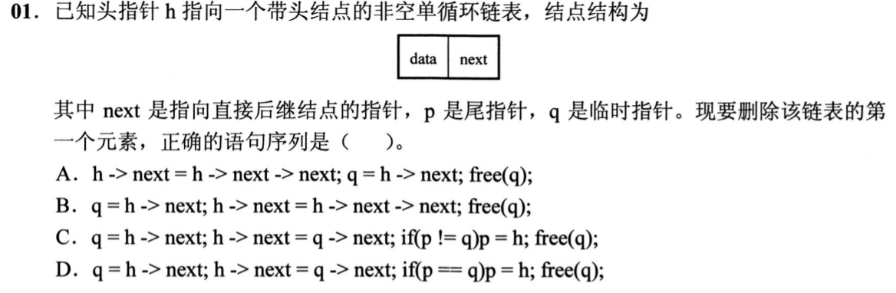
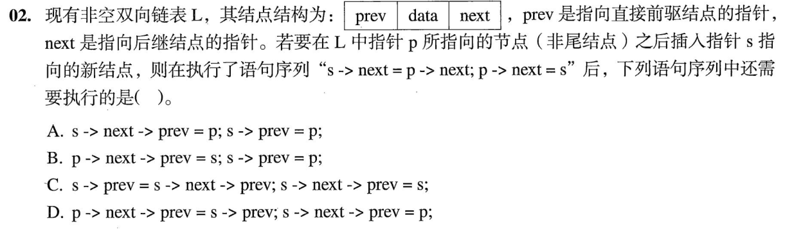
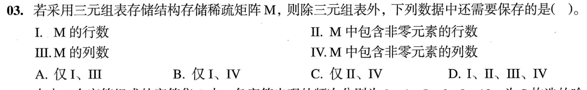
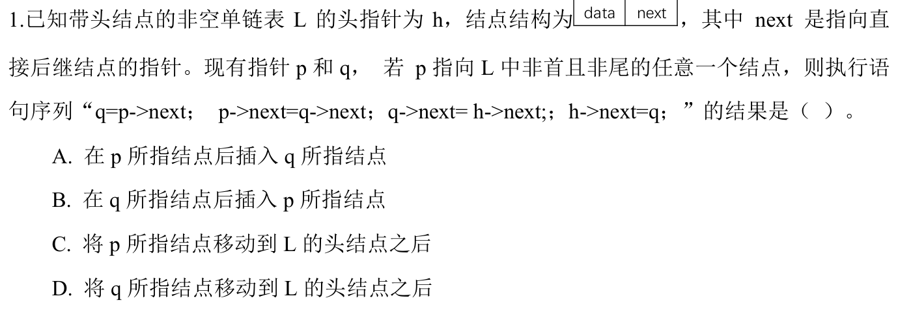
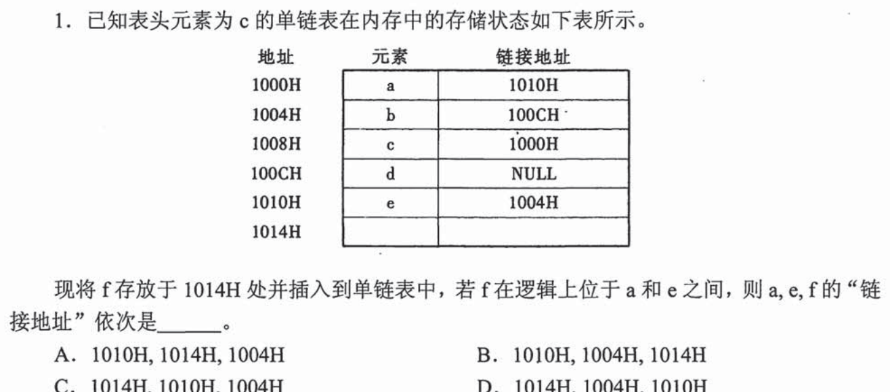
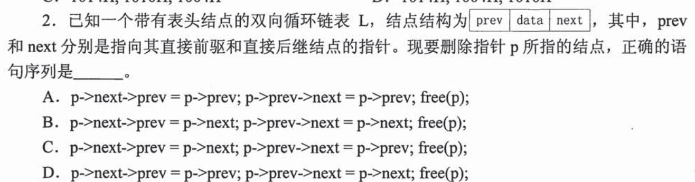
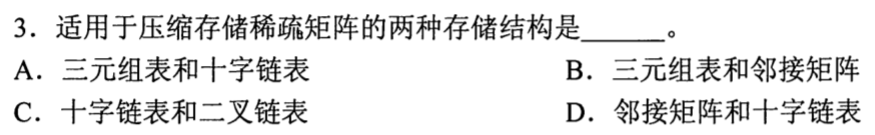

> **已有讲解模块。** 本页仅收录部分题目的讲解；完整2020—2026题单及当天指定题见[全量每日安排](../README.md)，不把做完本模块视作完成对应src全题单。

# 0801｜指针与下标：把逻辑关系画出来

[全量每日安排](../README.md) · [原题单](../../src/0801.md)

**当前范围：4道2020—2026年题。** 旧题讲解在页末注释保留，暂不安排；本页是现有教学材料的年份更新，不要求刷完整份src题单。

卡住先读：完成本组所需的最少知识

指针保存地址，不是结点数据，也不要求指向相邻内存。单链表插入s到p后：先s→next=p→next，再p→next=s；删除p的后继：先保存q=p→next，再p→next=q→next，最后free(q)。双链表还必须把前驱方向接好：相邻u、v始终要满足u→next=v且v→prev=u。

头结点不算第一个数据元素；尾指针删除了它所指结点时必须回退。稀疏矩阵只存非零项，三元组记录行、列、值，但全零行列不能从三元组恢复，必须另存矩阵总行列数。

## 01 · 2021-01

先写选项和一句依据；概念题尝试45秒、计算题尝试90秒仍无入口，就展开下面的讲解。学习后遮住讲解，重新作答，保留真实状态。

核对与补学（作答后展开）

**答案：D。** 先q=h→next，再h→next=q→next；若p==q说明删的是唯一数据结点，尾指针p必须改为h，最后释放q。

## 02 · 2023-02

先写选项和一句依据；概念题尝试45秒、计算题尝试90秒仍无入口，就展开下面的讲解。学习后遮住讲解，重新作答，保留真实状态。

核对与补学（作答后展开）

**答案：C。** 两条next赋值后，s的后继仍是原p的后继，其prev仍指p。先s→prev=s→next→prev得到p，再s→next→prev=s，补齐反向链。

## 03 · 2023-03

先写选项和一句依据；概念题尝试45秒、计算题尝试90秒仍无入口，就展开下面的讲解。学习后遮住讲解，重新作答，保留真实状态。

核对与补学（作答后展开）

**答案：A。** 需要保存矩阵总行数、总列数，即I、III；含非零元素的行列数不能告诉你末尾全零行列有多少。

## 04 · 2024-01

先写选项和一句依据；概念题尝试45秒、计算题尝试90秒仍无入口，就展开下面的讲解。学习后遮住讲解，重新作答，保留真实状态。

核对与补学（作答后展开）

**答案：D。** 先把q=p的后继摘下：p→next=q→next；再将q头插到h之后。被移动的是q，不是p。

## 离开前的一个检查

删除双链表结点p，释放之前必须修好哪两条链？

检查答案

p→prev→next=p→next；p→next→prev=p→prev。先连接相邻结点，再释放p；不要free之后再读取p的成员。

## 暂缓材料（注释保留）

以下原题及讲解未删除，暂不计入当前训练。

<!-- 暂缓：2016-01；原文保留，当前不安排。
## 01 · 2016-01

先写选项和一句依据；概念题尝试45秒、计算题尝试90秒仍无入口，就展开下面的讲解。学习后遮住讲解，重新作答，保留真实状态。

核对与补学（作答后展开）

**答案：D。** 原链为c→a→e→b→d；在a与e之间插入地址1014H的f后，a的链域=1014H，e仍指1004H，f指向e的1010H。

-->

<!-- 暂缓：2016-02；原文保留，当前不安排。
## 02 · 2016-02

先写选项和一句依据；概念题尝试45秒、计算题尝试90秒仍无入口，就展开下面的讲解。学习后遮住讲解，重新作答，保留真实状态。

核对与补学（作答后展开）

**答案：D。** 删除p：后继的prev改成p→prev，前驱的next改成p→next，然后free(p)。只改一边会留下指向已释放结点的链。

-->

<!-- 暂缓：2017-03；原文保留，当前不安排。
## 03 · 2017-03

先写选项和一句依据；概念题尝试45秒、计算题尝试90秒仍无入口，就展开下面的讲解。学习后遮住讲解，重新作答，保留真实状态。

核对与补学（作答后展开）

**答案：A。** 三元组表与十字链表均可只存非零元素。邻接矩阵仍占完整矩阵空间，不是稀疏压缩结构。

-->
