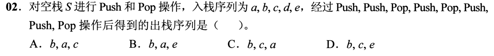
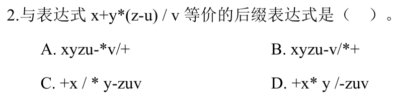
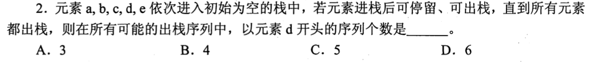
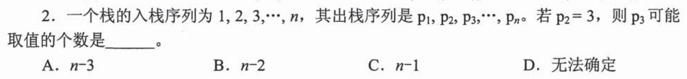
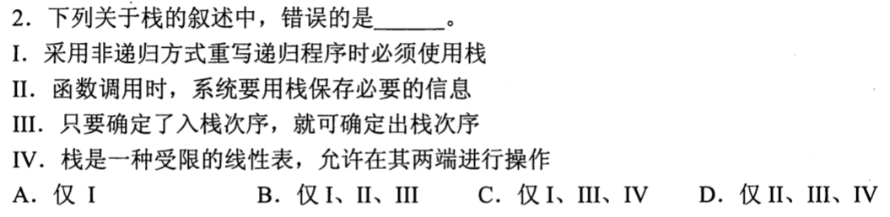

# 0802｜栈与队列：按操作逐步跟踪

[← 当天安排](../day05.md) · [原题单](../../src/0802.md)

**当前范围：2道2020—2026年题。** 旧题讲解在页末注释保留，暂不安排；本页是现有教学材料的年份更新，不要求刷完整份src题单。

卡住先读：完成本组所需的最少知识

栈只在一端进出，后进先出；队列尾进头出，先进先出。判断出栈序列时，只能弹当前栈顶，想要更后的输入元素就必须继续入栈。递归可用栈模拟，但某些尾递归可直接改循环，不能说所有非递归改写必须用栈。后缀表达式按左、右、运算符排列；遇运算符先弹右操作数、再弹左操作数。

## 01 · 2020-02

先写选项和一句依据；概念题尝试45秒、计算题尝试90秒仍无入口，就展开下面的讲解。学习后遮住讲解，重新作答，保留真实状态。

核对与补学（作答后展开）

**答案：D。** 逐步跟踪：入a、入b、出b、入c、出c、入d、入e、出e，输出b,c,e。不要自动把剩下的栈也全部弹出。

## 02 · 2024-02

先写选项和一句依据；概念题尝试45秒、计算题尝试90秒仍无入口，就展开下面的讲解。学习后遮住讲解，重新作答，保留真实状态。

核对与补学（作答后展开）

**答案：A。** 先(z−u)→zu−，再y乘→yzu−*，再除v→yzu−*v/，最后与x相加→xyzu−*v/+。乘除同优先级按原式左结合。

## 离开前的一个检查

后缀ab−表示a−b还是b−a？

检查答案

a−b。栈先弹出的是右操作数b，再弹左操作数a。

## 暂缓材料（注释保留）

以下原题及讲解未删除，暂不计入当前训练。

<!-- 暂缓：2011-02；原文保留，当前不安排。
## 01 · 2011-02

先写选项和一句依据；概念题尝试45秒、计算题尝试90秒仍无入口，就展开下面的讲解。学习后遮住讲解，重新作答，保留真实状态。

核对与补学（作答后展开）

**答案：B。** d首先出栈时a、b、c在栈内，e未入。之后a、b、c必须按c、b、a弹出，e可插在这三个元素之前、之间或之后，共4种。

-->

<!-- 暂缓：2013-02；原文保留，当前不安排。
## 02 · 2013-02

先写选项和一句依据；概念题尝试45秒、计算题尝试90秒仍无入口，就展开下面的讲解。学习后遮住讲解，重新作答，保留真实状态。

核对与补学（作答后展开）

**答案：C。** p₂=3，p₁可为1、2，或任意4至n，共n−1种；不能是3。若先弹大于3的数，3在它下方，第二次仍可弹3。

-->

<!-- 暂缓：2017-02；原文保留，当前不安排。
## 03 · 2017-02

先写选项和一句依据；概念题尝试45秒、计算题尝试90秒仍无入口，就展开下面的讲解。学习后遮住讲解，重新作答，保留真实状态。

核对与补学（作答后展开）

**答案：C。** I错：尾递归等有时可直接改循环；III错：入栈序列不能唯一决定弹出时机；IV错：栈只允许同一端操作。II正确，错误项I、III、IV。

-->
