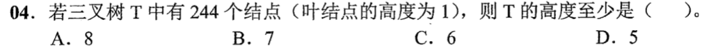
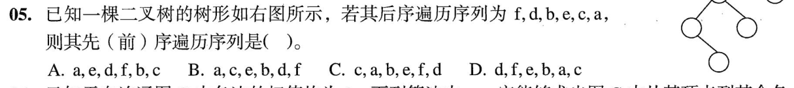
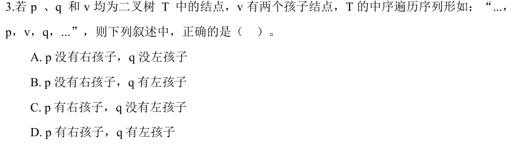
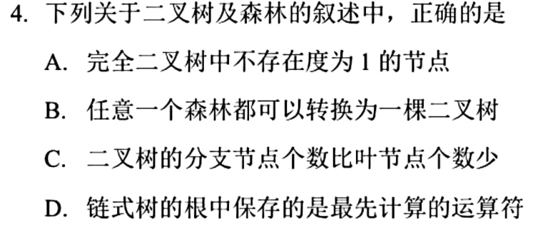
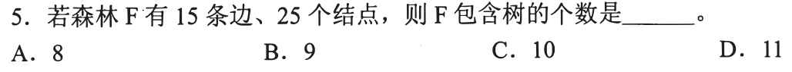
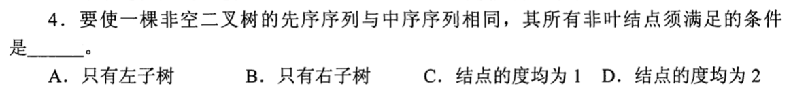
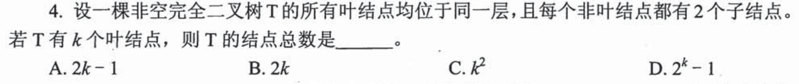
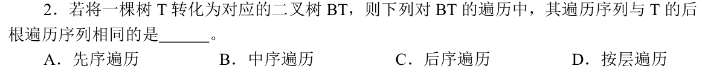

# 0803｜树形约束：计数公式与遍历位置

[← 当天安排](../day07.md) · [原题单](../../src/0803.md)

**当前范围：4道2020—2026年题。** 旧题讲解在页末注释保留，暂不安排；本页是现有教学材料的年份更新，不要求刷完整份src题单。

卡住先读：完成本组所需的最少知识

有n个结点、t棵树的森林共有n−t条边。二叉树n₀=n₂+1；若无度1结点，总结点=2n₀−1。高度从1起的满m叉树最多(m^h−1)/(m−1)个结点。先序根左右，中序左根右，后序左右根；已知树形就先按遍历位置填结点。树转二叉树用左孩子右兄弟表示：树的先根对应二叉树先序，树的后根对应二叉树中序。

## 01 · 2022-04

先写选项和一句依据；概念题尝试45秒、计算题尝试90秒仍无入口，就展开下面的讲解。学习后遮住讲解，重新作答，保留真实状态。

核对与补学（作答后展开）

**答案：C。** 三叉树h=5最多(3⁵−1)/2=121个，不够244；h=6最多364个，故最小高度6。

## 02 · 2023-05

先写选项和一句依据；概念题尝试45秒、计算题尝试90秒仍无入口，就展开下面的讲解。学习后遮住讲解，重新作答，保留真实状态。

核对与补学（作答后展开）

**答案：A。** 后序末项a是根；右子树仅一个结点c，左子树后序f,d,b,e，其根e、右孩子b、左孩子d（d右孩子f）。先序根左右得a,e,d,f,b,c，选A。按树形分配后序片段，不能仅靠末两项猜结构。

## 03 · 2024-03

先写选项和一句依据；概念题尝试45秒、计算题尝试90秒仍无入口，就展开下面的讲解。学习后遮住讲解，重新作答，保留真实状态。

核对与补学（作答后展开）

**答案：A。** p是v的中序前驱，v有左子树时p为左子树最右结点，因此p无右孩子；q为右子树最左结点，因此q无左孩子。

## 04 · 2025-04

先写选项和一句依据；概念题尝试45秒、计算题尝试90秒仍无入口，就展开下面的讲解。学习后遮住讲解，重新作答，保留真实状态。

核对与补学（作答后展开）

**答案：B。** 任意森林可用左孩子右兄弟转换成二叉树。完全二叉树可有一个度1结点；一般二叉树分支数未必少于叶子；表达式树根通常是最后执行的运算。

## 离开前的一个检查

有12个结点、8条边的森林有几棵树？先序等于中序的非空二叉树能有左孩子吗？

检查答案

4棵；不能有左孩子，否则根在先序和中序的先后位置不同。

## 暂缓材料（注释保留）

以下原题及讲解未删除，暂不计入当前训练。

<!-- 暂缓：2016-05；原文保留，当前不安排。
## 01 · 2016-05

先写选项和一句依据；概念题尝试45秒、计算题尝试90秒仍无入口，就展开下面的讲解。学习后遮住讲解，重新作答，保留真实状态。

核对与补学（作答后展开）

**答案：C。** 森林边数e=n−t，所以t=25−15=10。每棵树比结点数少一条边，森林逐棵相加即可。

-->

<!-- 暂缓：2017-04；原文保留，当前不安排。
## 02 · 2017-04

先写选项和一句依据；概念题尝试45秒、计算题尝试90秒仍无入口，就展开下面的讲解。学习后遮住讲解，重新作答，保留真实状态。

核对与补学（作答后展开）

**答案：B。** 先序一开始访问根，中序须先访问左子树。两者相同要求每一非叶结点都无左子树、只有右子树。

-->

<!-- 暂缓：2018-04；原文保留，当前不安排。
## 03 · 2018-04

先写选项和一句依据；概念题尝试45秒、计算题尝试90秒仍无入口，就展开下面的讲解。学习后遮住讲解，重新作答，保留真实状态。

核对与补学（作答后展开）

**答案：A。** 题设每个非叶都有2孩子，n₁=0；叶k=n₂+1，故n=k+(k−1)=2k−1。完全二叉条件不是使用此式的必要条件。

-->

<!-- 暂缓：2019-02；原文保留，当前不安排。
## 04 · 2019-02

先写选项和一句依据；概念题尝试45秒、计算题尝试90秒仍无入口，就展开下面的讲解。学习后遮住讲解，重新作答，保留真实状态。

核对与补学（作答后展开）

**答案：B。** 左孩子右兄弟转换后，中序先访问孩子链再根，恰对应原树孩子先于根的后根遍历。不要把树的后根机械等同二叉树后序。

-->
