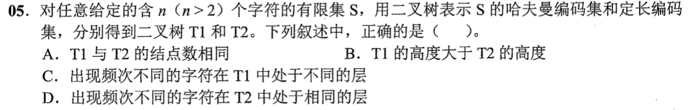
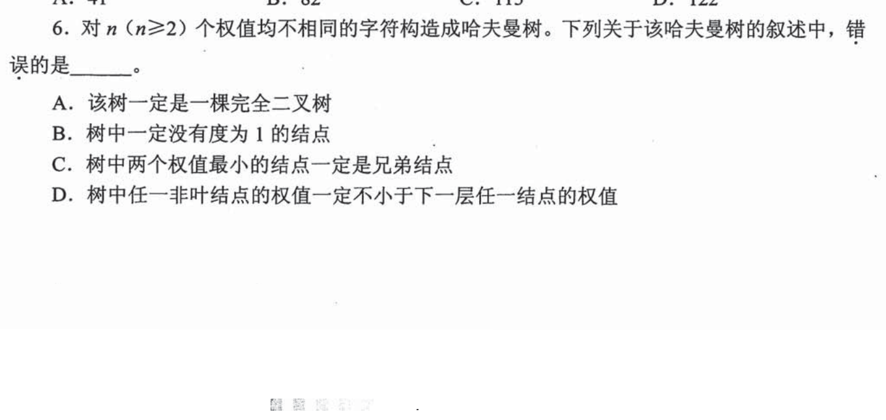
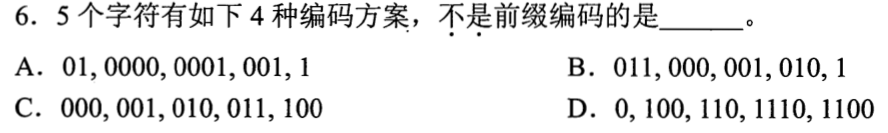
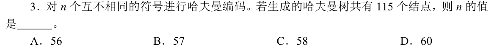

# 0804｜哈夫曼：前缀约束与结点数量

[← Day 09](../day09.md) · [原题单](../../src/0804.md)

**当前范围：1道2020—2026年题。** 旧题讲解在页末注释保留，暂不安排；本页是现有教学材料的年份更新，不要求刷完整份src题单。

卡住先读：完成本组所需的最少知识

前缀码要求任何完整码字都不是其他码字的开头，才能即时唯一译码。二叉哈夫曼每次合并最小两权，新结点权为两者之和，直至根；共有n个叶子、n−1个内部结点、2n−1个总结点，不存在度1结点，但不一定是完全二叉树。WPL=Σ频次×码长；权不同也可能得到相同码长。定长编码所有字符码长一致。

## 01 · 2022-05

先写选项和一句依据；概念题尝试45秒、计算题尝试90秒仍无入口，就展开下面的讲解。学习后遮住讲解，重新作答，保留真实状态。

核对与补学（作答后展开）

**答案：D。** 定长编码的所有字符都是同一深度，频次不同也不改变码长。哈夫曼树中频次不同的字符也可同层。两种树的高度可以相同；例如4个等频字符都用2位。结点数也未必相同，例如3个字符的定长码取00、01、10，按这三条路径建树有6个结点，而二叉哈夫曼树有5个。

## 离开前的一个检查

码字0、10、110、111是否是前缀码？有4个符号的二叉哈夫曼有几个结点？

检查答案

是，没有码字是另一完整码字的前缀；总结点2×4−1=7。

## 暂缓材料（注释保留）

以下原题及讲解未删除，暂不计入当前训练。

<!-- 暂缓：2010-06；原文保留，当前不安排。
## 01 · 2010-06

先写选项和一句依据；概念题尝试45秒、计算题尝试90秒仍无入口，就展开下面的讲解。学习后遮住讲解，重新作答，保留真实状态。

核对与补学（作答后展开）

**答案：A。** 哈夫曼树不一定完全，叶子不必按完全二叉规则靠左排列；它的要求是带权路径长度最优，不是形状尽量满。

-->

<!-- 暂缓：2014-06；原文保留，当前不安排。
## 02 · 2014-06

先写选项和一句依据；概念题尝试45秒、计算题尝试90秒仍无入口，就展开下面的讲解。学习后遮住讲解，重新作答，保留真实状态。

核对与补学（作答后展开）

**答案：D。** 110是1100的前缀，收到110时无法立刻确定是否结束，所以D不是前缀码。用短码逐一检查是否出现在长码开头。

-->

<!-- 暂缓：2019-03；原文保留，当前不安排。
## 03 · 2019-03

先写选项和一句依据；概念题尝试45秒、计算题尝试90秒仍无入口，就展开下面的讲解。学习后遮住讲解，重新作答，保留真实状态。

核对与补学（作答后展开）

**答案：C。** 总结点115=2n−1，n=58。符号只对应叶子，不能把内部合并结点也算符号。

-->
