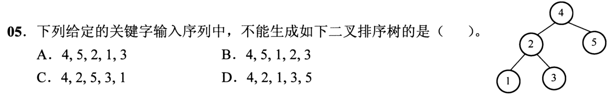
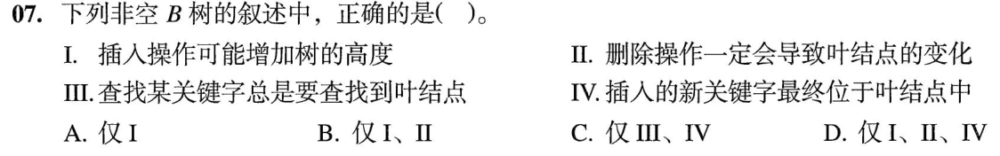
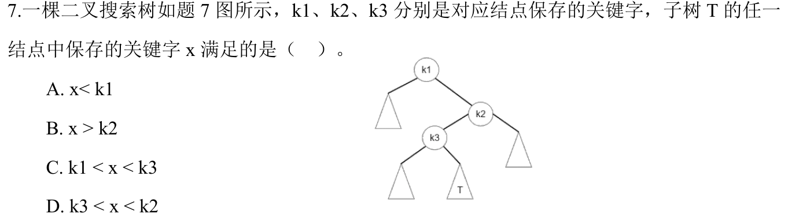
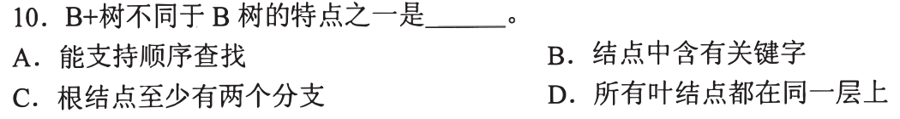
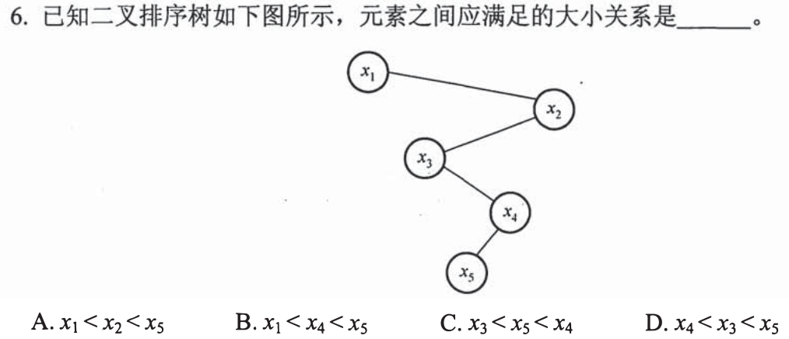
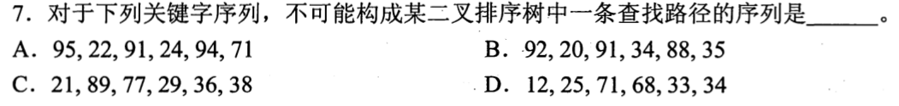

# 0805｜有序树：沿祖先约束缩小区间

[← 模块入口](../README.md) · [原题单](../../src/0805.md)

本页是已写草稿收尾后的独立模块，未据此新增每日安排。

**当前范围：3道2020—2026年题。** 旧题讲解在页末注释保留，暂不安排；本页是现有教学材料的年份更新，不要求刷完整份src题单。

卡住先读：完成本组所需的最少知识

BST每个结点的整棵左子树都小于它、右子树都大于它。查找路径必须同时满足所有祖先给出的上下界，不只比较相邻两项。插入顺序中，一个子树的根必须早于其后代。B树内部和叶中均可命中关键字；B+树所有记录在底层叶子、叶间有链，便于顺序和区间扫描。B树插入分裂可使新关键字提升到内部结点，不能说最终一定留叶。

## 01 · 2020-05

先写选项和一句依据；概念题尝试45秒、计算题尝试90秒仍无入口，就展开下面的讲解。学习后遮住讲解，重新作答，保留真实状态。

核对与补学（作答后展开）

**答案：B。** 目标左子树根是2，故2必须在1、3之前插入。B先插1再插2，会把1变成4的左孩子，不能得到题图。

## 02 · 2023-07

先写选项和一句依据；概念题尝试45秒、计算题尝试90秒仍无入口，就展开下面的讲解。学习后遮住讲解，重新作答，保留真实状态。

核对与补学（作答后展开）

**答案：B。** I插入根分裂可增高；II删除最终在叶层移除或调整关键字，会改变叶；III错，B树可在内部命中；IV错，插入关键字可分裂提升。选I、II。

## 03 · 2024-07

先写选项和一句依据；概念题尝试45秒、计算题尝试90秒仍无入口，就展开下面的讲解。学习后遮住讲解，重新作答，保留真实状态。

核对与补学（作答后展开）

**答案：D。** T在k3右侧且在k2左侧，所有x满足k3<x<k2，同时继承k1<x。D给出有效的更紧区间。

## 离开前的一个检查

BST路径50→20→40后，下一个结点30与45都可能吗？60呢？

检查答案

30与45可能，分别进入40左或右侧，且都在20与50之间；60违背根50留下的上界，不可能。

## 暂缓材料（注释保留）

以下原题及讲解未删除，暂不计入当前训练。

<!-- 暂缓：2016-10；原文保留，当前不安排。
## 01 · 2016-10

先写选项和一句依据；概念题尝试45秒、计算题尝试90秒仍无入口，就展开下面的讲解。学习后遮住讲解，重新作答，保留真实状态。

核对与补学（作答后展开）

**答案：A。** B+树叶子链支持顺序扫描，既可从根查也可沿叶链顺序找。结点含关键字、叶同层等并非它独有。

-->

<!-- 暂缓：2018-06；原文保留，当前不安排。
## 02 · 2018-06

先写选项和一句依据；概念题尝试45秒、计算题尝试90秒仍无入口，就展开下面的讲解。学习后遮住讲解，重新作答，保留真实状态。

核对与补学（作答后展开）

**答案：C。** 图中x5在x3右子树，故x5>x3；又在x4左子树，故x5<x4，得到x3<x5<x4。应同时继承祖先区间。

-->

<!-- 暂缓：2011-07；原文保留，当前不安排。
## 06 · 2011-07

先写选项和一句依据；概念题尝试45秒、计算题尝试90秒仍无入口，就展开下面的讲解。学习后遮住讲解，重新作答，保留真实状态。

核对与补学（作答后展开）

**答案：A。** 95→22后，后续值必须在(22,95)；91后往24走要求接下来<91；94已超出上界91，不可能。逐次维护上下界能排除。

-->
