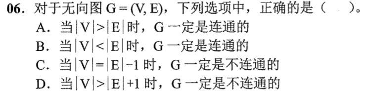
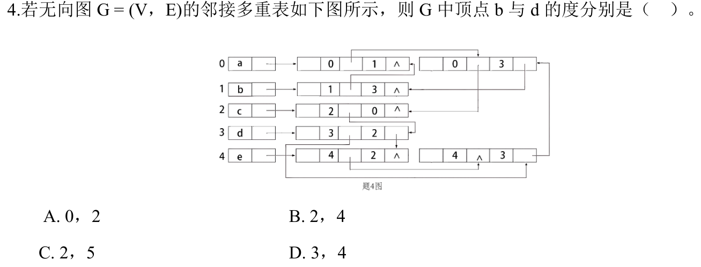

# 0806｜无向图的边数与邻接多重表

[← Day 13](../day13.md) · [原题单](../../src/0806.md)

**本日指定 2 题。** 先写选项和一句依据，卡住再展开补学。

卡住先读：本组判据

连通图至少有 n−1 条边。邻接多重表的一条无向边只存一个边结点，沿当前端点对应的指针追踪。

## 01 · 2022-06

核对与补学（作答后展开）

**答案：D。** 连通图有生成树，至少有 |V|−1 条边。边数达到下界仍可能不连通，例如三角形加一个孤点。

## 02 · 2024-04

核对与补学（作答后展开）

**答案：B。** b 关联 (0,1)、(1,3) 两条边；d 关联 (0,3)、(1,3)、(3,2)、(4,3) 四条边。追踪每条边时按所求端点位于 i 还是 j，选对应的链接。

## 离开前的一个检查

五个点四条边一定连通吗？

检查答案

不一定，四点成环加一个孤点。

