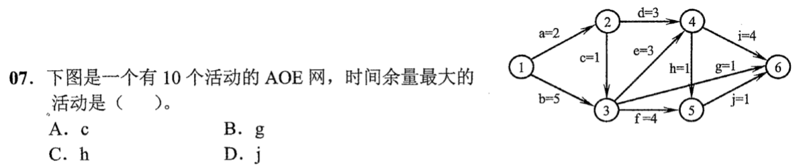
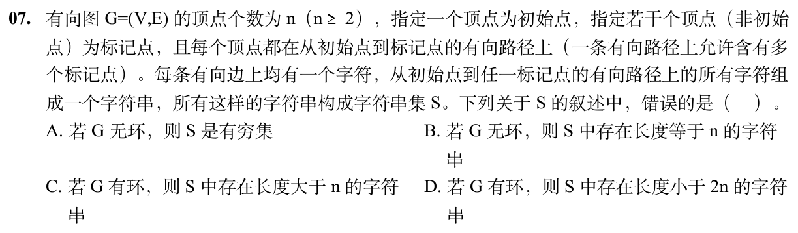

> **已有讲解模块。** 本页仅收录部分题目的讲解；完整2020—2026题单及当天指定题见[全量每日安排](../README.md)，不把做完本模块视作完成对应src全题单。

# 0807｜图上的工期余量与路径长度

[全量每日安排](../README.md) · [原题单](../../src/0807.md)

**本日指定 2 题。** 先写选项和一句依据，卡住再展开补学。

卡住先读：本组判据

关键路径正向取最晚完成的前驱，反向取最早期限的后继。无环图不能沿途重访顶点。

## 01 · 2022-07

核对与补学（作答后展开）

**答案：B。** 事件1～6的最早时刻为0、2、5、8、9、12，最迟为0、4、5、8、11、12。用终点最迟减时长再减起点最早，c、g、h、j 的余量是2、6、2、2。

## 02 · 2026-07

核对与补学（作答后展开）

**答案：B。** 无环时至多经过 n−1 条边，串长不会达到 n。可达且通往标记点的环能反复绕行。另取到某标记点的最短路，必不重复顶点，长度小于2n。

## 离开前的一个检查

一条路经过 k 个不同顶点并且不重访，共几条边？

检查答案

k−1 条。

