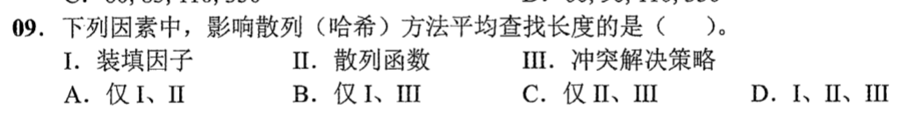
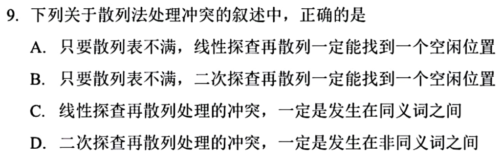

> **已有讲解模块。** 本页仅收录部分题目的讲解；完整2020—2026题单及当天指定题见[全量每日安排](../README.md)，不把做完本模块视作完成对应src全题单。

# 0808｜散列冲突与平均查找长度

[全量每日安排](../README.md) · [原题单](../../src/0808.md)

**本日指定 2 题。** 先写选项和一句依据，卡住再展开补学。

卡住先读：本组判据

先区分初始地址与实际探查位置。装填因子控制占用程度，散列函数和冲突策略决定候选的集中程度与探查路线。

## 01 · 2022-09

核对与补学（作答后展开）

**答案：D。** 三个因素都可能改变探查次数。即使装填因子相同，散列分布或冲突处理方式不同，平均查找长度仍可不同。

## 02 · 2025-09

核对与补学（作答后展开）

**答案：A。** 线性探查逐槽循环，表未满就能遇到空位。二次探查未必覆盖全表。不同初始地址的关键字也可能撞上同一实际探查位置。

## 离开前的一个检查

找到首个从未使用的空槽时，无删除的开放定址查找能停吗？

检查答案

能。目标若按同一序列插入，会在这里停下。

