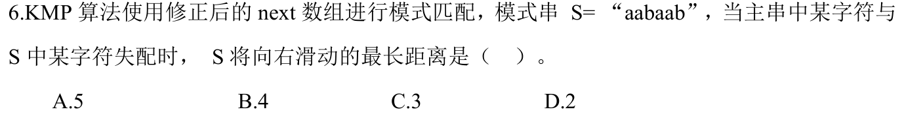

# 0809｜KMP 失配时保留的前缀

[← Day 17](../day17.md) · [原题单](../../src/0809.md)

**本日指定 1 题。** 先写选项和一句依据，卡住再展开补学。

卡住先读：本组判据

主串位置保持不动。先用已匹配部分的最长真前后缀计算回退，再跳过与失配字符相同的候选。

## 01 · 2024-06

核对与补学（作答后展开）

**答案：A。** 按1起始下标，aabaab 的 nextval 为 0、0、2、0、0、2。第5位失配时，依次可退到第2位和第1位，但三者都是 a，已知都会失配，最终退到0。右移5个位置；第6位仍可退到第2位，只移4位。

## 离开前的一个检查

nextval 跳过候选时，已知哪两个字符相等？

检查答案

当前模式位与回退候选位相等，所以当前主串字符与二者均不匹配。

