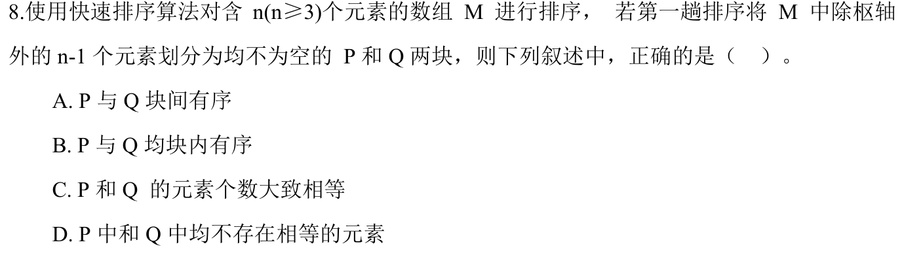
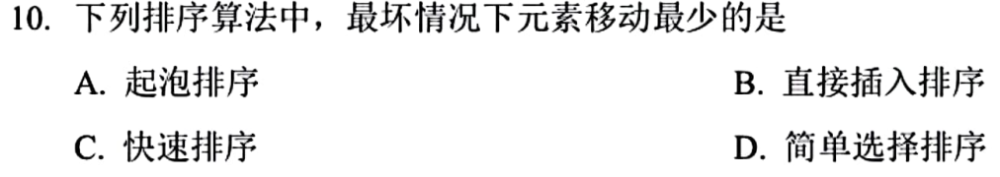

# 0810｜内排序：区分划分结果、比较与移动

[← Day 19](../day19.md) · [原题单](../../src/0810.md)

**本日指定 2 题。** 先写选项和一句依据，卡住再展开补学。

卡住先读：本组判据

快排每次划分先保证枢轴两侧的相对范围。简单选择每趟最多交换一次，找最小仍需要扫描。

## 01 · 2024-08

核对与补学（作答后展开）

**答案：A。** 划分后左块元素均不大于右块元素，两块之间有序。块内仍可无序、存在重复，枢轴也可能使两块很不均衡。

## 02 · 2025-10

核对与补学（作答后展开）

**答案：D。** 简单选择排序每趟至多一次交换，总移动量 O(n)。另外几种在最坏情形的移动数可达 O(n²)。选择排序的比较次数仍是平方量级。

## 离开前的一个检查

一次快排划分后，哪一项已到最终排序位置？

检查答案

题设的标准划分中，枢轴已到一个合法最终位置。

