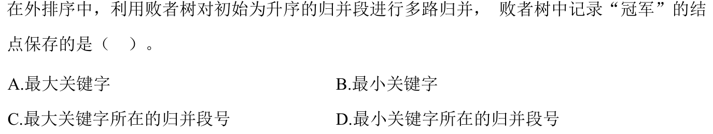

> **已有讲解模块。** 本页仅收录部分题目的讲解；完整2020—2026题单及当天指定题见[全量每日安排](../README.md)，不把做完本模块视作完成对应src全题单。

# 0811｜外归并：冠军、归并趟数与生成方式

[全量每日安排](../README.md) · [原题单](../../src/0811.md)

**本日指定 1 题。** 先写选项和一句依据，卡住再展开补学。

卡住先读：本组判据

k路归并时，每路只把段首作为候选，输出冠军后从该段补下一个元素。区分普通内排序生成初始段与置换选择生成初始段。

## 01 · 2024-11

核对与补学（作答后展开）

**答案：D。** 升序归并的冠军对应各段当前最小段首。冠军结点保存该关键字所在的归并段号，由段号读取元素和补入下一条。

## 离开前的一个检查

有20个初始段，4路归并几趟？如果用置换选择，单段能比工作区大吗？

检查答案

20→5→2→1，共3趟。能；若后续记录一直不小于刚输出的记录，甚至可把全文件生成一段。用 [全量每日安排](../README.md) 验证。

