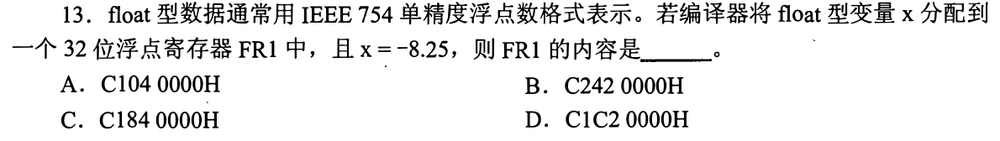
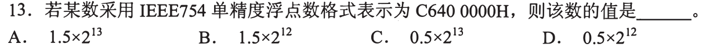
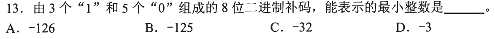
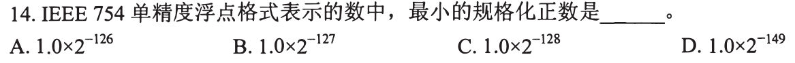
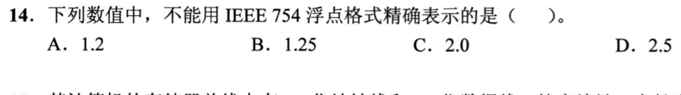
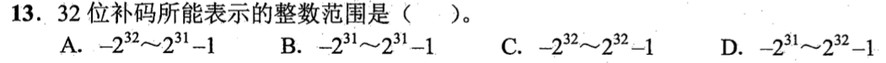
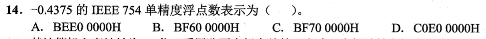
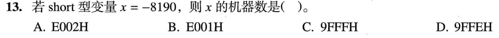
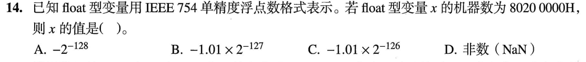
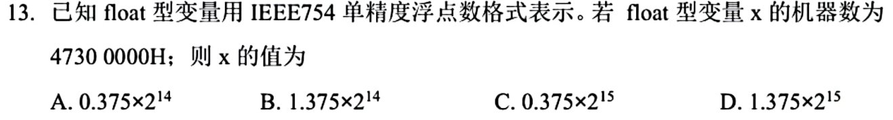

# 0812｜整数与浮点：先切位，再解释

[← 当天安排](../day02.md) · [原题单](../../src/0812.md)

**本轮范围：10道快速题。** 先尝试，卡住再展开讲解；原题前的旧提示不作为依据。本页答案与说明按原图独立核对。

卡住先读：完成本组所需的最少知识

w位补码范围为−2^(w−1)到2^(w−1)−1，负数机器码等于2^w+x。IEEE 754单精度分成符号1位、阶码8位、尾数23位。规格化数值为(−1)^s×(1.f)×2^(E−127)；E=0且f非零是非规格化数，数值为(−1)^s×(0.f)×2^(−126)，没有隐含的1。

十六进制每位展开4bit；先取符号和8位阶码，再算有效数。−8.25=−1.00001₂×2³，所以符号1、阶码130、尾数00001…，编码C1040000H。十进制有限小数能否二进制有限表示，看最简分母是否仅含因子2，还要检查有效位与指数范围。

## 01 · 2011-13

先写选项和一句依据；概念题尝试45秒、计算题尝试90秒仍无入口，就展开下面的讲解。学习后遮住讲解，重新作答，保留真实状态。

核对与补学（作答后展开）

**答案：A。** −8.25=−1000.01₂=−1.00001₂×2³；s=1，E=130，尾数00001后补0，合为C1040000H。原提示漏了负号。

## 02 · 2013-13

先写选项和一句依据；概念题尝试45秒、计算题尝试90秒仍无入口，就展开下面的讲解。学习后遮住讲解，重新作答，保留真实状态。

核对与补学（作答后展开）

**答案：A。** C6400000H：s=1，E=140，f=.1₂，有效数1.5，所以值为−1.5×2¹³。A前有负号，不能只看绝对值。

## 03 · 2015-13

先写选项和一句依据；概念题尝试45秒、计算题尝试90秒仍无入口，就展开下面的讲解。学习后遮住讲解，重新作答，保留真实状态。

核对与补学（作答后展开）

**答案：B。** 负权符号位−128必须占一个1。要最小，剩余两个1放在最低权位1和2，得到10000011₂=−125；放高位会使数变大。

## 04 · 2018-14

先写选项和一句依据；概念题尝试45秒、计算题尝试90秒仍无入口，就展开下面的讲解。学习后遮住讲解，重新作答，保留真实状态。

核对与补学（作答后展开）

**答案：A。** 规格化数最小正阶码E=1，对应指数−126；有效数最小1.0，得2^(−126)。2^(−149)是最小正非规格化数，题目特意限定规格化。

## 05 · 2021-14

先写选项和一句依据；概念题尝试45秒、计算题尝试90秒仍无入口，就展开下面的讲解。学习后遮住讲解，重新作答，保留真实状态。

核对与补学（作答后展开）

**答案：A。** 1.2=6/5，最简分母含5，二进制无限循环；1.25、2、2.5的二进制均有限且在表示范围内。

## 06 · 2022-13

先写选项和一句依据；概念题尝试45秒、计算题尝试90秒仍无入口，就展开下面的讲解。学习后遮住讲解，重新作答，保留真实状态。

核对与补学（作答后展开）

**答案：B。** 32位补码最高位权−2³¹，其余位权和2³¹−1，端点为−2³¹与2³¹−1。

## 07 · 2022-14

先写选项和一句依据；概念题尝试45秒、计算题尝试90秒仍无入口，就展开下面的讲解。学习后遮住讲解，重新作答，保留真实状态。

核对与补学（作答后展开）

**答案：A。** −0.4375=−0.0111₂=−1.11₂×2^(−2)；s=1，E=125=01111101₂，尾数110…，编码BEE00000H。

## 08 · 2023-13

先写选项和一句依据；概念题尝试45秒、计算题尝试90秒仍无入口，就展开下面的讲解。学习后遮住讲解，重新作答，保留真实状态。

核对与补学（作答后展开）

**答案：A。** 16位short中−8190的补码=65536−8190=57346=E002H。先确定位宽，不能直接把负号写进十六进制。

## 09 · 2023-14

先写选项和一句依据；概念题尝试45秒、计算题尝试90秒仍无入口，就展开下面的讲解。学习后遮住讲解，重新作答，保留真实状态。

核对与补学（作答后展开）

**答案：A。** 80200000H的E=0，f=.01₂=1/4；值=−(1/4)×2^(−126)=−2^(−128)。这里不能补隐含1。

## 10 · 2025-13

先写选项和一句依据；概念题尝试45秒、计算题尝试90秒仍无入口，就展开下面的讲解。学习后遮住讲解，重新作答，保留真实状态。

核对与补学（作答后展开）

**答案：D。** 47300000H拆得E=142，指数15；有效数1.011₂=1.375，结果1.375×2¹⁵。

## 离开前的一个检查

E=0、尾数非零时，还能用1.f和E−127吗？

检查答案

不能。用0.f和固定指数−126；这是非规格化数。若尾数也为0则表示带符号零。

