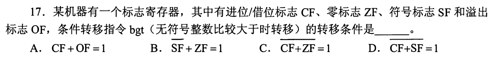
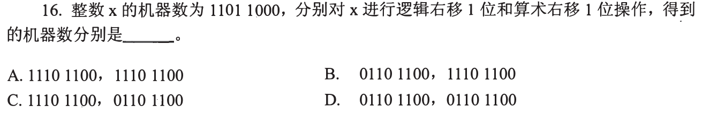
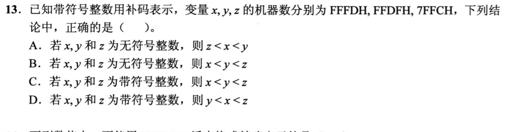
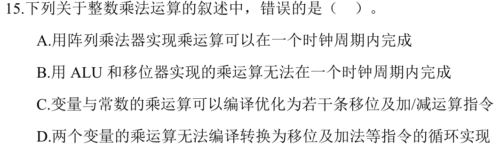

# 0813｜有限位运算：先辨有符号还是无符号

[← 当天安排](../day04.md) · [原题单](../../src/0813.md)

**本轮范围：4道快速题。** 先尝试，卡住再展开讲解；原题前的旧提示不作为依据。本页答案与说明按原图独立核对。

卡住先读：完成本组所需的最少知识

机器码不变，解释类型变了，大小关系就可能改变。w位补码最高位为1时真值=无符号码−2^w。逻辑右移高位补0，算术右移补原符号位；左移要检查溢出，不能无条件当乘2。

比较常由减法产生标志：无符号A>B需既不借位也不为零（按本题CF=借位约定，即CF=0且ZF=0）；有符号比较看SF与OF的组合，不能混用。乘法既可用阵列硬件并行实现，也可用移位加法迭代实现；编译器可把乘常数改写成移位加减。

## 01 · 2011-17

先写选项和一句依据；概念题尝试45秒、计算题尝试90秒仍无入口，就展开下面的讲解。学习后遮住讲解，重新作答，保留真实状态。

核对与补学（作答后展开）

**答案：C。** 无符号大于要求CF=0且ZF=0；图中C是对CF+ZF整体取反等于1，即NOR条件，不是CF+ZF=1。不要忽略选项上方横线。

## 02 · 2018-16

先写选项和一句依据；概念题尝试45秒、计算题尝试90秒仍无入口，就展开下面的讲解。学习后遮住讲解，重新作答，保留真实状态。

核对与补学（作答后展开）

**答案：B。** 11011000逻辑右移补0得01101100；算术右移补符号1得11101100。低位均丢弃。

## 03 · 2021-13

先写选项和一句依据；概念题尝试45秒、计算题尝试90秒仍无入口，就展开下面的讲解。学习后遮住讲解，重新作答，保留真实状态。

核对与补学（作答后展开）

**答案：D。** 16位有符号：x=FFFDH=−3，y=FFDFH=−33，z=7FFCH=32764，所以y<x<z。若按无符号解释则z<y<x。

## 04 · 2024-15

先写选项和一句依据；概念题尝试45秒、计算题尝试90秒仍无入口，就展开下面的讲解。学习后遮住讲解，重新作答，保留真实状态。

核对与补学（作答后展开）

**答案：D。** 两个变量相乘也能用循环移位加法实现，D说无法转换是错的。阵列乘法器可在一个足够长的时钟周期完成；串行移位加法通常需多个周期。

## 离开前的一个检查

同一16位码FFFFH，按unsigned short和short分别是多少？

检查答案

分别为65535和−1。机器位模式相同，数值解释不同；比较题先确定类型再算。

