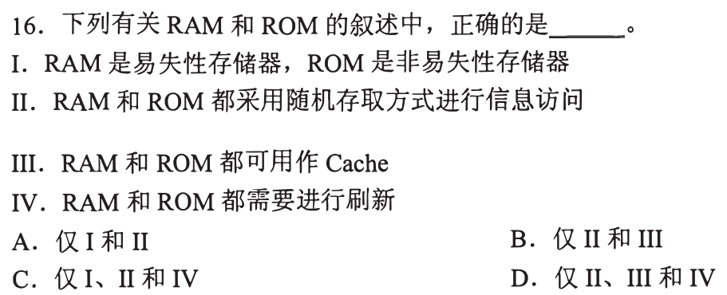
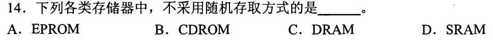
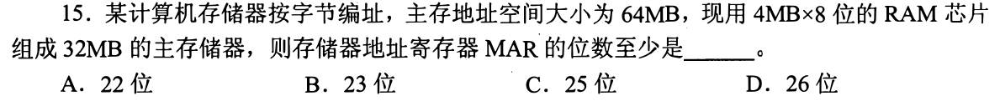
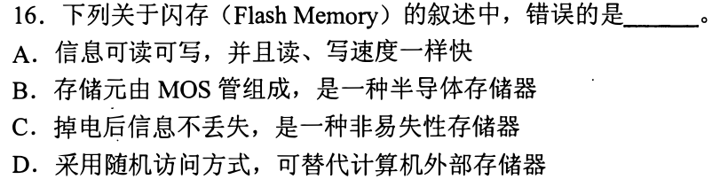
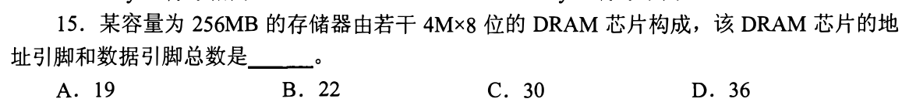
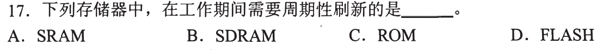
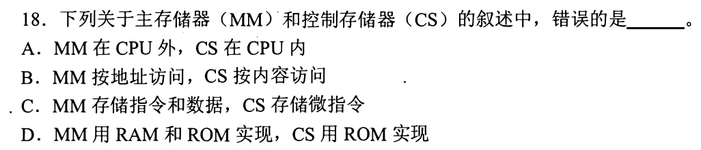

# 0814｜存储器：容量、地址位与芯片引脚

[← 当天安排](../day06.md) · [原题单](../../src/0814.md)

**本轮范围：7道快速题。** 先尝试，卡住再展开讲解；原题前的旧提示不作为依据。本页答案与说明按原图独立核对。

卡住先读：完成本组所需的最少知识

按字节编址时，2^a个字节地址需要a位地址。芯片规格4M×8表示2²²个8bit单元；容量扩展用片选高位，字长扩展用并联数据位。DRAM行列地址复用，芯片地址引脚约为地址总位数的一半，不等于系统MAR。SRAM无需刷新，DRAM/SDRAM要刷新；ROM/Flash断电保持。控制存储器CS装微指令，也按地址取，不是按内容检索。

## 01 · 2010-16

先写选项和一句依据；概念题尝试45秒、计算题尝试90秒仍无入口，就展开下面的讲解。学习后遮住讲解，重新作答，保留真实状态。

核对与补学（作答后展开）

**答案：A。** I、II正确：RAM通常易失、ROM非易失，二者都能随机选地址。Cache需可快速写回，通常用SRAM；仅DRAM类需刷新，ROM和SRAM不需。

## 02 · 2011-14

先写选项和一句依据；概念题尝试45秒、计算题尝试90秒仍无入口，就展开下面的讲解。学习后遮住讲解，重新作答，保留真实状态。

核对与补学（作答后展开）

**答案：B。** CDROM是光盘，属于直接存取设备，不属于半导体随机存储器；EPROM、DRAM、SRAM可按地址随机访问。

## 03 · 2011-15

先写选项和一句依据；概念题尝试45秒、计算题尝试90秒仍无入口，就展开下面的讲解。学习后遮住讲解，重新作答，保留真实状态。

核对与补学（作答后展开）

**答案：D。** MAR针对主存地址空间64MB=2²⁶B，至少26位；实际只装32MB不把体系可寻址空间自动缩成25位。

## 04 · 2012-16

先写选项和一句依据；概念题尝试45秒、计算题尝试90秒仍无入口，就展开下面的讲解。学习后遮住讲解，重新作答，保留真实状态。

核对与补学（作答后展开）

**答案：A。** Flash读写速度不相同，写入和擦除通常明显慢于读取；掉电保持、MOS存储和随机地址访问均成立。

## 05 · 2014-15

先写选项和一句依据；概念题尝试45秒、计算题尝试90秒仍无入口，就展开下面的讲解。学习后遮住讲解，重新作答，保留真实状态。

核对与补学（作答后展开）

**答案：A。** 单片4M×8需22位逻辑地址；DRAM行列复用为11根地址引脚，加8根数据引脚，共19。不要把整机256MB的地址线算进单片引脚。

## 06 · 2015-17

先写选项和一句依据；概念题尝试45秒、计算题尝试90秒仍无入口，就展开下面的讲解。学习后遮住讲解，重新作答，保留真实状态。

核对与补学（作答后展开）

**答案：B。** SDRAM仍是动态RAM，需周期刷新；S表示同步，不表示静态。SRAM的S才是Static。

## 07 · 2017-18

先写选项和一句依据；概念题尝试45秒、计算题尝试90秒仍无入口，就展开下面的讲解。学习后遮住讲解，重新作答，保留真实状态。

核对与补学（作答后展开）

**答案：B。** 主存与控制存储器均按地址访问。CS的地址由微地址控制产生，并不按存储内容匹配；按内容检索是相联存储的特性。

## 离开前的一个检查

4M×8的DRAM：容量多少字节，逻辑地址多少位，复用地址引脚多少根？

检查答案

4MiB，22位，均分行列时11根；8是数据位宽，不是地址位数。

