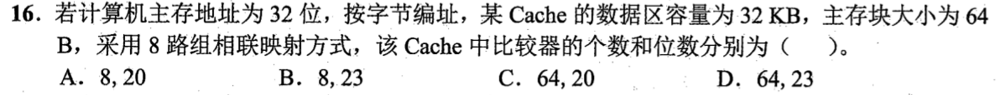
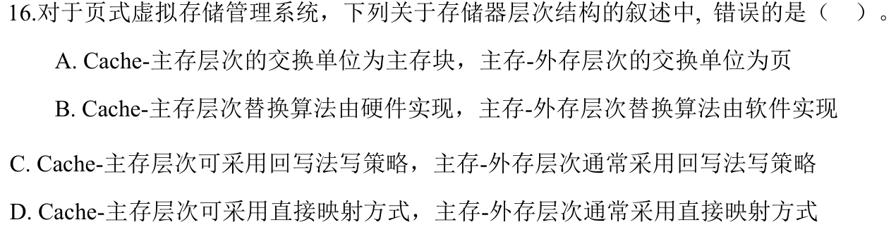
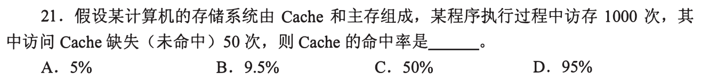
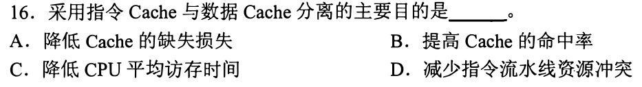

# 0815｜Cache：先拆地址，再算命中

[← 当天安排](../day08.md) · [原题单](../../src/0815.md)

**当前范围：3道2020—2026年题。** 旧题讲解在页末注释保留，暂不安排；本页是现有教学材料的年份更新，不要求刷完整份src题单。

卡住先读：完成本组所需的最少知识

Cache缓存主存数据块，利用时间和空间局部性。地址分为tag、组号、块内偏移；偏移位=log₂块字节数，组数=数据容量/(块大小×路数)，组号位=log₂组数。每组并行比较各路tag，所以比较器数等于路数。命中率=命中次数/总访存次数；指令与数据Cache分离主要解决同时取指访数的结构冲突。TLB缓存页表项，不是普通数据块。

## 01 · 2020-15

先写选项和一句依据；概念题尝试45秒、计算题尝试90秒仍无入口，就展开下面的讲解。学习后遮住讲解，重新作答，保留真实状态。

核对与补学（作答后展开）

**答案：D。** Cache一般用SRAM，TLB通常是相联查找结构，不能说两者都由DRAM组成。按本题模型，缺失后的下级信息位于主存，硬件可以处理查询。

## 02 · 2022-16

先写选项和一句依据；概念题尝试45秒、计算题尝试90秒仍无入口，就展开下面的讲解。学习后遮住讲解，重新作答，保留真实状态。

核对与补学（作答后展开）

**答案：A。** 32KiB/64B=512行，8路得64组，组号6位，偏移6位，tag=32−6−6=20位；8路需要8个20位比较器。

## 03 · 2024-16

先写选项和一句依据；概念题尝试45秒、计算题尝试90秒仍无入口，就展开下面的讲解。学习后遮住讲解，重新作答，保留真实状态。

核对与补学（作答后展开）

**答案：D。** 主存页框不是虚拟页的固定直接映射槽位，虚拟页可装入可用页框。Cache可直接映射；主存—外存页面映射通常是全相联的灵活装入。

## 离开前的一个检查

32位地址、16KiB Cache、64B块、4路，tag多少位？

检查答案

256行/4=64组→6位组号，6位块内偏移，tag=20位；4个20位比较器。

## 暂缓材料（注释保留）

以下原题及讲解未删除，暂不计入当前训练。

<!-- 暂缓：2009-21；原文保留，当前不安排。
## 01 · 2009-21

先写选项和一句依据；概念题尝试45秒、计算题尝试90秒仍无入口，就展开下面的讲解。学习后遮住讲解，重新作答，保留真实状态。

核对与补学（作答后展开）

**答案：D。** 共1000次，缺失50次，命中950次，命中率950/1000=95%。

-->

<!-- 暂缓：2014-16；原文保留，当前不安排。
## 02 · 2014-16

先写选项和一句依据；概念题尝试45秒、计算题尝试90秒仍无入口，就展开下面的讲解。学习后遮住讲解，重新作答，保留真实状态。

核对与补学（作答后展开）

**答案：D。** 取指和数据访存可同时访问各自Cache，减少流水线抢同一存储端口的结构冲突；不是必然提升命中率。

-->
