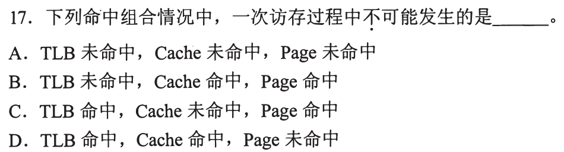
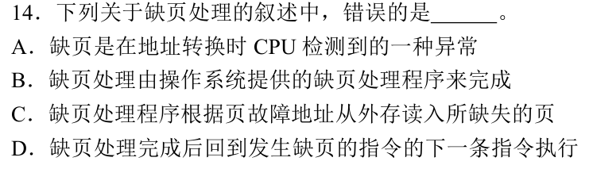
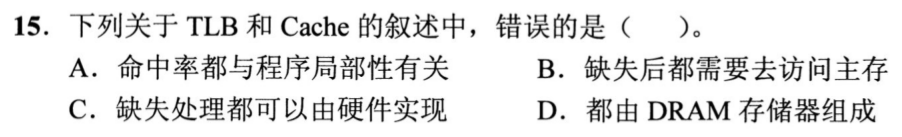

# 0816｜地址翻译：TLB、页表与Cache分工

[← 模块入口](../README.md) · [原题单](../../src/0816.md)

本页是已写草稿收尾后的独立模块，未据此新增每日安排。

**本轮范围：4道快速题。** 先尝试，卡住再展开讲解；原题前的旧提示不作为依据。本页答案与说明按原图独立核对。

卡住先读：完成本组所需的最少知识

虚拟地址分成虚页号和页内偏移。先用TLB查页表项，命中得到物理页框；未命中再查内存页表。页表有效/驻留位无效时触发缺页，由OS调页、更新页表，随后重启原指令；TLB未命中本身不等于缺页。得到物理地址后访问数据Cache，Cache未命中再读主存数据。TLB主要缓存映射，Cache缓存指令/数据，不能把两个未命中相加成同一事件。

## 01 · 2010-17

先写选项和一句依据；概念题尝试45秒、计算题尝试90秒仍无入口，就展开下面的讲解。学习后遮住讲解，重新作答，保留真实状态。

核对与补学（作答后展开）

**答案：D。** 按本题有效TLB项保持一致的模型，TLB命中说明页面在主存，不可能同时Page未命中；D不可能。TLB未命中但页面在内存、Cache命中是可能的。

## 02 · 2019-14

先写选项和一句依据；概念题尝试45秒、计算题尝试90秒仍无入口，就展开下面的讲解。学习后遮住讲解，重新作答，保留真实状态。

核对与补学（作答后展开）

**答案：D。** 缺页属于故障，处理完应重新执行引发缺页的原指令，完成未完成的访存；不能直接跳下一条。

## 03 · 2020-15

先写选项和一句依据；概念题尝试45秒、计算题尝试90秒仍无入口，就展开下面的讲解。学习后遮住讲解，重新作答，保留真实状态。

核对与补学（作答后展开）

**答案：D。** TLB和Cache并非都由DRAM组成，Cache通常用SRAM。此题在0815已见，若已独立答对，这次只说明映射与数据的区别即可，不重复长推。

## 04 · 2024-18

先写选项和一句依据；概念题尝试45秒、计算题尝试90秒仍无入口，就展开下面的讲解。学习后遮住讲解，重新作答，保留真实状态。

核对与补学（作答后展开）

**答案：B。** MMU检测翻译和保护相关的TLB缺失、页面缺失、越权；Cache缺失由Cache访问与标记比较检测，不是MMU翻译的职责。

## 离开前的一个检查

TLB未命中时是否一定要读磁盘？缺页修好从哪里继续？

检查答案

不一定，页表可表明该页已在内存；真正缺页才需要相应调页。处理完重启原访存指令。

