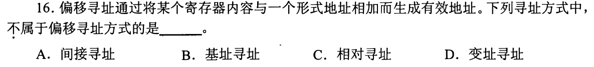
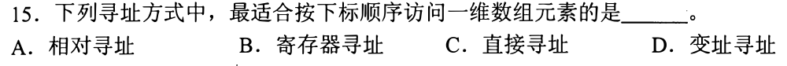
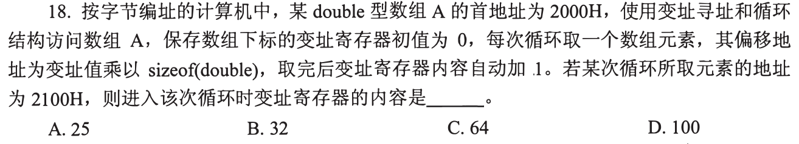
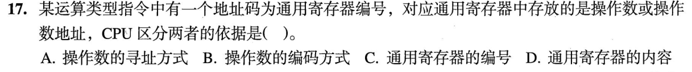

# 0817｜寻址：先找有效地址，再取数据

[← 模块入口](../README.md) · [原题单](../../src/0817.md)

本页是已写草稿收尾后的独立模块，未据此新增每日安排。

**本轮范围：4道快速题。** 先尝试，卡住再展开讲解；原题前的旧提示不作为依据。本页答案与说明按原图独立核对。

卡住先读：完成本组所需的最少知识

立即寻址操作数在指令里；寄存器寻址寄存器里就是数据；寄存器间接寻址寄存器里是内存地址。偏移寻址有效地址EA=某寄存器+形式地址，包括基址、变址、PC相对。数组访问EA=首址+下标×元素字节数，十六进制先做地址差再换算。CPU依靠指令中的寻址方式字段解释操作数字段，而不是看寄存器里的数像不像地址。

## 01 · 2011-16

先写选项和一句依据；概念题尝试45秒、计算题尝试90秒仍无入口，就展开下面的讲解。学习后遮住讲解，重新作答，保留真实状态。

核对与补学（作答后展开）

**答案：A。** 间接寻址通过指针取地址，不是“寄存器内容+形式地址”的偏移方式；基址、PC相对、变址均满足该加法模型。

## 02 · 2017-15

先写选项和一句依据；概念题尝试45秒、计算题尝试90秒仍无入口，就展开下面的讲解。学习后遮住讲解，重新作答，保留真实状态。

核对与补学（作答后展开）

**答案：D。** 数组基址固定、下标变化，用变址寄存器表达下标最方便；不能用只改PC的相对寻址代替数组索引。

## 03 · 2018-18

先写选项和一句依据；概念题尝试45秒、计算题尝试90秒仍无入口，就展开下面的讲解。学习后遮住讲解，重新作答，保留真实状态。

核对与补学（作答后展开）

**答案：B。** 2100H−2000H=100H=256B；double=8B，下标256/8=32。题目问进入本轮前的寄存器，不要再加1。

## 04 · 2023-17

先写选项和一句依据；概念题尝试45秒、计算题尝试90秒仍无入口，就展开下面的讲解。学习后遮住讲解，重新作答，保留真实状态。

核对与补学（作答后展开）

**答案：A。** 由寻址方式决定寄存器保存的是数据还是地址；寄存器编号只定位哪个寄存器，内容本身不能说明应如何解释。

## 离开前的一个检查

数组基址1000H、int4B、元素地址102CH，下标多少？

检查答案

2CH=44B，44/4=11；先地址差，不要把十六进制2C误写成十进制28。

