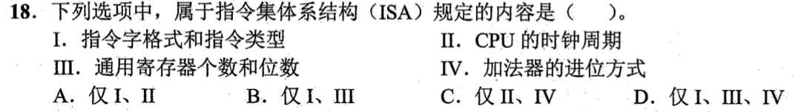
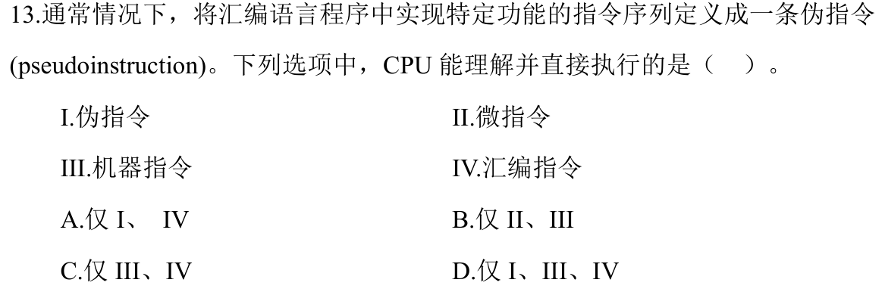

# 0818｜程序层级与 ISA

[← Day 14](../day14.md) · [原题单](../../src/0818.md)

**本日指定 2 题。** 先写选项和一句依据，卡住再展开补学。

卡住先读：本组判据

ISA 描述软件能依赖的机器接口；汇编助记符和伪指令由汇编器处理。

## 01 · 2022-18

核对与补学（作答后展开）

**答案：B。** 指令字格式和通用寄存器是软件可见的约定。时钟周期和加法器进位方式可以换实现。

## 02 · 2024-13

核对与补学（作答后展开）

**答案：B。** CPU 可译码机器指令，微程序控制器也可根据微指令产生内部控制信号。汇编文本和伪指令先由汇编器翻译。

## 离开前的一个检查

不同频率的 CPU 能实现同一 ISA 吗？

检查答案

能，只要机器指令、可见寄存器等接口一致。

