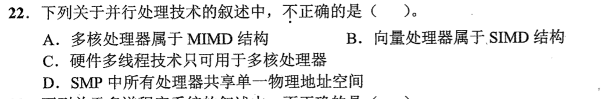
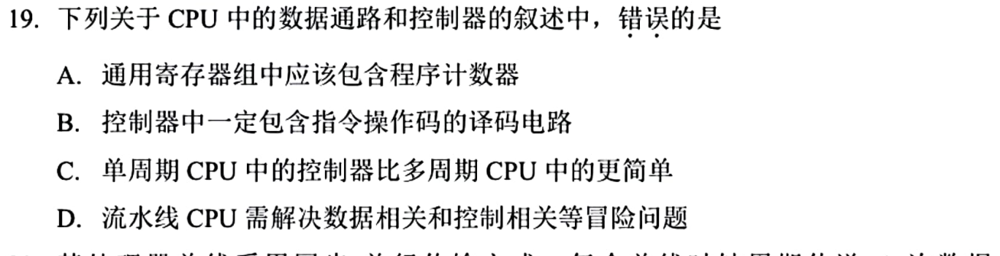

> **已有讲解模块。** 本页仅收录部分题目的讲解；完整2020—2026题单及当天指定题见[全量每日安排](../README.md)，不把做完本模块视作完成对应src全题单。

# 0819｜数据通路与并行执行

[全量每日安排](../README.md) · [原题单](../../src/0819.md)

**本日指定 2 题。** 先写选项和一句依据，卡住再展开补学。

卡住先读：本组判据

PC 保存指令地址并有专门的更新路径。处理器核心数与每个核心能维持的硬件线程数是两个维度。

## 01 · 2022-22

核对与补学（作答后展开）

**答案：C。** 单核也可保留多份线程上下文并交替发射。多核可执行多条指令流，向量计算是单指令作用于多项数据，SMP共享物理地址空间。

## 02 · 2025-19

核对与补学（作答后展开）

**答案：A。** PC 是专用寄存器，无须放入通用寄存器组。多周期控制要分执行步骤，流水还要解决冒险。

## 离开前的一个检查

单核能否支持多个硬件线程？

检查答案

能，关键是能否保存多份线程上下文并调度发射。

