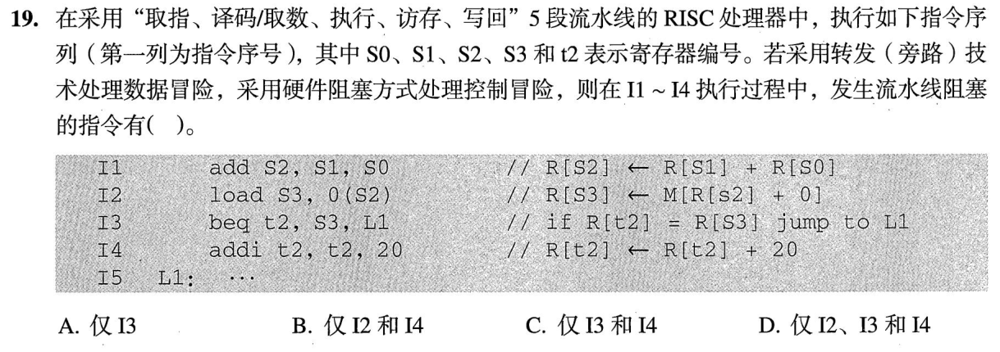
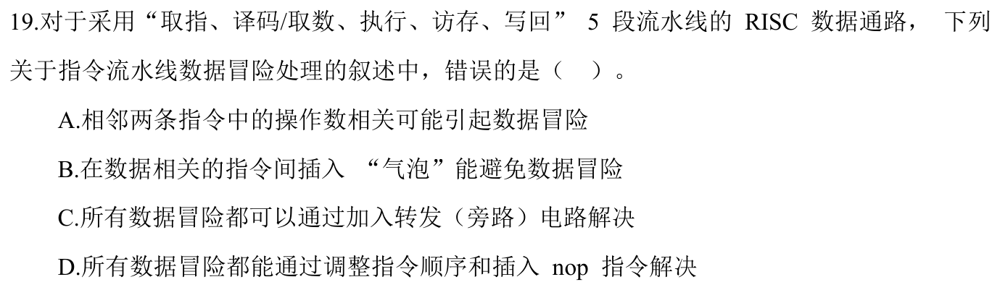

> **已有讲解模块。** 本页仅收录部分题目的讲解；完整2020—2026题单及当天指定题见[全量每日安排](../README.md)，不把做完本模块视作完成对应src全题单。

# 0820｜流水线结果何时就绪

[全量每日安排](../README.md) · [原题单](../../src/0820.md)

**本日指定 2 题。** 先写选项和一句依据，卡住再展开补学。

卡住先读：本组判据

画生产者与消费者阶段。旁路可把已经产生的结果提前送达，结果尚未产生时仍需等。

## 01 · 2023-19

核对与补学（作答后展开）

**答案：C。** I1 的 add 结果在执行段结束就能转给 I2；I2 的 load 值到访存段后才出现，紧随其后的 I3 必须等。I3 的分支结果也决定后续取指，控制阻塞波及 I4。

## 02 · 2024-19

核对与补学（作答后展开）

**答案：C。** 旁路无法消除紧邻的 load-use 等待。插入气泡或足够 nop 可以推迟消费者，重排则要保持原依赖关系。

## 离开前的一个检查

为什么 add→add 常可全旁路，load→add 常还要停？

检查答案

前者结果在执行段就有，后者要到访存段结束才有。

