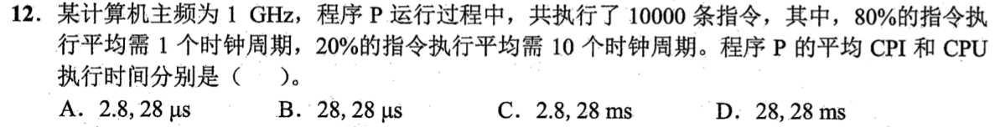
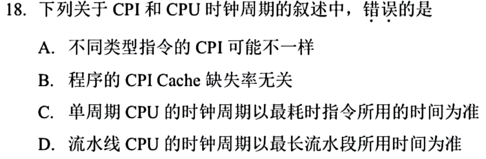

# 0821｜CPI、频率与程序时间

[← Day 18](../day18.md) · [原题单](../../src/0821.md)

**本日指定 2 题。** 先写选项和一句依据，卡住再展开补学。

卡住先读：本组判据

总周期数是各类指令条数乘各自CPI的总和。执行时间用总周期数除主频。

## 01 · 2022-12

核对与补学（作答后展开）

**答案：A。** 平均 CPI=0.8×1+0.2×10=2.8。10000条需28000周期，1GHz下每周期1ns，共28μs。

## 02 · 2025-18

核对与补学（作答后展开）

**答案：B。** Cache缺失可使流水或访存停顿，平均CPI因增加的周期而上升。单周期和流水线时钟分别受最慢指令、最慢段约束。

## 离开前的一个检查

指令条数不变，平均 CPI 翻倍且主频也翻倍，耗时怎样变？

检查答案

总周期数和主频同比变化，耗时不变。

