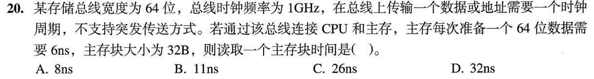
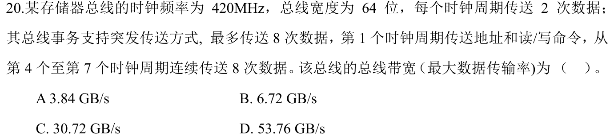

# 0822｜总线事务与峰值带宽

[← Day 20](../day20.md) · [原题单](../../src/0822.md)

**本日指定 2 题。** 先写选项和一句依据，卡住再展开补学。

卡住先读：本组判据

先问要算一次完整事务，还是总线连续传数据时的峰值。非突发逐项发送地址；突发允许多次数据共享一次首地址。

## 01 · 2023-20

核对与补学（作答后展开）

**答案：D。** 32B分4次送。每次1ns发地址、6ns准备、1ns发数据，共4×8=32ns。

## 02 · 2024-20

核对与补学（作答后展开）

**答案：B。** 题目问总线最大数据传输率。连续传数据时每拍2×8B，420MHz下为6.72GB/s。把7拍事务全部摊入，才得到单笔连续突发的平均3.84GB/s。

## 离开前的一个检查

每拍可传16B，事务只在4/7的周期传数据，整笔平均是峰值的几倍？

检查答案

4/7。

