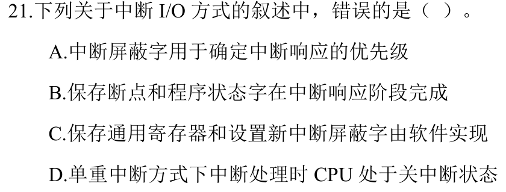
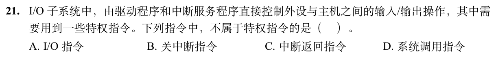

# 0823｜中断 I/O：优先级与权限边界

[← Day 20](../day20.md) · [原题单](../../src/0823.md)

**本日指定 2 题。** 先写选项和一句依据，卡住再展开补学。

卡住先读：本组判据

把响应阶段的硬件动作与中断服务例程的软件动作分开。用户态需要服务时可发出系统调用，由硬件受控转入内核。

## 01 · 2024-21

核对与补学（作答后展开）

**答案：A。** 响应优先级由中断判优逻辑决定。屏蔽字可决定当前处理期间允许哪些中断嵌套，从而改变处理优先关系。断点和状态字由响应阶段保存，通用寄存器与新屏蔽字可由软件处理。

## 02 · 2026-21

核对与补学（作答后展开）

**答案：D。** 系统调用指令允许用户程序主动陷入。直接控制设备、关中断和恢复中断前机器状态涉及特权，不能由普通用户程序任意执行。

## 离开前的一个检查

系统调用指令本身在什么态可以发出？

检查答案

用户态可以发出，由受控入口完成权限切换。

