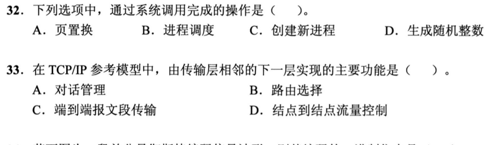
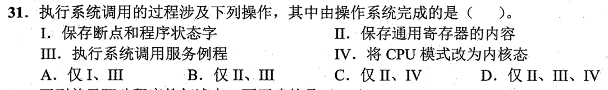
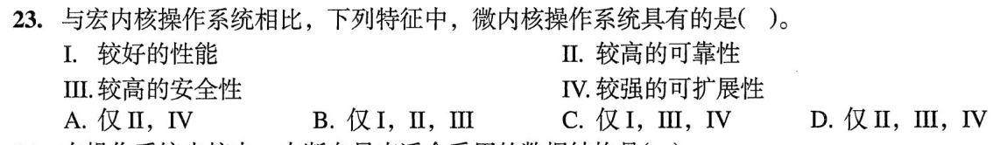
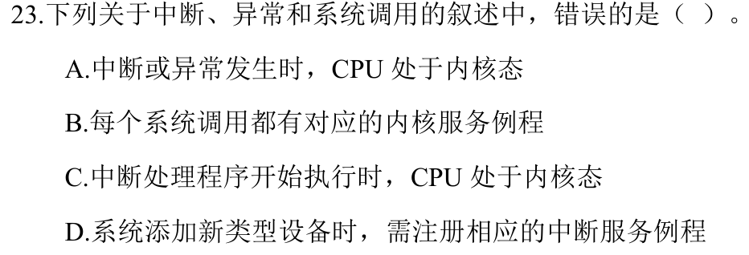
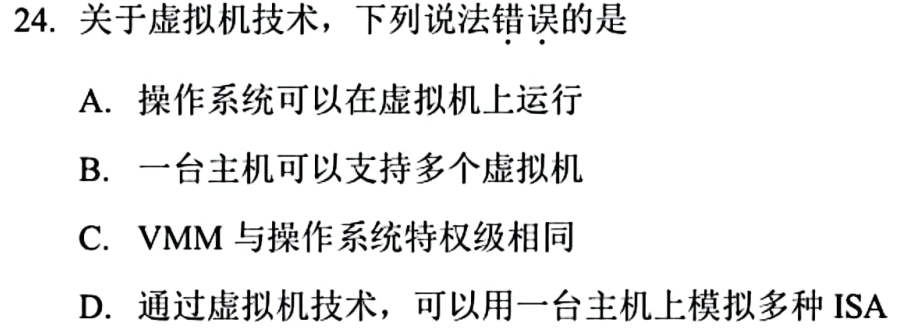
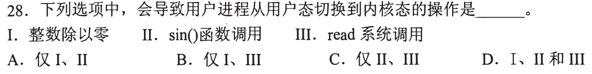
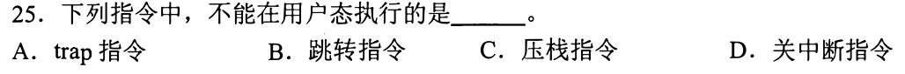
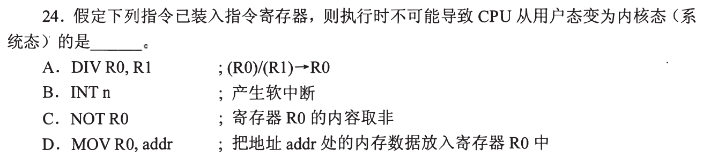
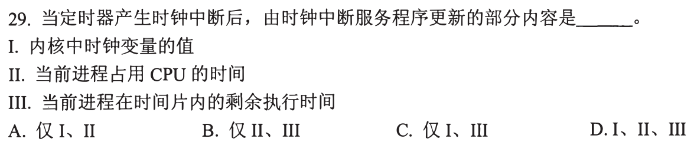
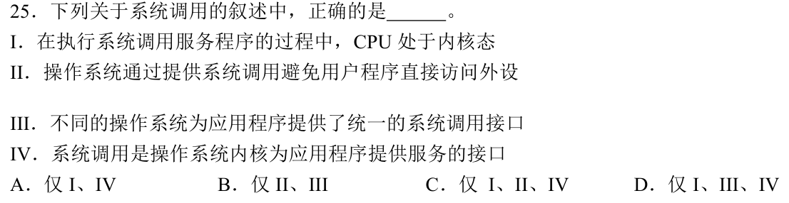

# 0824｜系统边界：谁触发、谁处理、谁受保护

[← 当天安排](../day01.md) · [原题单](../../src/0824.md)

**当前范围：5道2020—2026年题。** 旧题讲解在页末注释保留，暂不安排；本页是现有教学材料的年份更新，不要求刷完整份src题单。

卡住先读：完成本组所需的最少知识

用户态和内核态是CPU的权限状态。普通计算可留在用户态；异常、外中断、主动系统调用会转入内核处理。trap/访管指令允许用户程序执行，关中断等特权指令则不允许。硬件完成入口处的最低限度现场保存与状态切换，操作系统软件保存其他所需上下文并执行服务。

系统调用是应用请求内核服务的接口；页置换、调度等内部机制并不等于应用显式发起的系统调用。微内核缩小内核，把更多服务放到用户空间，可靠性、隔离性、扩展性较好，但消息通信可能增加开销。VMM负责管理虚拟机，不能把其权限简单等同于客户操作系统。

## 01 · 2021-32

先写选项和一句依据；概念题尝试45秒、计算题尝试90秒仍无入口，就展开下面的讲解。学习后遮住讲解，重新作答，保留真实状态。

核对与补学（作答后展开）

**答案：C。** 创建新进程需要应用请求内核建立进程资源。页置换和调度是内核内部工作；生成随机数一般可由用户程序算法完成。原题并非用户栈切换。

## 02 · 2022-31

先写选项和一句依据；概念题尝试45秒、计算题尝试90秒仍无入口，就展开下面的讲解。学习后遮住讲解，重新作答，保留真实状态。

核对与补学（作答后展开）

**答案：B。** II保存通用寄存器、III执行服务例程由操作系统软件完成；I保存断点及状态字、IV切到内核态属于系统调用入口的硬件动作。选II、III。

## 03 · 2023-23

先写选项和一句依据；概念题尝试45秒、计算题尝试90秒仍无入口，就展开下面的讲解。学习后遮住讲解，重新作答，保留真实状态。

核对与补学（作答后展开）

**答案：D。** 微内核服务隔离带来可靠性、安全性和扩展性，即II、III、IV；频繁进程间通信使性能未必更好，I不能选。

## 04 · 2024-23

先写选项和一句依据；概念题尝试45秒、计算题尝试90秒仍无入口，就展开下面的讲解。学习后遮住讲解，重新作答，保留真实状态。

核对与补学（作答后展开）

**答案：A。** 异常或中断可以在用户态执行期间发生；进入处理程序后才处于内核态。不要把发生时刻和处理时刻混为一谈。

## 05 · 2025-24

先写选项和一句依据；概念题尝试45秒、计算题尝试90秒仍无入口，就展开下面的讲解。学习后遮住讲解，重新作答，保留真实状态。

核对与补学（作答后展开）

**答案：C。** VMM与客户操作系统承担不同层次的权限管理，不能断言特权级相同。虚拟化/模拟技术允许一机多虚拟机，也可借模拟支持不同ISA；题目要求找错误叙述。

## 离开前的一个检查

用户程序执行trap时在什么态？系统调用服务例程在什么态？

检查答案

trap由用户程序在用户态执行并触发权限转换；对应内核服务例程在内核态执行。触发指令与被调用服务要分开判断。

## 暂缓材料（注释保留）

以下原题及讲解未删除，暂不计入当前训练。

<!-- 暂缓：2013-28；原文保留，当前不安排。
## 01 · 2013-28

先写选项和一句依据；概念题尝试45秒、计算题尝试90秒仍无入口，就展开下面的讲解。学习后遮住讲解，重新作答，保留真实状态。

核对与补学（作答后展开）

**答案：B。** 整数除零触发异常，read通过系统调用请求内核，二者都涉及进入内核；sin通常是用户空间的数学库计算。选I、III。

-->

<!-- 暂缓：2014-25；原文保留，当前不安排。
## 02 · 2014-25

先写选项和一句依据；概念题尝试45秒、计算题尝试90秒仍无入口，就展开下面的讲解。学习后遮住讲解，重新作答，保留真实状态。

核对与补学（作答后展开）

**答案：D。** 关中断改变整个CPU的中断响应，属于特权指令。trap恰恰是用户程序合法请求系统服务的入口，不因会转入内核就成为禁止在用户态执行的指令。

-->

<!-- 暂缓：2015-24；原文保留，当前不安排。
## 03 · 2015-24

先写选项和一句依据；概念题尝试45秒、计算题尝试90秒仍无入口，就展开下面的讲解。学习后遮住讲解，重新作答，保留真实状态。

核对与补学（作答后展开）

**答案：C。** NOT只对寄存器按位取反。DIV可能除零，INT主动触发软中断，访存MOV可能缺页；注意问的是不可能导致切换。

-->

<!-- 暂缓：2018-29；原文保留，当前不安排。
## 04 · 2018-29

先写选项和一句依据；概念题尝试45秒、计算题尝试90秒仍无入口，就展开下面的讲解。学习后遮住讲解，重新作答，保留真实状态。

核对与补学（作答后展开）

**答案：D。** 原题问时钟中断服务更新什么：内核时钟、进程累计CPU时间和剩余时间片均需维护。这里并不是中断向量表题。

-->

<!-- 暂缓：2019-25；原文保留，当前不安排。
## 05 · 2019-25

先写选项和一句依据；概念题尝试45秒、计算题尝试90秒仍无入口，就展开下面的讲解。学习后遮住讲解，重新作答，保留真实状态。

核对与补学（作答后展开）

**答案：C。** I、II、IV正确。内核执行服务并提供受控外设访问；不同操作系统的系统调用接口并不统一，III错。

-->
